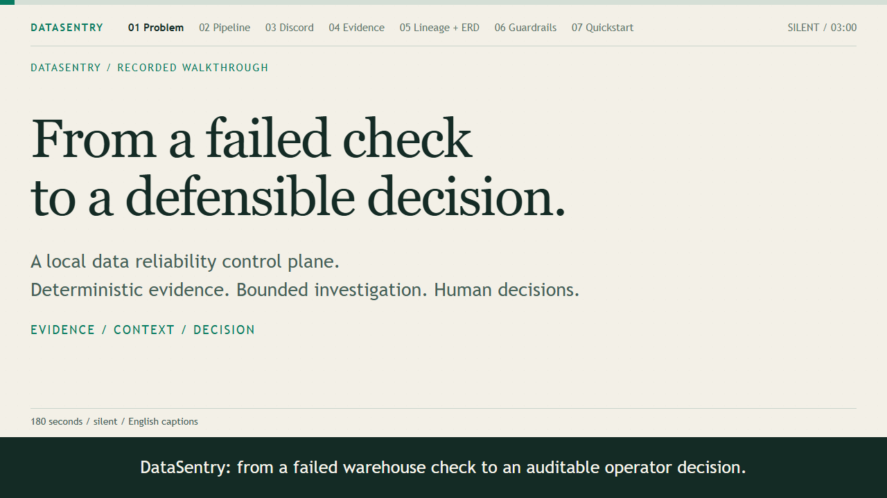
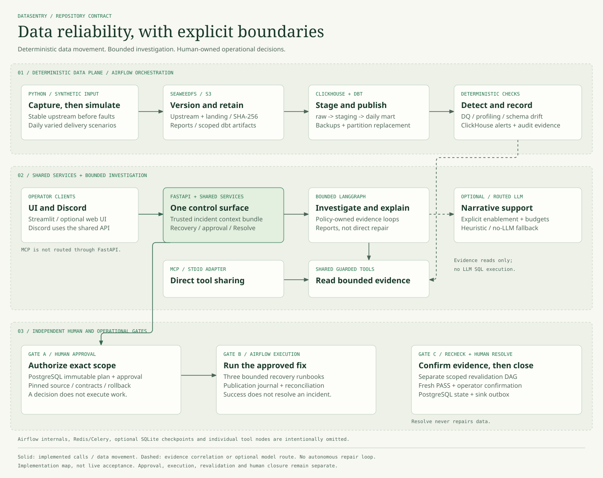
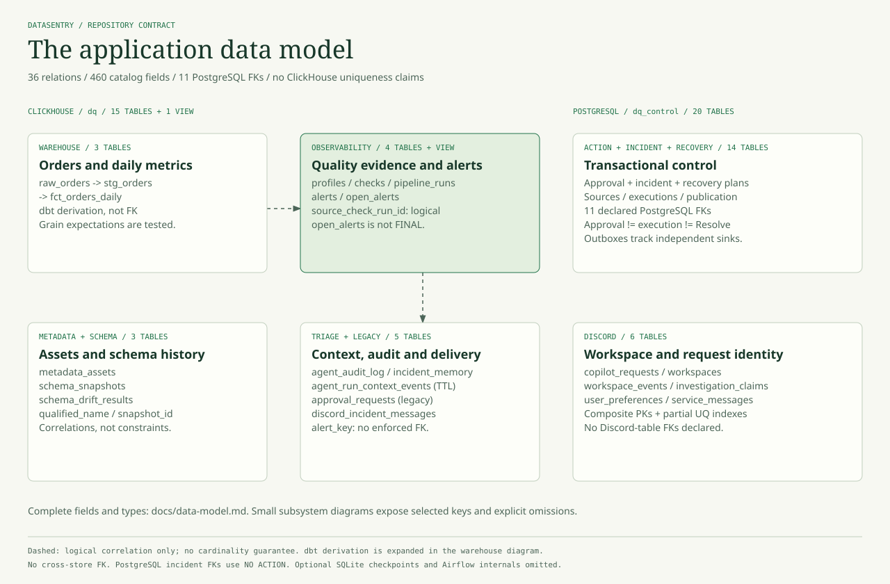

<!--
Agentic Data Quality Triage
Author: Mario Caesar // hello@caesarmar.io // https://caesarmar.io/
-->

<h1 align="center">🛡️ Agentic Data Quality Triage</h1>
<p align="center"><b>Find data-quality issues. Investigate with evidence. Keep humans in control.</b></p>
<p align="center">An incident workspace for data engineers: deterministic checks, optional AI analysis, and evidence-gated closure.<br>Built with <b>Apache Airflow</b>, <b>SeaweedFS</b>, <b>ClickHouse</b>, <b>dbt</b>, and <b>LangGraph</b>, with local operator interfaces and optional LLM providers.</p>
<br>
<p align="center">
  <a href="https://github.com/caesarmario/agentic-data-quality-triage"></a>
  <a href="https://github.com/caesarmario"></a>
  <a href="https://beacons.ai/caesarmario_"></a>
  <a href="https://www.kaggle.com/caesarmario"></a>
  <a href="LICENSE"></a>
</p>
<br>

**Watch:** [Historical 3-minute walkthrough](https://github.com/user-attachments/assets/186c375d-3629-47e3-b9c8-b69b2e261a0b) · **Try:** [Local setup](#run-locally) · **Explore:** [Architecture](#architecture) · [Data model](#data-model)

https://github.com/user-attachments/assets/186c375d-3629-47e3-b9c8-b69b2e261a0b

Recorded UI and a stored Gemini report, with English captions and no audio. This recording predates the saved-source recovery workflow below; scenes span separate sessions, not an autonomous repair. [Chapters, captions, and reproduction](docs/demo-video.md).

A new live DataSentry v1 demo has not been recorded. The existing video is historical, not a new release recording. Use the [operator recording runbook](docs/local-operations.md#future-live-demo-recording) for a future capture.

<details>
<summary>Video fallback and poster</summary>

[](https://github.com/user-attachments/assets/186c375d-3629-47e3-b9c8-b69b2e261a0b)

</details>

DataSentry helps a data engineer answer four questions:

- **What failed?** Find the affected table, business date, and quality rule.
- **Why might it have failed?** Compare evidence, pipeline history, and lineage.
- **What should happen next?** Review a bounded recommendation, not a free-form command.
- **Can this incident close?** Run a fresh check, review its result, and confirm closure.

This is a **local reference implementation using synthetic orders**, not an autonomous repair service. The first demo works without an API key. Gemini and other configured providers are optional.

Fresh runtime results, retained failures, and verification limits: [DataSentry v1 acceptance](docs/datasentry-v1-acceptance.md).

## The Problem

A pipeline can finish successfully while its data is incomplete. In this demo, a daily orders mart expects 25 country/channel segments. A controlled scenario can leave only 24.

DataSentry turns that signal into an incident with supporting evidence, a likely explanation, a report, and an operator decision. It keeps the difference between **job success**, **data quality**, **approval**, and **resolution** visible.


## What You Can Do

| Capability | What is implemented |
| --- | --- |
| Detect | Deterministic DQ checks, profiling, schema snapshots, and contract comparison. |
| Read daily status | Explicit `available` or `empty` data availability; no quality data is not a healthy result. |
| Investigate | Bounded LangGraph evidence collection, hypothesis framing/ranking, and Markdown/JSON reports. |
| Understand impact | Metadata registry, ownership/grain/SLA lookup, dbt lineage, and blast-radius tools. |
| Work in Discord | One DataSentry identity, compact incident cards, shared investigation threads, mention Ask, buttons, and bilingual Help. |
| Work in Streamlit | Incident queue, evidence/report views, approvals, audit/recovery, and English/Indonesia selection. |
| Review an action | Approval previews and decisions with separate Airflow execution workflows. |
| Recover a partition | Three allowlisted runbooks replay verified saved input or rebuild derived data, with immutable plans, approval, and separate execution. |
| Close an incident | Fresh scoped DQ/schema revalidation, a reason, confirmation, and synchronized lifecycle state. |
| Connect an AI client | MCP stdio tools over shared guarded services; optional Next.js interface over FastAPI. |

**Resolve checks the data; it does not fix the data.** Approving a plan does not run it. The existing Airflow action paths remain separate from approval decisions.

## Architecture



Three boundaries matter:

| Boundary | Responsibility |
| --- | --- |
| Data plane | Airflow orchestrates synthetic generation, SeaweedFS landing, ClickHouse loading, dbt, and deterministic quality checks. |
| Investigation plane | Shared services and LangGraph gather guarded evidence. An optional model explains it and recommends a safe next step. |
| Operational control | Humans review actions. Allowlisted execution uses Airflow. Resolve independently checks evidence before recording closure. |

ClickHouse stores orders, quality results, evidence, audit, and legacy approval projections. PostgreSQL is authoritative for approval decisions, recovery plans/executions, publication coordination, resolution, and Discord records; Airflow metadata is separate. SeaweedFS stores versioned upstream/landing snapshots, reports, and artifacts.

**An LLM is not the executor.** The default supervisor uses one bounded handoff; opt-in fan-out is not ten unrestricted autonomous agents. MCP is an external adapter to shared tools, not the internal transport between Airflow and LangGraph.

[Detailed architecture and request paths](docs/architecture.md) · [Supervisor design](docs/agent_supervisor_lite_architecture.md)

## Data Model



| Area | Important records |
| --- | --- |
| Warehouse | `dq.raw_orders` → `dq.stg_orders` → `dq.fct_orders_daily`. The mart grain is business date × country × channel. |
| Observability | DQ checks, profiles, alerts, pipeline runs, metadata assets, and schema findings. |
| Investigation | Audit events, run context, incident memory, and report object references. |
| Operator control | Approvals, immutable recovery plans, executions, partition journals, incident revisions, revalidation, closure decisions, and outboxes. |
| Discord coordination | Incident message IDs, workspaces, request claims, language preferences, and the durable welcome message. |

These are not all relational foreign keys. ClickHouse correlations and dbt derivations are logical relationships; PostgreSQL foreign keys are shown separately. An S3 report URI points to an object, not a report table.

[Complete table/view catalog, fields, source definitions, and detailed ERDs](docs/data-model.md)

## Run Locally

### 1. Prerequisites

Use Docker with a Linux engine, Docker Compose v2, and Git. On Windows, use Docker Desktop with WSL2. GNU Make is optional.

A machine with **16 GB RAM is a practical starting point**, not a measured minimum. This stack includes Airflow workers, ClickHouse, PostgreSQL, Redis, SeaweedFS, and Streamlit. All published Compose host ports bind to `127.0.0.1` (localhost-only); container-to-container service addresses are unchanged. This is not a hardened public deployment.

### 2. Clone and configure

PowerShell:

```powershell
 git clone https://github.com/caesarmario/agentic-data-quality-triage.git
 Set-Location agentic-data-quality-triage
 if (-not (Test-Path infra/.env)) { Copy-Item .env.example infra/.env }
```

Bash:

```bash
 git clone https://github.com/caesarmario/agentic-data-quality-triage.git
 cd agentic-data-quality-triage
 test -f infra/.env || cp .env.example infra/.env
```

Review `infra/.env` before starting. Keep `EXTERNAL_LLM_ENABLED=false`, `COPILOT_EXTERNAL_LLM_ENABLED=false`, provider keys blank, and provider retries at zero for the no-key demo. Do not overwrite an existing environment during an upgrade.

The example credentials are **local-demo defaults**. Change the Airflow JWT secret before initialization and set a strong shared `CONTROL_PLANE_APPROVAL_TOKEN` in the API and its server-side callers. Custom infrastructure credentials require matching server/bootstrap configuration, not only client environment edits.

Both `POST /api/v1/copilot/answer` and `POST /api/v1/triage/run` require `X-Control-Plane-Token`, even in heuristic/no-LLM mode. Missing server token configuration returns `503`; a missing or wrong caller token returns `401` before platform or provider work. Keep the token server-side, never in `NEXT_PUBLIC_*`, browser headers, or published examples. Shared clients and the Next.js proxy reject redirects. [API contract and daily-summary availability](docs/local-operations.md#fastapi).

### 3. Start the core stack

These commands work from the repository root in either shell:

```text
 docker compose --env-file infra/.env -f infra/docker-compose.yml config --quiet
 docker compose --env-file infra/.env -f infra/docker-compose.yml build dq-runner
 docker compose --env-file infra/.env -f infra/docker-compose.yml up -d
 docker compose --env-file infra/.env -f infra/docker-compose.yml ps -a
 docker exec dq_airflow_scheduler airflow dags list-import-errors
```

Wait for healthy services and successful initialization. One-shot init containers ending with `Exited (0)` are expected. If initialization or DAG imports fail, inspect their logs before triggering work.

| Interface | Local URL |
| --- | --- |
| Airflow | [localhost:8080](http://localhost:8080) |
| Streamlit | [localhost:8501](http://localhost:8501) |
| CH-UI | [localhost:3488](http://localhost:3488) |
| SeaweedFS Filer | [localhost:8888](http://localhost:8888) |

Airflow uses the local credentials configured in the environment; the example login is `admin` / `admin`. These defaults are not suitable for a shared deployment.

### 4. Run your first investigation

1. Follow the [temporary manual-only procedure](docs/local-operations.md#temporary-manual-only-acceptance), verify the effective schedules, and prepare only the required manual DAGs before triggering their parent.
2. Trigger `00_dag_dq_platform_daily_orchestrator` with an unused business date, `incident_scenario=baseline`, and `run_triage=false`.
3. Run another unused date with `incident_scenario=missing_segment`.
4. Open Streamlit, select the affected Alert Ref, and inspect its quality result and evidence.
5. Trigger `40_dag_dq_orders_triage_agent` for that Alert Ref, then read the stored report and audit.

Use the [copy-ready Airflow commands and expected results](docs/local-operations.md#first-demo-without-an-api-key). Rerunning an existing date can replace its data: do not reuse a partition casually.

Scheduled daily runs use a deterministic, date-seeded `auto` scenario policy. Manual runs default to `baseline` unless a scenario is supplied. Baseline disables injected faults, not normal volume/seasonality variation. Regenerating baseline data for a demo is **not AI repair**.

`DQ_ACCEPTANCE_MANUAL_ONLY=false` is the default. A temporary `true` changes only DAGs `00` and `90_06` to `schedule=None`; it does not pause DAGs or cancel existing runs. Restore the flag to `false` with both DAGs paused. The recovery reconciler remains paused, not currently enabled.

Daily summaries return `availability=available|empty`. Empty data is request success, not health. An explicit `dt` is preserved even when empty; when `dt` is omitted, `dt=null` means no latest business DQ date exists.

### 5. Optional interfaces

```text
 docker compose --env-file infra/.env -f infra/docker-compose.yml --profile api up -d api
 docker compose --env-file infra/.env -f infra/docker-compose.yml --profile api --profile discord up -d discord-bot
```

Configure Discord's bot token, guild, and three channel IDs first. Use private operator channels and the minimum permissions from the [Discord setup guide](docs/local-operations.md#discord-setup). Do not enable privileged Message Content Intent.

In Discord, begin with **`/help`**, **`/dq help`**, or a real DataSentry mention followed by `help`. The guide explains commands and buttons without an AI call. `/dq language` changes personal English/Indonesia responses; shared cards stay English.

The optional Next.js UI uses the `web` Compose profile. Its available controls are not identical to Streamlit. [Interface setup and API reference](docs/local-operations.md#operator-interfaces).

## Where AI Works

The full triage graph can use a model to plan allowlisted evidence collection, frame known hypotheses, and write an evidence-linked explanation. Ask/Copilot answers use bounded incident/report context and the selected response language.

| Component | What it does | What it cannot authorize |
| --- | --- | --- |
| Gemini or another configured provider | Explain evidence and recommend a next step. | Approval, mutation, remediation, arbitrary SQL or tool access. |
| LangGraph | Manage state, bounded evidence steps, and controlled replay. | Turn generated text into unrestricted execution authority. |
| Guarded tools | Read allowlisted evidence and enforce scope. | Ignore policy because a model asks. |
| Heuristic fallback | Keep a no-key explanation path available. | Claim an external model actually responded. |

A provider label appears only for a proven provider response. Stored AI reports describe their investigation time, not necessarily the current warehouse condition. Metadata tools exist, but not every Ask response receives the full asset catalog.

External testing is opt-in through the bounded Airflow provider-smoke path. You do not need to purchase credits to run the first demo. [Provider setup, kill switches, and cost controls](docs/local-operations.md#llm-setup-and-cost-controls).

## Recovery, Approval And Resolve

```text
Investigate → Review Fix → Approve Plan
                                ↓ separate confirmation
                         Run Approved Fix → Track Execution
                                                ↓
                              Fresh Check Again → Confirm Resolve
```

- **Recovery** uses a pinned, checksum-verified snapshot, never the generator or a forced zero-error scenario. Daily fault simulation remains independent.
- **Approval** accepts an immutable source, scope, validation, and rollback plan. It does not dispatch execution.
- **Run Approved Fix** executes one of three server-selected runbooks through DAG `90_05_dag_dq_incident_recovery`: raw replay, derived rebuild, or replay plus rebuild. Schema changes and missing/invalid source remain blocked.
- **Execution** can fail or remain uncertain. A successful trigger is not proof of a completed repair.
- **Check Again** runs the scoped, read-only revalidation DAG. A successful DagRun can still return a business result of `blocked`.
- **Resolve** requires a fresh passing result, unchanged required scope/revision, a reason, and confirmation. It does not run dbt, backfill, DDL, or Gemini.

The closure evidence window is ten minutes. Closing one incident does not declare the whole warehouse healthy. [Resolve workflow and evidence](docs/incident_resolution.md).

Publication uses isolated staging, backups, revision checks, and partition replacement. Atomicity is **per table**, not a transaction across raw, staging, and mart. Unknown outcomes stop for reconciliation; they are not blindly retried. [Recovery workflow, APIs, and operational evidence](docs/recovery-workflow.md).

## Verification And Limits

Use manual DAG `91_dag_dq_platform_validation`: **final acceptance comes from an Airflow DagRun**, not a direct pytest command.

```text
 docker exec dq_airflow_api_server python /opt/airflow/project/scripts/trigger_airflow_validation.py --suite all --require-api
```

Start the optional API first when using `--require-api`. Inspect the returned DagRun ID, all task states, and retained pytest/readiness logs. Routine regression uses no external LLM. Operational changes need their relevant operational DAG as well.

[Historical recovery evidence](docs/evidence-driven-recovery-acceptance.md) · [Earlier repository publication](docs/repository-refresh-acceptance.md) · [Help acceptance](docs/discord_help_acceptance.md)

The DataSentry v1 behavior documented here is implemented in code. These documentation changes do not establish fresh release acceptance or a CI result.

For a clean recording workspace, use the optional [manifest-confirmed local demo reset](docs/demo-reset.md). It permanently removes runtime data/history without a backup; it is not needed for ordinary operation or incident recovery.

Acceptance ledgers and recorded media from before the 16 October 2026 reset are historical evidence. Their old incidents, reports, and DagRuns are not retained in the fresh local stack.

Keep these limits in mind:

- One synthetic orders domain, local operator trust, and no enterprise SSO/RBAC or production certification.
- PostgreSQL coordinates current approvals; legacy approvals without a pinned recovery plan require review and cannot authorize the new recovery path.
- Direct warehouse writers can bypass platform locks. Cross-table publication is not atomic, and uncertain outcomes require reconciliation.
- Exact segment membership is checked, not counts alone. This proves the configured contract, not every possible business-data condition.
- Confidence includes policy/heuristic scores; it is not a calibrated probability of a correct diagnosis.
- Mobile/narrow and two-human checks remain separately pending where their ledgers say so. Screenshots are not proof of those cases.

This project does not demonstrate unrestricted agent spawning or autonomous source-data repair. [Operational and security boundaries](docs/local-operations.md#security-and-operational-boundaries).

## Documentation

| Read this | For |
| --- | --- |
| [Local operations](docs/local-operations.md) | Setup, DAGs, dates, queries, buckets, interfaces, troubleshooting, and safe shutdown. |
| [Architecture](docs/architecture.md) | Implemented services, request paths, and control boundaries. |
| [Data model](docs/data-model.md) | Full catalog and source-linked ERDs. |
| [Recovery workflow](docs/recovery-workflow.md) | Saved sources, three runbooks, approval/execution boundaries, and publication safety. |
| [Video and reproduction](docs/demo-video.md) | Chapters, capture provenance, captions, and render instructions. |
| [Discord guide](docs/discord_output_templates.md) | Help, incident threads, messages, language, and button meanings. |
| [MCP acceptance](docs/mcp_stdio_acceptance.md) | Shared-tool stdio adapter and its verification boundary. |
| [Development rules](AGENTS.md) | Airflow-first acceptance and safe iteration. |

## Author and license

Built by **Mario Caesar**.

[Portfolio](https://caesarmar.io/?utm_source=github&utm_medium=referral&utm_campaign=repo-agentic-data-quality-triage&utm_content=readme-link-1) · [GitHub](https://github.com/caesarmario) · [Kaggle](https://www.kaggle.com/caesarmario) · [Other works](https://beacons.ai/caesarmario_) · [Email](mailto:hello@caesarmar.io)

Licensed under the [Apache License 2.0](LICENSE). Third-party services, libraries, and model APIs retain their own licenses and terms. This project is not affiliated with their providers.

---

## 🙌 Support me!

👉 If you find this project useful, **please ⭐ this repository 😆**!

---

👉 _More about myself: <a href="https://caesarmar.io?utm_source=github&amp;utm_medium=referral&amp;utm_campaign=repo-agentic-data-quality-triage&amp;utm_content=readme-link-2"> here </a>_
