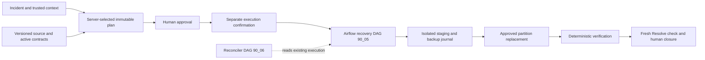

# Architecture

DataSentry is a local, production-flavored data reliability control plane. Deterministic pipelines move and check data; bounded agent workflows gather evidence and recommend next steps. Operators own authorization, operational execution and incident closure. This page maps the current checkout, including uncommitted implementation, not a deployed or fully accepted future architecture.


## Implemented Boundaries

| Boundary | Current Implementation | Source |
|---|---|---|
| Deterministic data plane | Seeded synthetic orders -> SeaweedFS S3 Parquet -> ClickHouse raw -> dbt staging/mart -> profiling, DQ and alerts. Schema-drift observation and metadata sync have their own DAGs. | [Daily orchestrator](../dags/00_dag_dq_platform_daily_orchestrator.py), [landing](../pipelines/seeding/run_daily.py), [ingestion](../pipelines/loading/load_clickhouse.py), [dbt project](../warehouse/dbt/dbt_project.yml), [DQ](../pipelines/dq), [schema drift](../pipelines/schema_drift), [metadata sync](../pipelines/metadata/sync_registry.py) |
| Shared operator services | FastAPI exposes evidence, summaries, Copilot, triage, legacy approval and resolution endpoints. Streamlit and Discord consume the shared control-plane API; an optional web UI also exists. They do not own independent approval/closure truth. | [API](../apps/api/main.py), [client](../apps/common/control_plane.py), [Streamlit](../apps/streamlit/app.py), [Discord service](../apps/discord_bot/service.py), [web](../apps/web) |
| Bounded investigation | LangGraph loads an alert, plans allowlisted evidence, gathers context, generates/ranks hypotheses, optionally loops for more evidence, then writes reports and audit. Policy owns limits and tool permissions. Supervisor/specialist modules add bounded routing; they do not authorize autonomous repair. | [Graph](../agent/graph.py), [node responsibilities](../agent/architecture.py), [supervisor runtime](../agent/supervisor/runtime.py), [SQL guard](../agent/tools/clickhouse_sql.py) |
| Optional model support | A model router may support interpretation and narratives behind explicit enablement, sanitization and budgets. Heuristic/no-LLM fallback remains available. Models do not execute arbitrary SQL or directly mutate warehouse data. Routine validation should keep external calls disabled. | [Model routing](../configs/agent/model_routing.yml), [LLM config](../agent/llm/config.py), [sanitization](../agent/llm/sanitization.py), [cost policy](decisions/llm_api_billing_and_cost_safety.md) |
| Direct MCP adapter | The stdio MCP server imports the same guarded SQL, alert, lineage, metadata and triage tools directly. It is not a proxy that must pass through FastAPI. Its registry exposes a bounded subset of platform capability, not an unrestricted shell/database interface. | [MCP server and registry](../agent/mcp/server.py), [MCP acceptance notes](mcp_stdio_acceptance.md) |

The overview intentionally collapses individual tables, tool nodes, supervisor internals, Redis/Celery deployment components and optional SQLite checkpoint internals. The data plane is a runnable local synthetic-orders workload, not an implemented connector for arbitrary enterprise data sources. See the [data catalog](data-model.md) and [local operations](local-operations.md) for physical storage and operational procedures.

## Approval Is Not Execution

PostgreSQL is authoritative for current approval decisions and execution claims. ClickHouse retains legacy history and receives projections; it is not a second decision authority:

- **Legacy backfill approval:** Historical `dq.approval_requests` rows remain in ClickHouse. An idempotent importer preserves identifiers and available history in the control store. Imported requests have `legacy_review_required` eligibility; they do not acquire pinned-source recovery authorization. New generic backfill previews remain simulation-only, not recovery plans. See [queue implementation](../agent/tools/approval_queue.py), [importer](../scripts/migrate_legacy_approvals.py), and [dispatcher](../dags/dq_platform/backfill_dispatcher.py).
- **Transactional approved actions:** `dq_control.approval_requests` in PostgreSQL contains PK/UNIQUE/CHECK constraints, versioned decisions, exact scope, execution claims and outcomes. The [approved-action dispatcher](../dags/90_02_dag_dq_platform_approved_actions.py) uses [guarded action executors](../agent/tools/approved_actions.py). A value allowed in a DDL CHECK does not prove that every action is wired through every client. Provider-specific ticket/notification delivery also requires explicit configuration/readiness.
- **Human approval:** grants permission for the exact stored request. It is not proof of execution, business recovery or successful downstream delivery. Cancellation is a pre-dispatch authorization operation, not an Airflow stop/clear API. Prefer the current implementation over older [cancellation notes](approval_cancellation_semantics.md), whose local-store discussion predates later advisory-lock/control additions.
- **Airflow execution:** dispatch and child-run completion are distinct states. `dispatched` does not mean the target workload finished, and successful execution does not imply the incident is healthy. Ambiguous external delivery may require manual reconciliation rather than automatic retry.

## Evidence-Driven Recovery

Daily generation captures immutable upstream input before injecting a delivery fault, then captures the actual landing input. Seed identity does not depend on the scenario. Existing history is not regenerated. Recovery reads the exact registered upstream snapshot and checksum approved in the plan; it cannot select a new source, seed a baseline, change a scenario, or use arbitrary SQL.



The three runbooks are raw replay, derived rebuild, and replay plus rebuild. The model may explain or suggest; deterministic eligibility selects the minimum action and pins source, incident revision, contract/code hashes, targets, validation, and compensation scope. Schema drift and unavailable/invalid sources remain manual/blocked. The same bounded `IncidentContextBundle` feeds LangGraph and Copilot; simulation labels and evaluator ground truth are excluded.

All platform writers coordinate per dataset/date in PostgreSQL. Raw and dbt publication clone actual target structure, build isolated outputs, validate the approved scope, journal backups, and replace partitions. Each replacement is atomic, but the group of tables is not. A partial or unknown outcome is visible and must be reconciled before any further write. [Contracts, APIs, and acceptance](recovery-workflow.md).

## Resolve Is Not Repair

The resolution subsystem implements exact-scope verification and explicit human closure, independently of remediation:

1. An operator requests a durable revalidation record for the incident scope/revision.
2. [DAG `90_03_dag_dq_incident_revalidation`](../dags/90_03_dag_dq_incident_revalidation.py) loads server-owned scope and runs deterministic checks. It writes evidence/progress; it does not seed, ingest, backfill, run dbt, change schema or call an external model.
3. A successful DagRun can carry a business result of `blocked`. Only fresh explicit PASS evidence can proceed to closure review.
4. The operator supplies a reason and confirms Resolve. The backend rechecks revision, scope, evidence age, contract/schema/data fingerprints and remediation blockers before committing the decision.
5. PostgreSQL incident controls and an outbox retain the decision. ClickHouse alert projection, audit and Discord delivery are independently replayed sinks with separate completion flags. A committed decision and successful notification are different outcomes.

See [resolution service](../agent/tools/incident_resolution.py), [control store](../agent/tools/incident_resolution_store.py), [deterministic revalidation](../pipelines/dq/incident_revalidation.py), [resolution contracts](../agent/resolution_contracts.py), and the [operator guide](incident_resolution.md).

This is **not fully completed closed-loop recovery**. The project does not claim autonomous diagnosis-to-repair-to-verification-to-closure. Remediation remains a separate approved operational workflow; revalidation and explicit human closure do not prove whole-warehouse health. Outbox retries are not a blanket exactly-once or atomic cross-store guarantee.

## Storage Authority

| Store | Responsibility | Important Caveat |
|---|---|---|
| SeaweedFS S3 | Landing Parquet, dbt artifacts, reports and evidence objects | Object references are not database FKs; object existence is not verified by this documentation build. |
| ClickHouse `dq` | Warehouse tables, profiles/checks, alert projections, audit, metadata/schema history, triage context/memory, legacy approvals and incident-message projection | ORDER BY is not uniqueness. Replacement merges are not transactional coordination. `open_alerts` omits FINAL and filters only open/triaged. |
| PostgreSQL `dq_control` | Transactional action control, incident lifecycle/revalidation/closure outbox, Discord claims/workspaces/preferences/service-message identity | Five true declared FKs, all within the incident subsystem. JSON scope matching and all cross-store links are logical only. |
| Airflow PostgreSQL internal schema | Scheduler/orchestrator metadata on the local stack | Not an application data model; deliberately excluded from catalog and ERDs. Infrastructure co-location is not schema ownership. |
| Optional SQLite checkpoints | Bounded LangGraph resumability/history when enabled | Not a mandatory PostgreSQL schema; checkpoint mode defaults off. See [checkpoint implementation](../agent/checkpointing.py). |

The [complete data catalog](data-model.md) reconciles init DDL, idempotent ALTER migrations and dbt model derivation. In particular, bootstrap mart DDL uses `ReplacingMergeTree(updated_at)` while the dbt project config requests `MergeTree()`. This documented difference is not silently normalized or claimed to match a running database.

## Reproducible Media

Project-local [style tokens](diagrams/style-tokens.json) implement the approved green/light editorial skin; no installed skill or global profile is modified. [Architecture source](diagrams/architecture.json) contains the curated node/edge layout. [Subsystem specs](diagrams/diagram-specs.json) choose fields and selective correlations. [Mermaid source](diagrams/data-model.mmd) is a complete relation-level text index; the SVG layout is code-native, not a Mermaid renderer screenshot.

```powershell
py -3 scripts/build_repository_diagrams.py
py -3 scripts/build_repository_diagrams.py --check
```

The generator uses Python stdlib only, imports no application runtime, contacts no service and executes no SQL/dbt. `build_catalog(root=None) -> dict` returns the catalog without rewriting files. It reads only init DDL, safe dbt source/config/test files and diagram specs, never `.env`, connection profiles, database rows or logs. [schema-catalog.json](diagrams/schema-catalog.json) contains `objects`, `relationships`, `foreign_keys`, `logical_relationships`, `dbt_models`, input hashes and counts. [manifest.json](diagrams/manifest.json) records generated artifacts and hashes without timestamps for deterministic checks.

SVGs are standalone accessible XML with title/description, opaque backgrounds and no scripts, remote images, network fonts or foreignObject. Preferred font families have local serif/sans/mono fallbacks; exact glyph metrics may vary by platform. Overview media prioritizes reading at README/video size; small ERDs show selected fields and explicit omissions, while this documentation preserves full detail.

## Evidence Limits

These artifacts describe checked-in source and the current worktree, not deployed database contents, provider availability, live recovery, or acceptance of parallel work. Generator/shape/link checks are local static evidence only. Final acceptance requires a fresh `91_dag_dq_platform_validation` DagRun with inspected task states and logs. Documentation generation must not trigger production mutation, remediation or cleanup merely to prove the diagrams.
