# Data Model

<!-- Generated by scripts/build_repository_diagrams.py; edit DDL/specs, not this file. -->

Repository contract, not a live database dump. Includes every application-owned `dq` ClickHouse table/view and `dq_control` PostgreSQL table defined under `infra/init`, after filename-ordered ALTER migrations, plus dbt model derivation. Airflow internal tables are deliberately excluded.

**Inventory:** 15 ClickHouse tables, 1 ClickHouse view, 12 PostgreSQL tables; 399 catalog fields (including inherited view fields), 5 enforced foreign keys, 2 dbt models.


## Reading The Model

- PostgreSQL PK, UNIQUE and FK mean DDL-enforced constraints. All current FKs use default `ON DELETE NO ACTION` and `ON UPDATE NO ACTION`; no cascading deletes are declared.
- ClickHouse `ORDER BY` is a sorting/index key, not uniqueness or a relational primary key. `ReplacingMergeTree` reconciles versions during merges; it does not guarantee immediate uniqueness or transactional coordination.
- Dashed logical correlations express application matching, not enforced referential integrity. No cardinality is asserted for those correlations. dbt arrows mean transformation/aggregation, not FK.
- Physical diagrams select at most eight key fields per table, with explicit `+ N more columns` rows. All fields, full types, defaults, constraints and source links are below. Connectors are selective; the complete enforced-FK list is also below.
- Legacy backfill approvals remain in `dq.approval_requests`; transactional approved actions live in `dq_control.approval_requests`. They are not interchangeable tables and do not have a cross-store FK.
- JSON/JSONB/String payloads are documented as physical columns, not invented nested relational fields. No runtime rows, credentials, message bodies or connection profiles are embedded.

## Subsystem Diagrams

### Warehouse / dbt derivation

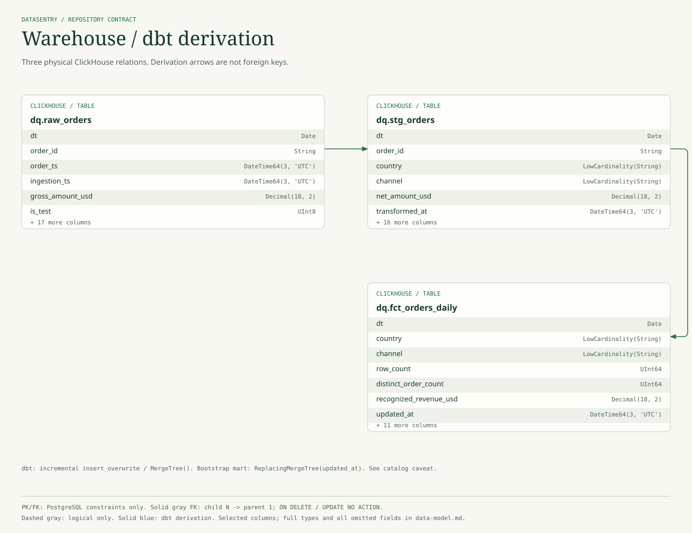

Selected partition, event identity and metric fields. dbt staging filters synthetic test rows and computes net amount; the mart aggregates by date/country/channel. ORDER BY does not enforce uniqueness.

### Observability / checks and incidents

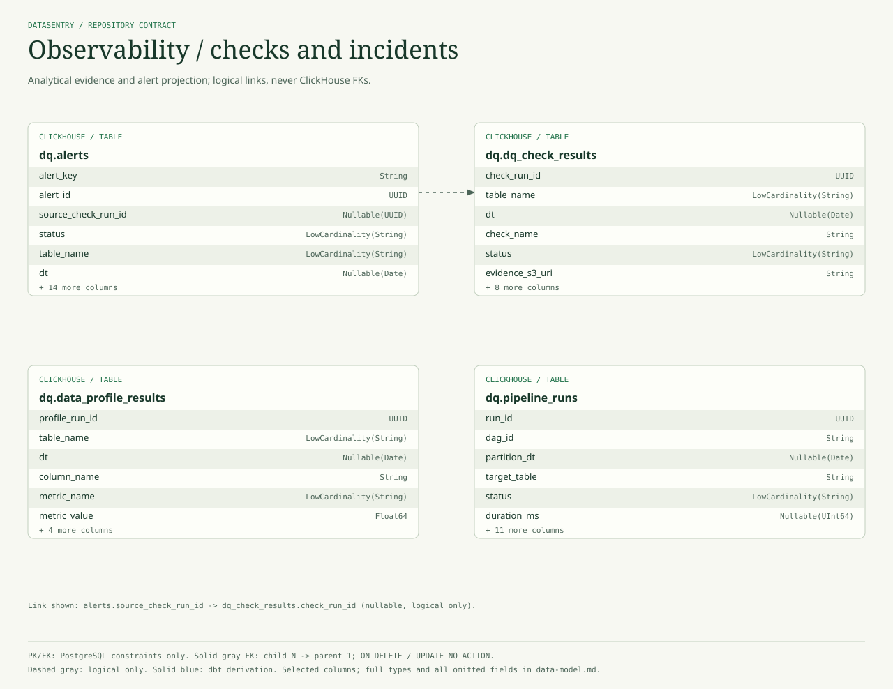

Profiles and pipeline runs describe table/date scope. DQ alerts can refer to check_run_id; schema alerts need not. The open_alerts view is a filtered, non-FINAL read, not a transactional lifecycle authority.

### Alerts / a filtered read is not authority

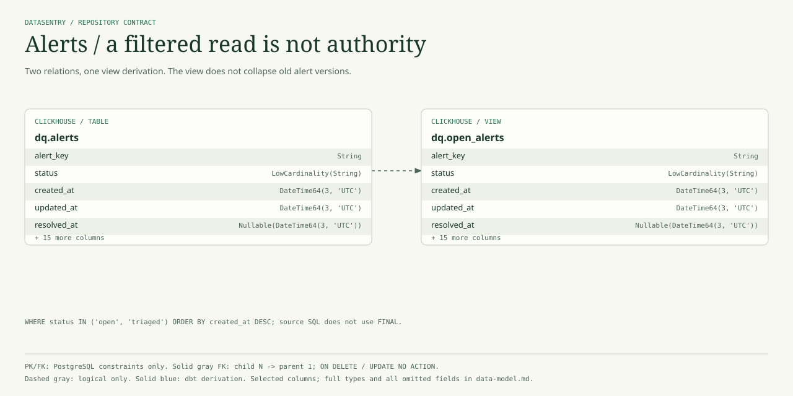

open_alerts inherits all 20 alert columns, but only selected lifecycle fields are shown. Its literal filter includes open/triaged, not acknowledged. No FK, UNIQUE or FINAL is introduced by the view.

### Metadata / schema observations

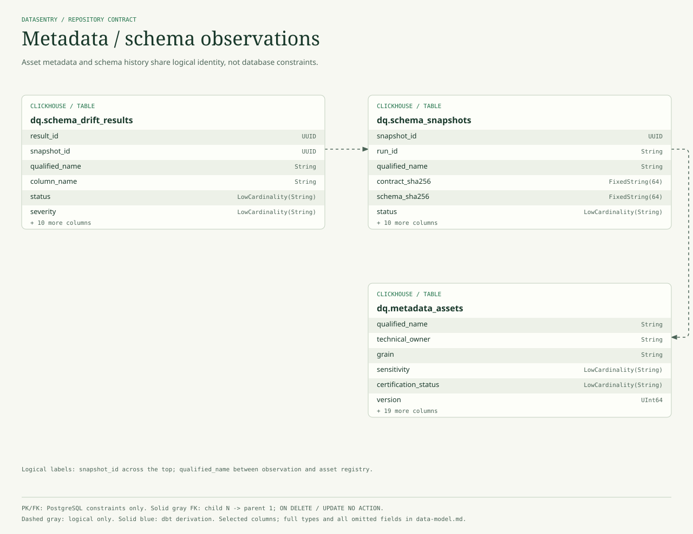

Findings correlate with schema observations through snapshot_id; qualified_name identifies the observed asset. Contract/version hashes preserve provenance. These ClickHouse fields are not FK/PK declarations.

### Triage / context and audit evidence

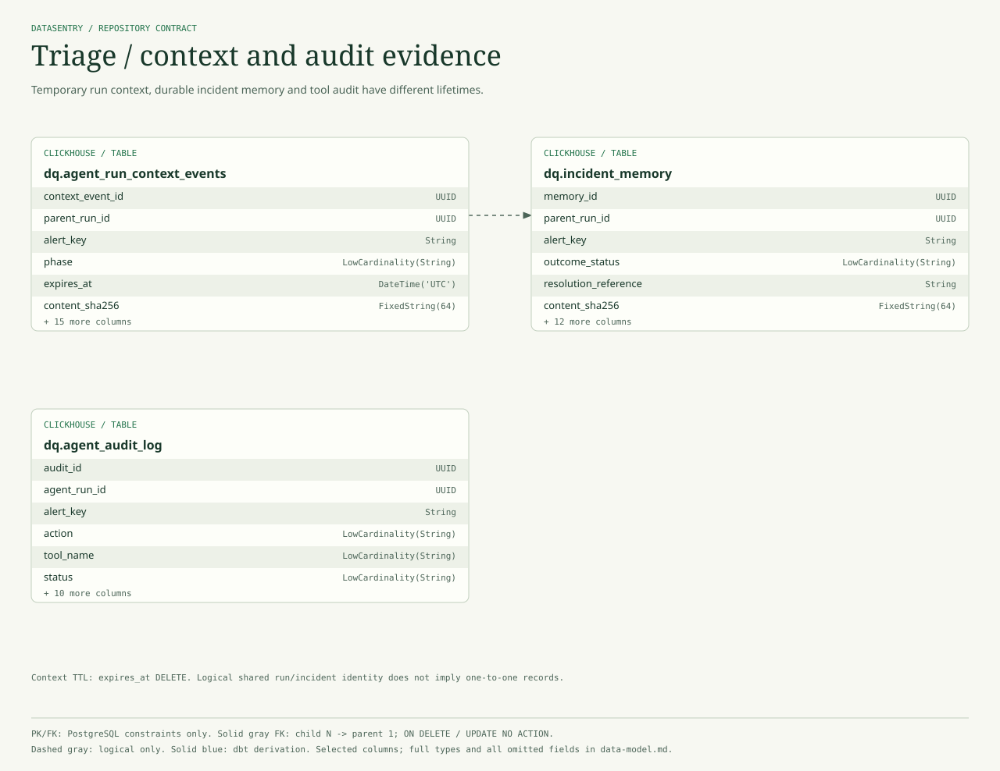

parent_run_id and alert identity correlate context with memory. Temporary context uses an expires_at deletion TTL; incident memory remains durable. Audit is append evidence, not an approval or recovery engine.

### Approvals / two distinct stores

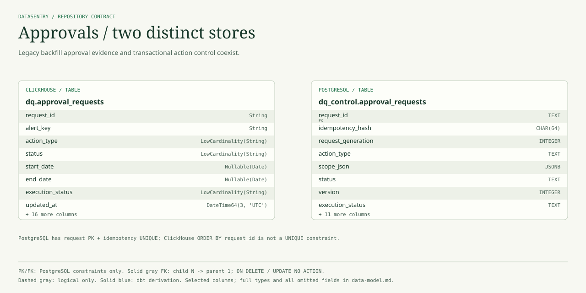

No connector is drawn because these two approval tables are not declared counterparts or FK-linked replicas. The backfill/API path still uses legacy ClickHouse approvals; the approved-action dispatcher uses PostgreSQL control. PostgreSQL advisory locking in parts of the legacy path does not turn ClickHouse into a transactional store.

### Resolution / scoped revalidation

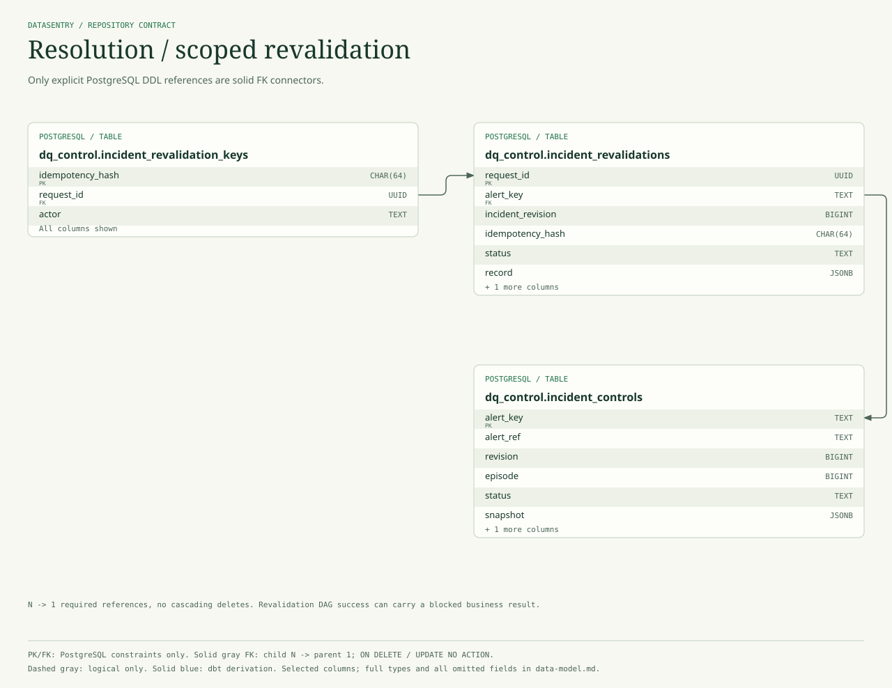

A revalidation request belongs to one incident control; an idempotency key points to a durable request. Child-to-parent FK references use NO ACTION. Fresh PASS does not automatically close an incident.

### Resolution / explicit closure decisions

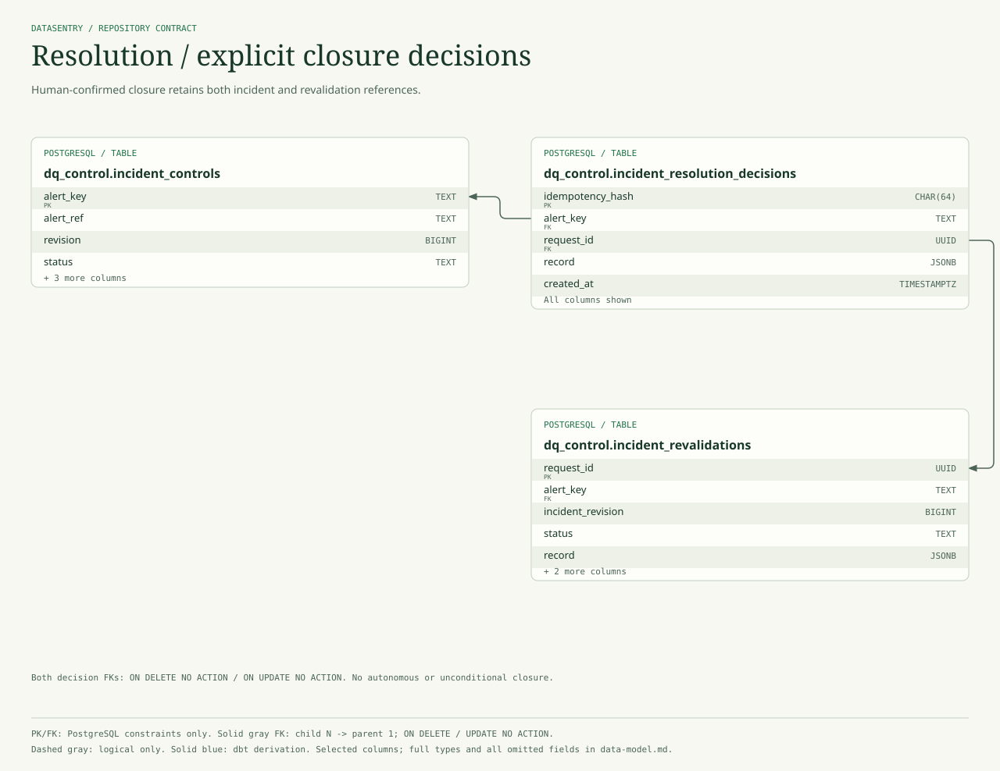

The decision has two true FKs, one to the incident and one to its revalidation request. The diagram shows both. Application revision/scope/evidence gates add semantics that the FK constraints alone cannot enforce.

### Resolution / independent sink delivery

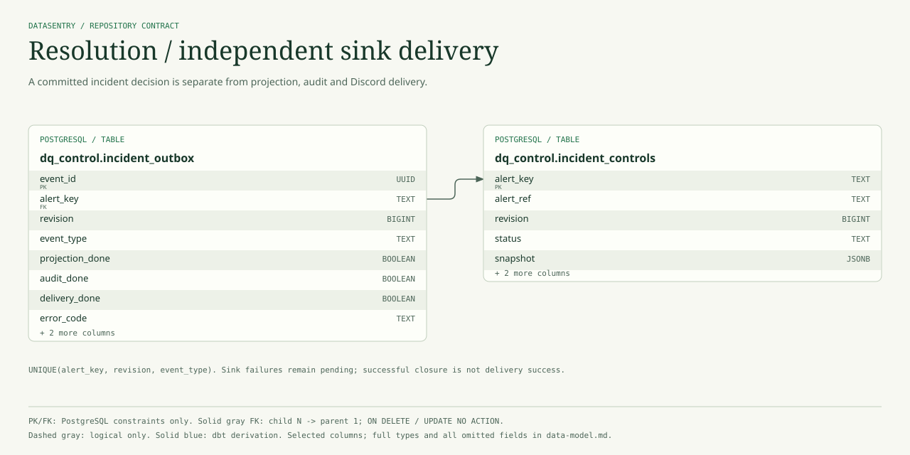

incident_outbox references the incident control with one true FK. The unique event tuple prevents duplicate logical events. Projection/audit/delivery flags track separate sinks; there is no atomic cross-store transaction or blanket exactly-once guarantee.

### Discord / canonical workspaces

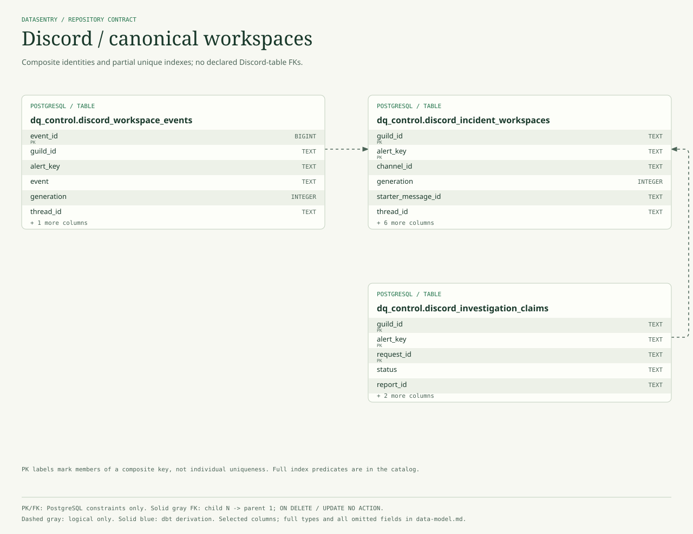

Workspaces, event history and investigation claims correlate on guild/incident. Thread uniqueness is partial (nonempty thread IDs), and single-active investigation uniqueness applies only to claimed/uncertain rows. No field-level FK is invented.

### Discord / claims and service identity

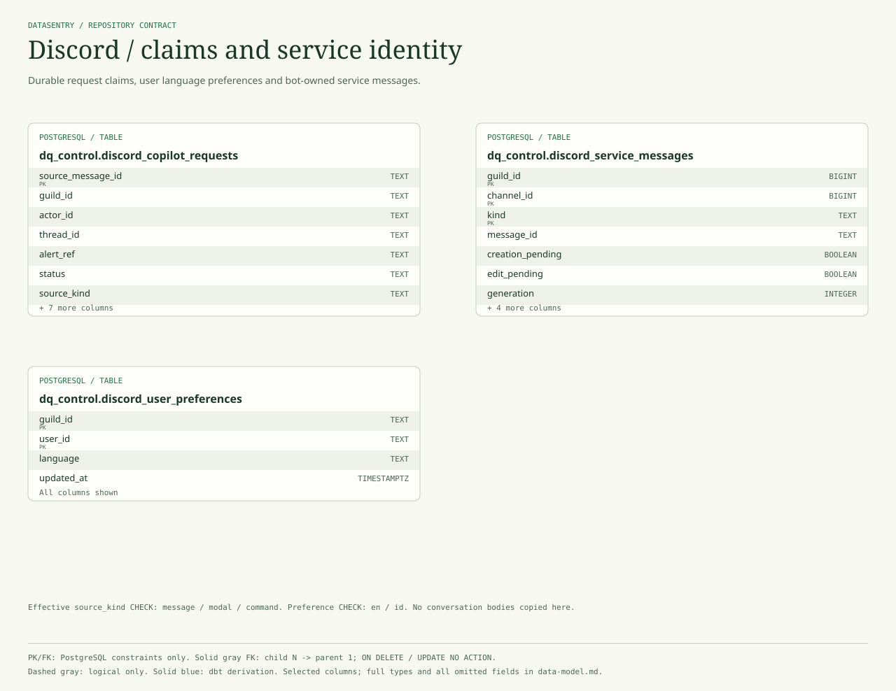

These tables have independent PKs, not a declared relational parent-child chain. Copilot source_kind incorporates the command migration; service messages currently constrain kind to welcome. Physical BIGINT/TEXT identifier differences are preserved.

### Discord / incident delivery projection

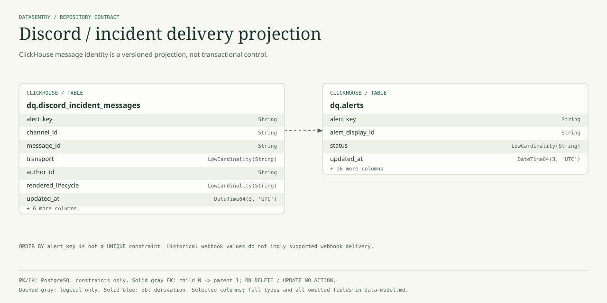

The message registry correlates to alerts through alert_key. transport/author_id are included after the idempotent bot-delivery ALTERs; legacy_webhook remains a historical default, not an active architecture recommendation.

## dbt And View Semantics

`raw_orders -> stg_orders -> fct_orders_daily` is dbt derivation. Staging filters `is_test = 0` and the requested date window, casts types, and computes `net_amount_usd = gross_amount_usd - discount_usd - refund_amount_usd`. The mart groups by `(dt, country, channel)`; `order_count` is `count()`, while `distinct_order_count` is `uniqExact(order_id)`. AOV divides gross amount by distinct orders. These are not SQL foreign keys.

The dbt project config uses incremental `insert_overwrite`, `MergeTree()` and `dt` partitions. Bootstrap DDL defines `dq.fct_orders_daily` as `ReplacingMergeTree(updated_at)`, whereas dbt config requests `MergeTree()`. Both contracts are retained here; the effective deployed engine depends on how the relation was created/rebuilt. No live engine verification is claimed. dbt uniqueness/grain tests validate expectations, not database constraints.

`dq.open_alerts` inherits all fields from `dq.alerts` and filters `status IN ('open', 'triaged')`. Its checked-in SQL does **not** use `FINAL`; old versions can therefore appear before replacement merges. It excludes `acknowledged` by literal filter and is not the canonical transactional incident lifecycle. Do not equate this view with all actionable incidents.

## Enforced Foreign Keys

| Child Column | Referenced Column | Delete / Update | Source |
|---|---|---|---|
| `dq_control.incident_outbox.alert_key` | `dq_control.incident_controls.alert_key` | NO ACTION / NO ACTION | [infra/init/postgres/03_incident_resolution.sql:41](../infra/init/postgres/03_incident_resolution.sql#L41) |
| `dq_control.incident_resolution_decisions.alert_key` | `dq_control.incident_controls.alert_key` | NO ACTION / NO ACTION | [infra/init/postgres/03_incident_resolution.sql:34](../infra/init/postgres/03_incident_resolution.sql#L34) |
| `dq_control.incident_resolution_decisions.request_id` | `dq_control.incident_revalidations.request_id` | NO ACTION / NO ACTION | [infra/init/postgres/03_incident_resolution.sql:35](../infra/init/postgres/03_incident_resolution.sql#L35) |
| `dq_control.incident_revalidation_keys.request_id` | `dq_control.incident_revalidations.request_id` | NO ACTION / NO ACTION | [infra/init/postgres/03_incident_resolution.sql:26](../infra/init/postgres/03_incident_resolution.sql#L26) |
| `dq_control.incident_revalidations.alert_key` | `dq_control.incident_controls.alert_key` | NO ACTION / NO ACTION | [infra/init/postgres/03_incident_resolution.sql:15](../infra/init/postgres/03_incident_resolution.sql#L15) |

## Logical Correlations

These are selective, source-backed navigation paths, not a complete join contract or FK list.

| From | To | Matching / Meaning | Evidence |
|---|---|---|---|
| `dq.agent_audit_log` | `dq.alerts` | alert_key links incident audit evidence; blank/null context is allowed | [infra/init/clickhouse/03_agent_tables.sql:14](../infra/init/clickhouse/03_agent_tables.sql#L14) |
| `dq.agent_run_context_events` | `dq.incident_memory` | Shared parent_run_id / incident identity; temporary events and durable memory differ | [agent/context/store.py:224](../agent/context/store.py#L224) |
| `dq.alerts` | `dq.dq_check_results` | Nullable source_check_run_id -> check_run_id; schema alerts may have no DQ check | [pipelines/dq/generate_alerts.py:223](../pipelines/dq/generate_alerts.py#L223) |
| `dq.approval_requests` | `dq.alerts` | Legacy backfill request incident correlation; not a cross-store action-control FK | [infra/init/clickhouse/03_agent_tables.sql:41](../infra/init/clickhouse/03_agent_tables.sql#L41) |
| `dq.data_profile_results` | `dq.stg_orders` | table_name and optional dt identify the observed dataset/date; not a row FK | [infra/init/clickhouse/02_observability_tables.sql:9](../infra/init/clickhouse/02_observability_tables.sql#L9) |
| `dq.discord_incident_messages` | `dq.alerts` | alert_key associates a canonical public incident message with its alert | [apps/discord_bot/registry.py:47](../apps/discord_bot/registry.py#L47) |
| `dq.pipeline_runs` | `dq.stg_orders` | target_table and partition_dt describe run scope, not relational identity | [infra/init/clickhouse/02_observability_tables.sql:77](../infra/init/clickhouse/02_observability_tables.sql#L77) |
| `dq.schema_drift_results` | `dq.schema_snapshots` | snapshot_id correlates findings to observations; not enforced | [pipelines/schema_drift/storage.py:37](../pipelines/schema_drift/storage.py#L37) |
| `dq.schema_snapshots` | `dq.metadata_assets` | qualified_name is a dataset identity convention; metadata is independently versioned | [infra/init/clickhouse/06_schema_drift_tables.sql:17](../infra/init/clickhouse/06_schema_drift_tables.sql#L17) |
| `dq_control.approval_requests` | `dq_control.incident_controls` | scope_json incident/date matching checks remediation blockers; no declared FK | [agent/tools/incident_resolution.py:203](../agent/tools/incident_resolution.py#L203) |
| `dq_control.discord_copilot_requests` | `dq_control.discord_incident_workspaces` | Thread/guild metadata correlate Copilot claims with workspaces; no FK | [infra/init/postgres/04_discord_workspaces.sql:47](../infra/init/postgres/04_discord_workspaces.sql#L47) |
| `dq_control.discord_investigation_claims` | `dq_control.discord_incident_workspaces` | Guild/incident-scoped investigation identity and partial single-active uniqueness; no FK | [apps/discord_bot/thread_store.py:161](../apps/discord_bot/thread_store.py#L161) |
| `dq_control.discord_workspace_events` | `dq_control.discord_incident_workspaces` | Guild/incident/generation correlation; no workspace-event FK | [apps/discord_bot/thread_store.py:86](../apps/discord_bot/thread_store.py#L86) |
| `dq_control.incident_controls` | `dq.alerts` | PostgreSQL incident authority projects a versioned ClickHouse snapshot through outbox | [agent/tools/incident_resolution.py:144](../agent/tools/incident_resolution.py#L144) |

## Complete Physical Catalog

Column declarations preserve bootstrap syntax for traceability. The nullable/default columns and the effective constraint list incorporate later ALTERs; migration history records no-op ADDs and replaced checks. PostgreSQL GENERATED identity is retained in the declaration. Composite PK/UNIQUE applies to the tuple, not each component individually.

### `dq.agent_audit_log`

Store: **clickhouse**. Kind: **table**. Fields: **16**.

Sources: [infra/init/clickhouse/03_agent_tables.sql:9](../infra/init/clickhouse/03_agent_tables.sql#L9).

Engine: `MergeTree`. Partition: `toYYYYMM(ts)`. Sorting key (not unique): `(ts, alert_key, agent_run_id, tool_name)`. TTL: -.

| Column | SQL Type | Nullable | Effective Default | Bootstrap Declaration / Modifiers | Source |
|---|---|---|---|---|---|
| `audit_id` | `UUID` | no | `generateUUIDv4()` | `DEFAULT generateUUIDv4()` | [infra/init/clickhouse/03_agent_tables.sql:11](../infra/init/clickhouse/03_agent_tables.sql#L11) |
| `ts` | `DateTime64(3, 'UTC')` | no | `now64(3)` | `DEFAULT now64(3)` | [infra/init/clickhouse/03_agent_tables.sql:12](../infra/init/clickhouse/03_agent_tables.sql#L12) |
| `alert_id` | `Nullable(UUID)` | yes | - | `` | [infra/init/clickhouse/03_agent_tables.sql:13](../infra/init/clickhouse/03_agent_tables.sql#L13) |
| `alert_key` | `String` | no | `''` | `DEFAULT ''` | [infra/init/clickhouse/03_agent_tables.sql:14](../infra/init/clickhouse/03_agent_tables.sql#L14) |
| `agent_run_id` | `UUID` | no | `generateUUIDv4()` | `DEFAULT generateUUIDv4()` | [infra/init/clickhouse/03_agent_tables.sql:15](../infra/init/clickhouse/03_agent_tables.sql#L15) |
| `actor` | `LowCardinality(String)` | no | `'agent'` | `DEFAULT 'agent'` | [infra/init/clickhouse/03_agent_tables.sql:16](../infra/init/clickhouse/03_agent_tables.sql#L16) |
| `action` | `LowCardinality(String)` | no | - | `` | [infra/init/clickhouse/03_agent_tables.sql:17](../infra/init/clickhouse/03_agent_tables.sql#L17) |
| `tool_name` | `LowCardinality(String)` | no | `''` | `DEFAULT ''` | [infra/init/clickhouse/03_agent_tables.sql:18](../infra/init/clickhouse/03_agent_tables.sql#L18) |
| `status` | `LowCardinality(String)` | no | - | `` | [infra/init/clickhouse/03_agent_tables.sql:19](../infra/init/clickhouse/03_agent_tables.sql#L19) |
| `duration_ms` | `Nullable(UInt64)` | yes | - | `` | [infra/init/clickhouse/03_agent_tables.sql:20](../infra/init/clickhouse/03_agent_tables.sql#L20) |
| `input_json` | `String` | no | `'{}'` | `DEFAULT '{}'` | [infra/init/clickhouse/03_agent_tables.sql:21](../infra/init/clickhouse/03_agent_tables.sql#L21) |
| `output_json` | `String` | no | `'{}'` | `DEFAULT '{}'` | [infra/init/clickhouse/03_agent_tables.sql:22](../infra/init/clickhouse/03_agent_tables.sql#L22) |
| `error_message` | `String` | no | `''` | `DEFAULT ''` | [infra/init/clickhouse/03_agent_tables.sql:23](../infra/init/clickhouse/03_agent_tables.sql#L23) |
| `sql_hash` | `String` | no | `''` | `DEFAULT ''` | [infra/init/clickhouse/03_agent_tables.sql:24](../infra/init/clickhouse/03_agent_tables.sql#L24) |
| `row_count` | `Nullable(UInt64)` | yes | - | `` | [infra/init/clickhouse/03_agent_tables.sql:25](../infra/init/clickhouse/03_agent_tables.sql#L25) |
| `report_s3_uri` | `String` | no | `''` | `DEFAULT ''` | [infra/init/clickhouse/03_agent_tables.sql:26](../infra/init/clickhouse/03_agent_tables.sql#L26) |

### `dq.agent_run_context_events`

Store: **clickhouse**. Kind: **table**. Fields: **21**.

Sources: [infra/init/clickhouse/07_agent_context_tables.sql:9](../infra/init/clickhouse/07_agent_context_tables.sql#L9).

Engine: `ReplacingMergeTree(occurred_at)`. Partition: `toYYYYMM(occurred_at)`. Sorting key (not unique): `(parent_run_id, context_event_id)`. TTL: `expires_at DELETE`.

| Column | SQL Type | Nullable | Effective Default | Bootstrap Declaration / Modifiers | Source |
|---|---|---|---|---|---|
| `context_event_id` | `UUID` | no | - | `` | [infra/init/clickhouse/07_agent_context_tables.sql:11](../infra/init/clickhouse/07_agent_context_tables.sql#L11) |
| `parent_run_id` | `UUID` | no | - | `` | [infra/init/clickhouse/07_agent_context_tables.sql:12](../infra/init/clickhouse/07_agent_context_tables.sql#L12) |
| `external_run_id` | `String` | no | - | `` | [infra/init/clickhouse/07_agent_context_tables.sql:13](../infra/init/clickhouse/07_agent_context_tables.sql#L13) |
| `event_sequence` | `UInt8` | no | - | `` | [infra/init/clickhouse/07_agent_context_tables.sql:14](../infra/init/clickhouse/07_agent_context_tables.sql#L14) |
| `phase` | `LowCardinality(String)` | no | - | `` | [infra/init/clickhouse/07_agent_context_tables.sql:15](../infra/init/clickhouse/07_agent_context_tables.sql#L15) |
| `occurred_at` | `DateTime64(3, 'UTC')` | no | - | `` | [infra/init/clickhouse/07_agent_context_tables.sql:16](../infra/init/clickhouse/07_agent_context_tables.sql#L16) |
| `expires_at` | `DateTime('UTC')` | no | - | `` | [infra/init/clickhouse/07_agent_context_tables.sql:17](../infra/init/clickhouse/07_agent_context_tables.sql#L17) |
| `requester` | `LowCardinality(String)` | no | - | `` | [infra/init/clickhouse/07_agent_context_tables.sql:18](../infra/init/clickhouse/07_agent_context_tables.sql#L18) |
| `status` | `LowCardinality(String)` | no | - | `` | [infra/init/clickhouse/07_agent_context_tables.sql:19](../infra/init/clickhouse/07_agent_context_tables.sql#L19) |
| `selected_specialist` | `LowCardinality(String)` | no | `''` | `DEFAULT ''` | [infra/init/clickhouse/07_agent_context_tables.sql:20](../infra/init/clickhouse/07_agent_context_tables.sql#L20) |
| `task_type` | `LowCardinality(String)` | no | `''` | `DEFAULT ''` | [infra/init/clickhouse/07_agent_context_tables.sql:21](../infra/init/clickhouse/07_agent_context_tables.sql#L21) |
| `task_id` | `Nullable(UUID)` | yes | - | `` | [infra/init/clickhouse/07_agent_context_tables.sql:22](../infra/init/clickhouse/07_agent_context_tables.sql#L22) |
| `alert_id` | `Nullable(UUID)` | yes | - | `` | [infra/init/clickhouse/07_agent_context_tables.sql:23](../infra/init/clickhouse/07_agent_context_tables.sql#L23) |
| `alert_key` | `String` | no | `''` | `DEFAULT ''` | [infra/init/clickhouse/07_agent_context_tables.sql:24](../infra/init/clickhouse/07_agent_context_tables.sql#L24) |
| `alert_display_id` | `String` | no | `''` | `DEFAULT ''` | [infra/init/clickhouse/07_agent_context_tables.sql:25](../infra/init/clickhouse/07_agent_context_tables.sql#L25) |
| `context_references_json` | `String` | no | `'[]'` | `DEFAULT '[]'` | [infra/init/clickhouse/07_agent_context_tables.sql:26](../infra/init/clickhouse/07_agent_context_tables.sql#L26) |
| `evidence_references_json` | `String` | no | `'[]'` | `DEFAULT '[]'` | [infra/init/clickhouse/07_agent_context_tables.sql:27](../infra/init/clickhouse/07_agent_context_tables.sql#L27) |
| `decision_json` | `String` | no | `'{}'` | `DEFAULT '{}'` | [infra/init/clickhouse/07_agent_context_tables.sql:28](../infra/init/clickhouse/07_agent_context_tables.sql#L28) |
| `report_s3_uri` | `String` | no | `''` | `DEFAULT ''` | [infra/init/clickhouse/07_agent_context_tables.sql:29](../infra/init/clickhouse/07_agent_context_tables.sql#L29) |
| `approval_state` | `LowCardinality(String)` | no | `'not_required'` | `DEFAULT 'not_required'` | [infra/init/clickhouse/07_agent_context_tables.sql:30](../infra/init/clickhouse/07_agent_context_tables.sql#L30) |
| `content_sha256` | `FixedString(64)` | no | - | `` | [infra/init/clickhouse/07_agent_context_tables.sql:31](../infra/init/clickhouse/07_agent_context_tables.sql#L31) |

### `dq.alerts`

Store: **clickhouse**. Kind: **table**. Fields: **20**.

Sources: [infra/init/clickhouse/02_observability_tables.sql:49](../infra/init/clickhouse/02_observability_tables.sql#L49).

Engine: `ReplacingMergeTree(updated_at)`. Partition: `toYYYYMM(created_at)`. Sorting key (not unique): `(alert_key)`. TTL: -.

| Column | SQL Type | Nullable | Effective Default | Bootstrap Declaration / Modifiers | Source |
|---|---|---|---|---|---|
| `alert_id` | `UUID` | no | `generateUUIDv4()` | `DEFAULT generateUUIDv4()` | [infra/init/clickhouse/02_observability_tables.sql:51](../infra/init/clickhouse/02_observability_tables.sql#L51) |
| `alert_key` | `String` | no | - | `` | [infra/init/clickhouse/02_observability_tables.sql:52](../infra/init/clickhouse/02_observability_tables.sql#L52) |
| `alert_display_id` | `String` | no | - | `` | [infra/init/clickhouse/02_observability_tables.sql:53](../infra/init/clickhouse/02_observability_tables.sql#L53) |
| `created_at` | `DateTime64(3, 'UTC')` | no | `now64(3)` | `DEFAULT now64(3)` | [infra/init/clickhouse/02_observability_tables.sql:54](../infra/init/clickhouse/02_observability_tables.sql#L54) |
| `updated_at` | `DateTime64(3, 'UTC')` | no | `now64(3)` | `DEFAULT now64(3)` | [infra/init/clickhouse/02_observability_tables.sql:55](../infra/init/clickhouse/02_observability_tables.sql#L55) |
| `status` | `LowCardinality(String)` | no | `'open'` | `DEFAULT 'open'` | [infra/init/clickhouse/02_observability_tables.sql:56](../infra/init/clickhouse/02_observability_tables.sql#L56) |
| `alert_type` | `LowCardinality(String)` | no | - | `` | [infra/init/clickhouse/02_observability_tables.sql:57](../infra/init/clickhouse/02_observability_tables.sql#L57) |
| `severity` | `LowCardinality(String)` | no | - | `` | [infra/init/clickhouse/02_observability_tables.sql:58](../infra/init/clickhouse/02_observability_tables.sql#L58) |
| `table_name` | `LowCardinality(String)` | no | - | `` | [infra/init/clickhouse/02_observability_tables.sql:59](../infra/init/clickhouse/02_observability_tables.sql#L59) |
| `metric` | `String` | no | - | `` | [infra/init/clickhouse/02_observability_tables.sql:60](../infra/init/clickhouse/02_observability_tables.sql#L60) |
| `dt` | `Nullable(Date)` | yes | - | `` | [infra/init/clickhouse/02_observability_tables.sql:61](../infra/init/clickhouse/02_observability_tables.sql#L61) |
| `dimension` | `String` | no | `''` | `DEFAULT ''` | [infra/init/clickhouse/02_observability_tables.sql:62](../infra/init/clickhouse/02_observability_tables.sql#L62) |
| `observed_value` | `Nullable(Float64)` | yes | - | `` | [infra/init/clickhouse/02_observability_tables.sql:63](../infra/init/clickhouse/02_observability_tables.sql#L63) |
| `expected_value` | `Nullable(Float64)` | yes | - | `` | [infra/init/clickhouse/02_observability_tables.sql:64](../infra/init/clickhouse/02_observability_tables.sql#L64) |
| `threshold_value` | `Nullable(Float64)` | yes | - | `` | [infra/init/clickhouse/02_observability_tables.sql:65](../infra/init/clickhouse/02_observability_tables.sql#L65) |
| `source_check_run_id` | `Nullable(UUID)` | yes | - | `` | [infra/init/clickhouse/02_observability_tables.sql:66](../infra/init/clickhouse/02_observability_tables.sql#L66) |
| `details_json` | `String` | no | `'{}'` | `DEFAULT '{}'` | [infra/init/clickhouse/02_observability_tables.sql:67](../infra/init/clickhouse/02_observability_tables.sql#L67) |
| `report_s3_uri` | `String` | no | `''` | `DEFAULT ''` | [infra/init/clickhouse/02_observability_tables.sql:68](../infra/init/clickhouse/02_observability_tables.sql#L68) |
| `acknowledged_by` | `String` | no | `''` | `DEFAULT ''` | [infra/init/clickhouse/02_observability_tables.sql:69](../infra/init/clickhouse/02_observability_tables.sql#L69) |
| `resolved_at` | `Nullable(DateTime64(3, 'UTC'))` | yes | - | `` | [infra/init/clickhouse/02_observability_tables.sql:70](../infra/init/clickhouse/02_observability_tables.sql#L70) |

### `dq.approval_requests`

Store: **clickhouse**. Kind: **table**. Fields: **24**.

Sources: [infra/init/clickhouse/03_agent_tables.sql:34](../infra/init/clickhouse/03_agent_tables.sql#L34).

Engine: `ReplacingMergeTree(updated_at)`. Partition: `toYYYYMM(created_at)`. Sorting key (not unique): `request_id`. TTL: -.

| Column | SQL Type | Nullable | Effective Default | Bootstrap Declaration / Modifiers | Source |
|---|---|---|---|---|---|
| `request_id` | `String` | no | - | `` | [infra/init/clickhouse/03_agent_tables.sql:36](../infra/init/clickhouse/03_agent_tables.sql#L36) |
| `created_at` | `DateTime64(3, 'UTC')` | no | `now64(3)` | `DEFAULT now64(3)` | [infra/init/clickhouse/03_agent_tables.sql:37](../infra/init/clickhouse/03_agent_tables.sql#L37) |
| `updated_at` | `DateTime64(3, 'UTC')` | no | `now64(3)` | `DEFAULT now64(3)` | [infra/init/clickhouse/03_agent_tables.sql:38](../infra/init/clickhouse/03_agent_tables.sql#L38) |
| `alert_id` | `Nullable(UUID)` | yes | - | `` | [infra/init/clickhouse/03_agent_tables.sql:39](../infra/init/clickhouse/03_agent_tables.sql#L39) |
| `alert_key` | `String` | no | `''` | `DEFAULT ''` | [infra/init/clickhouse/03_agent_tables.sql:40](../infra/init/clickhouse/03_agent_tables.sql#L40) |
| `agent_run_id` | `Nullable(UUID)` | yes | - | `` | [infra/init/clickhouse/03_agent_tables.sql:41](../infra/init/clickhouse/03_agent_tables.sql#L41) |
| `action_type` | `LowCardinality(String)` | no | - | `` | [infra/init/clickhouse/03_agent_tables.sql:42](../infra/init/clickhouse/03_agent_tables.sql#L42) |
| `risk_level` | `LowCardinality(String)` | no | - | `` | [infra/init/clickhouse/03_agent_tables.sql:43](../infra/init/clickhouse/03_agent_tables.sql#L43) |
| `status` | `LowCardinality(String)` | no | - | `` | [infra/init/clickhouse/03_agent_tables.sql:44](../infra/init/clickhouse/03_agent_tables.sql#L44) |
| `requested_by` | `String` | no | - | `` | [infra/init/clickhouse/03_agent_tables.sql:45](../infra/init/clickhouse/03_agent_tables.sql#L45) |
| `reason` | `String` | no | - | `` | [infra/init/clickhouse/03_agent_tables.sql:46](../infra/init/clickhouse/03_agent_tables.sql#L46) |
| `dispatcher_dag_id` | `String` | no | - | `` | [infra/init/clickhouse/03_agent_tables.sql:47](../infra/init/clickhouse/03_agent_tables.sql#L47) |
| `target_dag_id` | `String` | no | - | `` | [infra/init/clickhouse/03_agent_tables.sql:48](../infra/init/clickhouse/03_agent_tables.sql#L48) |
| `start_date` | `Nullable(Date)` | yes | - | `` | [infra/init/clickhouse/03_agent_tables.sql:49](../infra/init/clickhouse/03_agent_tables.sql#L49) |
| `end_date` | `Nullable(Date)` | yes | - | `` | [infra/init/clickhouse/03_agent_tables.sql:50](../infra/init/clickhouse/03_agent_tables.sql#L50) |
| `parameters_json` | `String` | no | `'{}'` | `DEFAULT '{}'` | [infra/init/clickhouse/03_agent_tables.sql:51](../infra/init/clickhouse/03_agent_tables.sql#L51) |
| `dry_run` | `UInt8` | no | `0` | `DEFAULT 0` | [infra/init/clickhouse/03_agent_tables.sql:52](../infra/init/clickhouse/03_agent_tables.sql#L52) |
| `idempotency_key` | `String` | no | - | `` | [infra/init/clickhouse/03_agent_tables.sql:53](../infra/init/clickhouse/03_agent_tables.sql#L53) |
| `decided_by` | `String` | no | `''` | `DEFAULT ''` | [infra/init/clickhouse/03_agent_tables.sql:54](../infra/init/clickhouse/03_agent_tables.sql#L54) |
| `decided_at` | `Nullable(DateTime64(3, 'UTC'))` | yes | - | `` | [infra/init/clickhouse/03_agent_tables.sql:55](../infra/init/clickhouse/03_agent_tables.sql#L55) |
| `decision_comment` | `String` | no | `''` | `DEFAULT ''` | [infra/init/clickhouse/03_agent_tables.sql:56](../infra/init/clickhouse/03_agent_tables.sql#L56) |
| `execution_dag_run_id` | `String` | no | `''` | `DEFAULT ''` | [infra/init/clickhouse/03_agent_tables.sql:57](../infra/init/clickhouse/03_agent_tables.sql#L57) |
| `execution_status` | `LowCardinality(String)` | no | `'not_started'` | `DEFAULT 'not_started'` | [infra/init/clickhouse/03_agent_tables.sql:58](../infra/init/clickhouse/03_agent_tables.sql#L58) |
| `execution_error` | `String` | no | `''` | `DEFAULT ''` | [infra/init/clickhouse/03_agent_tables.sql:59](../infra/init/clickhouse/03_agent_tables.sql#L59) |

### `dq.data_profile_results`

Store: **clickhouse**. Kind: **table**. Fields: **10**.

Sources: [infra/init/clickhouse/02_observability_tables.sql:9](../infra/init/clickhouse/02_observability_tables.sql#L9).

Engine: `MergeTree`. Partition: `toYYYYMM(run_at)`. Sorting key (not unique): `(table_name, ifNull(dt, toDate('1970-01-01')), column_name, metric_name, run_at)`. TTL: -.

| Column | SQL Type | Nullable | Effective Default | Bootstrap Declaration / Modifiers | Source |
|---|---|---|---|---|---|
| `profile_run_id` | `UUID` | no | `generateUUIDv4()` | `DEFAULT generateUUIDv4()` | [infra/init/clickhouse/02_observability_tables.sql:11](../infra/init/clickhouse/02_observability_tables.sql#L11) |
| `run_at` | `DateTime64(3, 'UTC')` | no | `now64(3)` | `DEFAULT now64(3)` | [infra/init/clickhouse/02_observability_tables.sql:12](../infra/init/clickhouse/02_observability_tables.sql#L12) |
| `dt` | `Nullable(Date)` | yes | - | `` | [infra/init/clickhouse/02_observability_tables.sql:13](../infra/init/clickhouse/02_observability_tables.sql#L13) |
| `table_name` | `LowCardinality(String)` | no | - | `` | [infra/init/clickhouse/02_observability_tables.sql:14](../infra/init/clickhouse/02_observability_tables.sql#L14) |
| `column_name` | `String` | no | - | `` | [infra/init/clickhouse/02_observability_tables.sql:15](../infra/init/clickhouse/02_observability_tables.sql#L15) |
| `metric_name` | `LowCardinality(String)` | no | - | `` | [infra/init/clickhouse/02_observability_tables.sql:16](../infra/init/clickhouse/02_observability_tables.sql#L16) |
| `metric_value` | `Float64` | no | - | `` | [infra/init/clickhouse/02_observability_tables.sql:17](../infra/init/clickhouse/02_observability_tables.sql#L17) |
| `metric_unit` | `LowCardinality(String)` | no | `''` | `DEFAULT ''` | [infra/init/clickhouse/02_observability_tables.sql:18](../infra/init/clickhouse/02_observability_tables.sql#L18) |
| `details_json` | `String` | no | `'{}'` | `DEFAULT '{}'` | [infra/init/clickhouse/02_observability_tables.sql:19](../infra/init/clickhouse/02_observability_tables.sql#L19) |
| `created_at` | `DateTime64(3, 'UTC')` | no | `now64(3)` | `DEFAULT now64(3)` | [infra/init/clickhouse/02_observability_tables.sql:20](../infra/init/clickhouse/02_observability_tables.sql#L20) |

### `dq.discord_incident_messages`

Store: **clickhouse**. Kind: **table**. Fields: **13**.

Sources: [infra/init/clickhouse/08_discord_incident_messages.sql:7](../infra/init/clickhouse/08_discord_incident_messages.sql#L7); [infra/init/clickhouse/09_discord_bot_delivery_migration.sql:8](../infra/init/clickhouse/09_discord_bot_delivery_migration.sql#L8); [infra/init/clickhouse/09_discord_bot_delivery_migration.sql:12](../infra/init/clickhouse/09_discord_bot_delivery_migration.sql#L12).

Engine: `ReplacingMergeTree(updated_at)`. Partition: -. Sorting key (not unique): `alert_key`. TTL: -.

| Column | SQL Type | Nullable | Effective Default | Bootstrap Declaration / Modifiers | Source |
|---|---|---|---|---|---|
| `alert_key` | `String` | no | - | `` | [infra/init/clickhouse/08_discord_incident_messages.sql:9](../infra/init/clickhouse/08_discord_incident_messages.sql#L9) |
| `alert_display_id` | `String` | no | - | `` | [infra/init/clickhouse/08_discord_incident_messages.sql:10](../infra/init/clickhouse/08_discord_incident_messages.sql#L10) |
| `channel_id` | `String` | no | - | `` | [infra/init/clickhouse/08_discord_incident_messages.sql:11](../infra/init/clickhouse/08_discord_incident_messages.sql#L11) |
| `message_id` | `String` | no | - | `` | [infra/init/clickhouse/08_discord_incident_messages.sql:12](../infra/init/clickhouse/08_discord_incident_messages.sql#L12) |
| `rendered_lifecycle` | `LowCardinality(String)` | no | - | `` | [infra/init/clickhouse/08_discord_incident_messages.sql:13](../infra/init/clickhouse/08_discord_incident_messages.sql#L13) |
| `content_hash` | `FixedString(64)` | no | - | `` | [infra/init/clickhouse/08_discord_incident_messages.sql:14](../infra/init/clickhouse/08_discord_incident_messages.sql#L14) |
| `narrative_source` | `LowCardinality(String)` | no | - | `` | [infra/init/clickhouse/08_discord_incident_messages.sql:15](../infra/init/clickhouse/08_discord_incident_messages.sql#L15) |
| `transport` | `LowCardinality(String)` | no | `'legacy_webhook'` | `DEFAULT 'legacy_webhook'` | [infra/init/clickhouse/08_discord_incident_messages.sql:16](../infra/init/clickhouse/08_discord_incident_messages.sql#L16); [infra/init/clickhouse/09_discord_bot_delivery_migration.sql:8](../infra/init/clickhouse/09_discord_bot_delivery_migration.sql#L8) |
| `author_id` | `String` | no | `''` | `DEFAULT ''` | [infra/init/clickhouse/08_discord_incident_messages.sql:17](../infra/init/clickhouse/08_discord_incident_messages.sql#L17); [infra/init/clickhouse/09_discord_bot_delivery_migration.sql:12](../infra/init/clickhouse/09_discord_bot_delivery_migration.sql#L12) |
| `last_http_status` | `Nullable(UInt16)` | yes | - | `` | [infra/init/clickhouse/08_discord_incident_messages.sql:18](../infra/init/clickhouse/08_discord_incident_messages.sql#L18) |
| `last_error_state` | `String` | no | `''` | `DEFAULT ''` | [infra/init/clickhouse/08_discord_incident_messages.sql:19](../infra/init/clickhouse/08_discord_incident_messages.sql#L19) |
| `created_at` | `DateTime64(3, 'UTC')` | no | - | `` | [infra/init/clickhouse/08_discord_incident_messages.sql:20](../infra/init/clickhouse/08_discord_incident_messages.sql#L20) |
| `updated_at` | `DateTime64(3, 'UTC')` | no | - | `` | [infra/init/clickhouse/08_discord_incident_messages.sql:21](../infra/init/clickhouse/08_discord_incident_messages.sql#L21) |

Applied idempotent migration declarations:

- `ALTER TABLE dq.discord_incident_messages ADD COLUMN IF NOT EXISTS transport LowCardinality(String) DEFAULT 'legacy_webhook' AFTER narrative_source;` ([infra/init/clickhouse/09_discord_bot_delivery_migration.sql:8](../infra/init/clickhouse/09_discord_bot_delivery_migration.sql#L8)).
- `ALTER TABLE dq.discord_incident_messages ADD COLUMN IF NOT EXISTS author_id String DEFAULT '' AFTER transport;` ([infra/init/clickhouse/09_discord_bot_delivery_migration.sql:12](../infra/init/clickhouse/09_discord_bot_delivery_migration.sql#L12)).

### `dq.dq_check_results`

Store: **clickhouse**. Kind: **table**. Fields: **14**.

Sources: [infra/init/clickhouse/02_observability_tables.sql:27](../infra/init/clickhouse/02_observability_tables.sql#L27).

Engine: `MergeTree`. Partition: `toYYYYMM(run_at)`. Sorting key (not unique): `(table_name, ifNull(dt, toDate('1970-01-01')), status, check_name, run_at)`. TTL: -.

| Column | SQL Type | Nullable | Effective Default | Bootstrap Declaration / Modifiers | Source |
|---|---|---|---|---|---|
| `check_run_id` | `UUID` | no | `generateUUIDv4()` | `DEFAULT generateUUIDv4()` | [infra/init/clickhouse/02_observability_tables.sql:29](../infra/init/clickhouse/02_observability_tables.sql#L29) |
| `run_at` | `DateTime64(3, 'UTC')` | no | `now64(3)` | `DEFAULT now64(3)` | [infra/init/clickhouse/02_observability_tables.sql:30](../infra/init/clickhouse/02_observability_tables.sql#L30) |
| `dt` | `Nullable(Date)` | yes | - | `` | [infra/init/clickhouse/02_observability_tables.sql:31](../infra/init/clickhouse/02_observability_tables.sql#L31) |
| `table_name` | `LowCardinality(String)` | no | - | `` | [infra/init/clickhouse/02_observability_tables.sql:32](../infra/init/clickhouse/02_observability_tables.sql#L32) |
| `check_name` | `String` | no | - | `` | [infra/init/clickhouse/02_observability_tables.sql:33](../infra/init/clickhouse/02_observability_tables.sql#L33) |
| `check_type` | `LowCardinality(String)` | no | - | `` | [infra/init/clickhouse/02_observability_tables.sql:34](../infra/init/clickhouse/02_observability_tables.sql#L34) |
| `status` | `LowCardinality(String)` | no | - | `` | [infra/init/clickhouse/02_observability_tables.sql:35](../infra/init/clickhouse/02_observability_tables.sql#L35) |
| `severity` | `LowCardinality(String)` | no | - | `` | [infra/init/clickhouse/02_observability_tables.sql:36](../infra/init/clickhouse/02_observability_tables.sql#L36) |
| `observed_value` | `Nullable(Float64)` | yes | - | `` | [infra/init/clickhouse/02_observability_tables.sql:37](../infra/init/clickhouse/02_observability_tables.sql#L37) |
| `expected_value` | `Nullable(Float64)` | yes | - | `` | [infra/init/clickhouse/02_observability_tables.sql:38](../infra/init/clickhouse/02_observability_tables.sql#L38) |
| `threshold_value` | `Nullable(Float64)` | yes | - | `` | [infra/init/clickhouse/02_observability_tables.sql:39](../infra/init/clickhouse/02_observability_tables.sql#L39) |
| `details_json` | `String` | no | `'{}'` | `DEFAULT '{}'` | [infra/init/clickhouse/02_observability_tables.sql:40](../infra/init/clickhouse/02_observability_tables.sql#L40) |
| `evidence_s3_uri` | `String` | no | `''` | `DEFAULT ''` | [infra/init/clickhouse/02_observability_tables.sql:41](../infra/init/clickhouse/02_observability_tables.sql#L41) |
| `created_at` | `DateTime64(3, 'UTC')` | no | `now64(3)` | `DEFAULT now64(3)` | [infra/init/clickhouse/02_observability_tables.sql:42](../infra/init/clickhouse/02_observability_tables.sql#L42) |

### `dq.fct_orders_daily`

Store: **clickhouse**. Kind: **table**. Fields: **18**.

Sources: [infra/init/clickhouse/01_orders_tables.sql:71](../infra/init/clickhouse/01_orders_tables.sql#L71); [warehouse/dbt/models/marts/fct_orders_daily.sql:1](../warehouse/dbt/models/marts/fct_orders_daily.sql#L1).

Engine: `ReplacingMergeTree(updated_at)`. Partition: `dt`. Sorting key (not unique): `(dt, country, channel)`. TTL: -.

dbt: [warehouse/dbt/models/marts/fct_orders_daily.sql:1](../warehouse/dbt/models/marts/fct_orders_daily.sql#L1); incremental `insert_overwrite`; configured engine `MergeTree()`. Types below are the init-DDL contract, not runtime inference.

| Column | SQL Type | Nullable | Effective Default | Bootstrap Declaration / Modifiers | Source |
|---|---|---|---|---|---|
| `dt` | `Date` | no | - | `` | [infra/init/clickhouse/01_orders_tables.sql:73](../infra/init/clickhouse/01_orders_tables.sql#L73) |
| `country` | `LowCardinality(String)` | no | - | `` | [infra/init/clickhouse/01_orders_tables.sql:74](../infra/init/clickhouse/01_orders_tables.sql#L74) |
| `channel` | `LowCardinality(String)` | no | - | `` | [infra/init/clickhouse/01_orders_tables.sql:75](../infra/init/clickhouse/01_orders_tables.sql#L75) |
| `row_count` | `UInt64` | no | - | `` | [infra/init/clickhouse/01_orders_tables.sql:76](../infra/init/clickhouse/01_orders_tables.sql#L76) |
| `order_count` | `UInt64` | no | - | `` | [infra/init/clickhouse/01_orders_tables.sql:77](../infra/init/clickhouse/01_orders_tables.sql#L77) |
| `distinct_order_count` | `UInt64` | no | - | `` | [infra/init/clickhouse/01_orders_tables.sql:78](../infra/init/clickhouse/01_orders_tables.sql#L78) |
| `paid_order_count` | `UInt64` | no | - | `` | [infra/init/clickhouse/01_orders_tables.sql:79](../infra/init/clickhouse/01_orders_tables.sql#L79) |
| `cancelled_order_count` | `UInt64` | no | - | `` | [infra/init/clickhouse/01_orders_tables.sql:80](../infra/init/clickhouse/01_orders_tables.sql#L80) |
| `refunded_order_count` | `UInt64` | no | - | `` | [infra/init/clickhouse/01_orders_tables.sql:81](../infra/init/clickhouse/01_orders_tables.sql#L81) |
| `pending_order_count` | `UInt64` | no | - | `` | [infra/init/clickhouse/01_orders_tables.sql:82](../infra/init/clickhouse/01_orders_tables.sql#L82) |
| `gross_amount_usd` | `Decimal(18, 2)` | no | - | `` | [infra/init/clickhouse/01_orders_tables.sql:83](../infra/init/clickhouse/01_orders_tables.sql#L83) |
| `discount_usd` | `Decimal(18, 2)` | no | - | `` | [infra/init/clickhouse/01_orders_tables.sql:84](../infra/init/clickhouse/01_orders_tables.sql#L84) |
| `refund_amount_usd` | `Decimal(18, 2)` | no | - | `` | [infra/init/clickhouse/01_orders_tables.sql:85](../infra/init/clickhouse/01_orders_tables.sql#L85) |
| `recognized_revenue_usd` | `Decimal(18, 2)` | no | - | `` | [infra/init/clickhouse/01_orders_tables.sql:86](../infra/init/clickhouse/01_orders_tables.sql#L86) |
| `aov_usd` | `Decimal(18, 2)` | no | - | `` | [infra/init/clickhouse/01_orders_tables.sql:87](../infra/init/clickhouse/01_orders_tables.sql#L87) |
| `duplicate_order_count` | `UInt64` | no | `0` | `DEFAULT 0` | [infra/init/clickhouse/01_orders_tables.sql:88](../infra/init/clickhouse/01_orders_tables.sql#L88) |
| `late_arriving_count` | `UInt64` | no | `0` | `DEFAULT 0` | [infra/init/clickhouse/01_orders_tables.sql:89](../infra/init/clickhouse/01_orders_tables.sql#L89) |
| `updated_at` | `DateTime64(3, 'UTC')` | no | `now64(3)` | `DEFAULT now64(3)` | [infra/init/clickhouse/01_orders_tables.sql:90](../infra/init/clickhouse/01_orders_tables.sql#L90) |

### `dq.incident_memory`

Store: **clickhouse**. Kind: **table**. Fields: **18**.

Sources: [infra/init/clickhouse/07_agent_context_tables.sql:40](../infra/init/clickhouse/07_agent_context_tables.sql#L40).

Engine: `ReplacingMergeTree(recorded_at)`. Partition: `toYYYYMM(recorded_at)`. Sorting key (not unique): `(alert_key, memory_id)`. TTL: -.

| Column | SQL Type | Nullable | Effective Default | Bootstrap Declaration / Modifiers | Source |
|---|---|---|---|---|---|
| `memory_id` | `UUID` | no | - | `` | [infra/init/clickhouse/07_agent_context_tables.sql:42](../infra/init/clickhouse/07_agent_context_tables.sql#L42) |
| `memory_key` | `FixedString(64)` | no | - | `` | [infra/init/clickhouse/07_agent_context_tables.sql:43](../infra/init/clickhouse/07_agent_context_tables.sql#L43) |
| `parent_run_id` | `UUID` | no | - | `` | [infra/init/clickhouse/07_agent_context_tables.sql:44](../infra/init/clickhouse/07_agent_context_tables.sql#L44) |
| `recorded_at` | `DateTime64(3, 'UTC')` | no | - | `` | [infra/init/clickhouse/07_agent_context_tables.sql:45](../infra/init/clickhouse/07_agent_context_tables.sql#L45) |
| `memory_type` | `LowCardinality(String)` | no | - | `` | [infra/init/clickhouse/07_agent_context_tables.sql:46](../infra/init/clickhouse/07_agent_context_tables.sql#L46) |
| `alert_id` | `Nullable(UUID)` | yes | - | `` | [infra/init/clickhouse/07_agent_context_tables.sql:47](../infra/init/clickhouse/07_agent_context_tables.sql#L47) |
| `alert_key` | `String` | no | `''` | `DEFAULT ''` | [infra/init/clickhouse/07_agent_context_tables.sql:48](../infra/init/clickhouse/07_agent_context_tables.sql#L48) |
| `alert_display_id` | `String` | no | `''` | `DEFAULT ''` | [infra/init/clickhouse/07_agent_context_tables.sql:49](../infra/init/clickhouse/07_agent_context_tables.sql#L49) |
| `outcome_status` | `LowCardinality(String)` | no | - | `` | [infra/init/clickhouse/07_agent_context_tables.sql:50](../infra/init/clickhouse/07_agent_context_tables.sql#L50) |
| `specialist_name` | `LowCardinality(String)` | no | `''` | `DEFAULT ''` | [infra/init/clickhouse/07_agent_context_tables.sql:51](../infra/init/clickhouse/07_agent_context_tables.sql#L51) |
| `task_type` | `LowCardinality(String)` | no | `''` | `DEFAULT ''` | [infra/init/clickhouse/07_agent_context_tables.sql:52](../infra/init/clickhouse/07_agent_context_tables.sql#L52) |
| `summary` | `String` | no | `''` | `DEFAULT ''` | [infra/init/clickhouse/07_agent_context_tables.sql:53](../infra/init/clickhouse/07_agent_context_tables.sql#L53) |
| `evidence_references_json` | `String` | no | `'[]'` | `DEFAULT '[]'` | [infra/init/clickhouse/07_agent_context_tables.sql:54](../infra/init/clickhouse/07_agent_context_tables.sql#L54) |
| `decision_json` | `String` | no | `'{}'` | `DEFAULT '{}'` | [infra/init/clickhouse/07_agent_context_tables.sql:55](../infra/init/clickhouse/07_agent_context_tables.sql#L55) |
| `report_s3_uri` | `String` | no | `''` | `DEFAULT ''` | [infra/init/clickhouse/07_agent_context_tables.sql:56](../infra/init/clickhouse/07_agent_context_tables.sql#L56) |
| `approval_state` | `LowCardinality(String)` | no | `'not_required'` | `DEFAULT 'not_required'` | [infra/init/clickhouse/07_agent_context_tables.sql:57](../infra/init/clickhouse/07_agent_context_tables.sql#L57) |
| `resolution_reference` | `String` | no | `''` | `DEFAULT ''` | [infra/init/clickhouse/07_agent_context_tables.sql:58](../infra/init/clickhouse/07_agent_context_tables.sql#L58) |
| `content_sha256` | `FixedString(64)` | no | - | `` | [infra/init/clickhouse/07_agent_context_tables.sql:59](../infra/init/clickhouse/07_agent_context_tables.sql#L59) |

### `dq.metadata_assets`

Store: **clickhouse**. Kind: **table**. Fields: **25**.

Sources: [infra/init/clickhouse/05_metadata_tables.sql:9](../infra/init/clickhouse/05_metadata_tables.sql#L9).

Engine: `ReplacingMergeTree(version)`. Partition: -. Sorting key (not unique): `qualified_name`. TTL: -.

| Column | SQL Type | Nullable | Effective Default | Bootstrap Declaration / Modifiers | Source |
|---|---|---|---|---|---|
| `qualified_name` | `String` | no | - | `` | [infra/init/clickhouse/05_metadata_tables.sql:11](../infra/init/clickhouse/05_metadata_tables.sql#L11) |
| `database_name` | `LowCardinality(String)` | no | - | `` | [infra/init/clickhouse/05_metadata_tables.sql:12](../infra/init/clickhouse/05_metadata_tables.sql#L12) |
| `table_name` | `String` | no | - | `` | [infra/init/clickhouse/05_metadata_tables.sql:13](../infra/init/clickhouse/05_metadata_tables.sql#L13) |
| `display_name` | `String` | no | - | `` | [infra/init/clickhouse/05_metadata_tables.sql:14](../infra/init/clickhouse/05_metadata_tables.sql#L14) |
| `description` | `String` | no | - | `` | [infra/init/clickhouse/05_metadata_tables.sql:15](../infra/init/clickhouse/05_metadata_tables.sql#L15) |
| `dataset` | `LowCardinality(String)` | no | - | `` | [infra/init/clickhouse/05_metadata_tables.sql:16](../infra/init/clickhouse/05_metadata_tables.sql#L16) |
| `domain` | `LowCardinality(String)` | no | - | `` | [infra/init/clickhouse/05_metadata_tables.sql:17](../infra/init/clickhouse/05_metadata_tables.sql#L17) |
| `data_layer` | `LowCardinality(String)` | no | - | `` | [infra/init/clickhouse/05_metadata_tables.sql:18](../infra/init/clickhouse/05_metadata_tables.sql#L18) |
| `technical_owner` | `String` | no | - | `` | [infra/init/clickhouse/05_metadata_tables.sql:19](../infra/init/clickhouse/05_metadata_tables.sql#L19) |
| `business_owner` | `String` | no | - | `` | [infra/init/clickhouse/05_metadata_tables.sql:20](../infra/init/clickhouse/05_metadata_tables.sql#L20) |
| `grain` | `String` | no | - | `` | [infra/init/clickhouse/05_metadata_tables.sql:21](../infra/init/clickhouse/05_metadata_tables.sql#L21) |
| `refresh_frequency` | `LowCardinality(String)` | no | - | `` | [infra/init/clickhouse/05_metadata_tables.sql:22](../infra/init/clickhouse/05_metadata_tables.sql#L22) |
| `sla_time` | `String` | no | - | `` | [infra/init/clickhouse/05_metadata_tables.sql:23](../infra/init/clickhouse/05_metadata_tables.sql#L23) |
| `sla_timezone` | `LowCardinality(String)` | no | - | `` | [infra/init/clickhouse/05_metadata_tables.sql:24](../infra/init/clickhouse/05_metadata_tables.sql#L24) |
| `criticality` | `LowCardinality(String)` | no | - | `` | [infra/init/clickhouse/05_metadata_tables.sql:25](../infra/init/clickhouse/05_metadata_tables.sql#L25) |
| `sensitivity` | `LowCardinality(String)` | no | - | `` | [infra/init/clickhouse/05_metadata_tables.sql:26](../infra/init/clickhouse/05_metadata_tables.sql#L26) |
| `contains_pii` | `UInt8` | no | - | `` | [infra/init/clickhouse/05_metadata_tables.sql:27](../infra/init/clickhouse/05_metadata_tables.sql#L27) |
| `certification_status` | `LowCardinality(String)` | no | - | `` | [infra/init/clickhouse/05_metadata_tables.sql:28](../infra/init/clickhouse/05_metadata_tables.sql#L28) |
| `lifecycle_status` | `LowCardinality(String)` | no | - | `` | [infra/init/clickhouse/05_metadata_tables.sql:29](../infra/init/clickhouse/05_metadata_tables.sql#L29) |
| `tags` | `Array(String)` | no | - | `` | [infra/init/clickhouse/05_metadata_tables.sql:30](../infra/init/clickhouse/05_metadata_tables.sql#L30) |
| `source_config_path` | `String` | no | - | `` | [infra/init/clickhouse/05_metadata_tables.sql:31](../infra/init/clickhouse/05_metadata_tables.sql#L31) |
| `config_sha256` | `FixedString(64)` | no | - | `` | [infra/init/clickhouse/05_metadata_tables.sql:32](../infra/init/clickhouse/05_metadata_tables.sql#L32) |
| `is_active` | `UInt8` | no | `1` | `DEFAULT 1` | [infra/init/clickhouse/05_metadata_tables.sql:33](../infra/init/clickhouse/05_metadata_tables.sql#L33) |
| `version` | `UInt64` | no | - | `` | [infra/init/clickhouse/05_metadata_tables.sql:34](../infra/init/clickhouse/05_metadata_tables.sql#L34) |
| `synced_at` | `DateTime64(3, 'UTC')` | no | `now64(3)` | `DEFAULT now64(3)` | [infra/init/clickhouse/05_metadata_tables.sql:35](../infra/init/clickhouse/05_metadata_tables.sql#L35) |

### `dq.open_alerts`

Store: **clickhouse**. Kind: **view**. Fields: **20**.

Sources: [infra/init/clickhouse/04_views.sql:8](../infra/init/clickhouse/04_views.sql#L8).

View definition: `SELECT * FROM dq.alerts WHERE status IN ('open', 'triaged') ORDER BY created_at DESC`.

| Column | SQL Type | Nullable | Effective Default | Bootstrap Declaration / Modifiers | Source |
|---|---|---|---|---|---|
| `alert_id` | `UUID` | no | `generateUUIDv4()` | Inherited from `dq.alerts.alert_id`. `DEFAULT generateUUIDv4()` | [infra/init/clickhouse/02_observability_tables.sql:51](../infra/init/clickhouse/02_observability_tables.sql#L51); [infra/init/clickhouse/04_views.sql:8](../infra/init/clickhouse/04_views.sql#L8) |
| `alert_key` | `String` | no | - | Inherited from `dq.alerts.alert_key`. `` | [infra/init/clickhouse/02_observability_tables.sql:52](../infra/init/clickhouse/02_observability_tables.sql#L52); [infra/init/clickhouse/04_views.sql:8](../infra/init/clickhouse/04_views.sql#L8) |
| `alert_display_id` | `String` | no | - | Inherited from `dq.alerts.alert_display_id`. `` | [infra/init/clickhouse/02_observability_tables.sql:53](../infra/init/clickhouse/02_observability_tables.sql#L53); [infra/init/clickhouse/04_views.sql:8](../infra/init/clickhouse/04_views.sql#L8) |
| `created_at` | `DateTime64(3, 'UTC')` | no | `now64(3)` | Inherited from `dq.alerts.created_at`. `DEFAULT now64(3)` | [infra/init/clickhouse/02_observability_tables.sql:54](../infra/init/clickhouse/02_observability_tables.sql#L54); [infra/init/clickhouse/04_views.sql:8](../infra/init/clickhouse/04_views.sql#L8) |
| `updated_at` | `DateTime64(3, 'UTC')` | no | `now64(3)` | Inherited from `dq.alerts.updated_at`. `DEFAULT now64(3)` | [infra/init/clickhouse/02_observability_tables.sql:55](../infra/init/clickhouse/02_observability_tables.sql#L55); [infra/init/clickhouse/04_views.sql:8](../infra/init/clickhouse/04_views.sql#L8) |
| `status` | `LowCardinality(String)` | no | `'open'` | Inherited from `dq.alerts.status`. `DEFAULT 'open'` | [infra/init/clickhouse/02_observability_tables.sql:56](../infra/init/clickhouse/02_observability_tables.sql#L56); [infra/init/clickhouse/04_views.sql:8](../infra/init/clickhouse/04_views.sql#L8) |
| `alert_type` | `LowCardinality(String)` | no | - | Inherited from `dq.alerts.alert_type`. `` | [infra/init/clickhouse/02_observability_tables.sql:57](../infra/init/clickhouse/02_observability_tables.sql#L57); [infra/init/clickhouse/04_views.sql:8](../infra/init/clickhouse/04_views.sql#L8) |
| `severity` | `LowCardinality(String)` | no | - | Inherited from `dq.alerts.severity`. `` | [infra/init/clickhouse/02_observability_tables.sql:58](../infra/init/clickhouse/02_observability_tables.sql#L58); [infra/init/clickhouse/04_views.sql:8](../infra/init/clickhouse/04_views.sql#L8) |
| `table_name` | `LowCardinality(String)` | no | - | Inherited from `dq.alerts.table_name`. `` | [infra/init/clickhouse/02_observability_tables.sql:59](../infra/init/clickhouse/02_observability_tables.sql#L59); [infra/init/clickhouse/04_views.sql:8](../infra/init/clickhouse/04_views.sql#L8) |
| `metric` | `String` | no | - | Inherited from `dq.alerts.metric`. `` | [infra/init/clickhouse/02_observability_tables.sql:60](../infra/init/clickhouse/02_observability_tables.sql#L60); [infra/init/clickhouse/04_views.sql:8](../infra/init/clickhouse/04_views.sql#L8) |
| `dt` | `Nullable(Date)` | yes | - | Inherited from `dq.alerts.dt`. `` | [infra/init/clickhouse/02_observability_tables.sql:61](../infra/init/clickhouse/02_observability_tables.sql#L61); [infra/init/clickhouse/04_views.sql:8](../infra/init/clickhouse/04_views.sql#L8) |
| `dimension` | `String` | no | `''` | Inherited from `dq.alerts.dimension`. `DEFAULT ''` | [infra/init/clickhouse/02_observability_tables.sql:62](../infra/init/clickhouse/02_observability_tables.sql#L62); [infra/init/clickhouse/04_views.sql:8](../infra/init/clickhouse/04_views.sql#L8) |
| `observed_value` | `Nullable(Float64)` | yes | - | Inherited from `dq.alerts.observed_value`. `` | [infra/init/clickhouse/02_observability_tables.sql:63](../infra/init/clickhouse/02_observability_tables.sql#L63); [infra/init/clickhouse/04_views.sql:8](../infra/init/clickhouse/04_views.sql#L8) |
| `expected_value` | `Nullable(Float64)` | yes | - | Inherited from `dq.alerts.expected_value`. `` | [infra/init/clickhouse/02_observability_tables.sql:64](../infra/init/clickhouse/02_observability_tables.sql#L64); [infra/init/clickhouse/04_views.sql:8](../infra/init/clickhouse/04_views.sql#L8) |
| `threshold_value` | `Nullable(Float64)` | yes | - | Inherited from `dq.alerts.threshold_value`. `` | [infra/init/clickhouse/02_observability_tables.sql:65](../infra/init/clickhouse/02_observability_tables.sql#L65); [infra/init/clickhouse/04_views.sql:8](../infra/init/clickhouse/04_views.sql#L8) |
| `source_check_run_id` | `Nullable(UUID)` | yes | - | Inherited from `dq.alerts.source_check_run_id`. `` | [infra/init/clickhouse/02_observability_tables.sql:66](../infra/init/clickhouse/02_observability_tables.sql#L66); [infra/init/clickhouse/04_views.sql:8](../infra/init/clickhouse/04_views.sql#L8) |
| `details_json` | `String` | no | `'{}'` | Inherited from `dq.alerts.details_json`. `DEFAULT '{}'` | [infra/init/clickhouse/02_observability_tables.sql:67](../infra/init/clickhouse/02_observability_tables.sql#L67); [infra/init/clickhouse/04_views.sql:8](../infra/init/clickhouse/04_views.sql#L8) |
| `report_s3_uri` | `String` | no | `''` | Inherited from `dq.alerts.report_s3_uri`. `DEFAULT ''` | [infra/init/clickhouse/02_observability_tables.sql:68](../infra/init/clickhouse/02_observability_tables.sql#L68); [infra/init/clickhouse/04_views.sql:8](../infra/init/clickhouse/04_views.sql#L8) |
| `acknowledged_by` | `String` | no | `''` | Inherited from `dq.alerts.acknowledged_by`. `DEFAULT ''` | [infra/init/clickhouse/02_observability_tables.sql:69](../infra/init/clickhouse/02_observability_tables.sql#L69); [infra/init/clickhouse/04_views.sql:8](../infra/init/clickhouse/04_views.sql#L8) |
| `resolved_at` | `Nullable(DateTime64(3, 'UTC'))` | yes | - | Inherited from `dq.alerts.resolved_at`. `` | [infra/init/clickhouse/02_observability_tables.sql:70](../infra/init/clickhouse/02_observability_tables.sql#L70); [infra/init/clickhouse/04_views.sql:8](../infra/init/clickhouse/04_views.sql#L8) |

### `dq.pipeline_runs`

Store: **clickhouse**. Kind: **table**. Fields: **17**.

Sources: [infra/init/clickhouse/02_observability_tables.sql:77](../infra/init/clickhouse/02_observability_tables.sql#L77).

Engine: `ReplacingMergeTree(created_at)`. Partition: `toYYYYMM(started_at)`. Sorting key (not unique): `(job_name, ifNull(partition_dt, toDate('1970-01-01')), run_id)`. TTL: -.

| Column | SQL Type | Nullable | Effective Default | Bootstrap Declaration / Modifiers | Source |
|---|---|---|---|---|---|
| `run_id` | `UUID` | no | `generateUUIDv4()` | `DEFAULT generateUUIDv4()` | [infra/init/clickhouse/02_observability_tables.sql:79](../infra/init/clickhouse/02_observability_tables.sql#L79) |
| `job_name` | `LowCardinality(String)` | no | - | `` | [infra/init/clickhouse/02_observability_tables.sql:80](../infra/init/clickhouse/02_observability_tables.sql#L80) |
| `dag_id` | `String` | no | `''` | `DEFAULT ''` | [infra/init/clickhouse/02_observability_tables.sql:81](../infra/init/clickhouse/02_observability_tables.sql#L81) |
| `task_id` | `String` | no | `''` | `DEFAULT ''` | [infra/init/clickhouse/02_observability_tables.sql:82](../infra/init/clickhouse/02_observability_tables.sql#L82) |
| `logical_date` | `Nullable(Date)` | yes | - | `` | [infra/init/clickhouse/02_observability_tables.sql:83](../infra/init/clickhouse/02_observability_tables.sql#L83) |
| `partition_dt` | `Nullable(Date)` | yes | - | `` | [infra/init/clickhouse/02_observability_tables.sql:84](../infra/init/clickhouse/02_observability_tables.sql#L84) |
| `status` | `LowCardinality(String)` | no | - | `` | [infra/init/clickhouse/02_observability_tables.sql:85](../infra/init/clickhouse/02_observability_tables.sql#L85) |
| `started_at` | `DateTime64(3, 'UTC')` | no | - | `` | [infra/init/clickhouse/02_observability_tables.sql:86](../infra/init/clickhouse/02_observability_tables.sql#L86) |
| `ended_at` | `Nullable(DateTime64(3, 'UTC'))` | yes | - | `` | [infra/init/clickhouse/02_observability_tables.sql:87](../infra/init/clickhouse/02_observability_tables.sql#L87) |
| `duration_ms` | `Nullable(UInt64)` | yes | - | `` | [infra/init/clickhouse/02_observability_tables.sql:88](../infra/init/clickhouse/02_observability_tables.sql#L88) |
| `rows_read` | `Nullable(UInt64)` | yes | - | `` | [infra/init/clickhouse/02_observability_tables.sql:89](../infra/init/clickhouse/02_observability_tables.sql#L89) |
| `rows_written` | `Nullable(UInt64)` | yes | - | `` | [infra/init/clickhouse/02_observability_tables.sql:90](../infra/init/clickhouse/02_observability_tables.sql#L90) |
| `source_uri` | `String` | no | `''` | `DEFAULT ''` | [infra/init/clickhouse/02_observability_tables.sql:91](../infra/init/clickhouse/02_observability_tables.sql#L91) |
| `target_table` | `String` | no | `''` | `DEFAULT ''` | [infra/init/clickhouse/02_observability_tables.sql:92](../infra/init/clickhouse/02_observability_tables.sql#L92) |
| `error_message` | `String` | no | `''` | `DEFAULT ''` | [infra/init/clickhouse/02_observability_tables.sql:93](../infra/init/clickhouse/02_observability_tables.sql#L93) |
| `metadata_json` | `String` | no | `'{}'` | `DEFAULT '{}'` | [infra/init/clickhouse/02_observability_tables.sql:94](../infra/init/clickhouse/02_observability_tables.sql#L94) |
| `created_at` | `DateTime64(3, 'UTC')` | no | `now64(3)` | `DEFAULT now64(3)` | [infra/init/clickhouse/02_observability_tables.sql:95](../infra/init/clickhouse/02_observability_tables.sql#L95) |

### `dq.raw_orders`

Store: **clickhouse**. Kind: **table**. Fields: **23**.

Sources: [infra/init/clickhouse/01_orders_tables.sql:9](../infra/init/clickhouse/01_orders_tables.sql#L9).

Engine: `MergeTree`. Partition: `dt`. Sorting key (not unique): `(dt, country, channel, order_id, order_ts)`. TTL: -.

| Column | SQL Type | Nullable | Effective Default | Bootstrap Declaration / Modifiers | Source |
|---|---|---|---|---|---|
| `dt` | `Date` | no | - | `` | [infra/init/clickhouse/01_orders_tables.sql:11](../infra/init/clickhouse/01_orders_tables.sql#L11) |
| `order_id` | `String` | no | - | `` | [infra/init/clickhouse/01_orders_tables.sql:12](../infra/init/clickhouse/01_orders_tables.sql#L12) |
| `order_date` | `Date` | no | - | `` | [infra/init/clickhouse/01_orders_tables.sql:13](../infra/init/clickhouse/01_orders_tables.sql#L13) |
| `order_ts` | `DateTime64(3, 'UTC')` | no | - | `` | [infra/init/clickhouse/01_orders_tables.sql:14](../infra/init/clickhouse/01_orders_tables.sql#L14) |
| `ingestion_ts` | `DateTime64(3, 'UTC')` | no | - | `` | [infra/init/clickhouse/01_orders_tables.sql:15](../infra/init/clickhouse/01_orders_tables.sql#L15) |
| `customer_id` | `String` | no | - | `` | [infra/init/clickhouse/01_orders_tables.sql:16](../infra/init/clickhouse/01_orders_tables.sql#L16) |
| `country` | `LowCardinality(String)` | no | - | `` | [infra/init/clickhouse/01_orders_tables.sql:17](../infra/init/clickhouse/01_orders_tables.sql#L17) |
| `channel` | `LowCardinality(String)` | no | - | `` | [infra/init/clickhouse/01_orders_tables.sql:18](../infra/init/clickhouse/01_orders_tables.sql#L18) |
| `status` | `LowCardinality(String)` | no | - | `` | [infra/init/clickhouse/01_orders_tables.sql:19](../infra/init/clickhouse/01_orders_tables.sql#L19) |
| `currency` | `LowCardinality(String)` | no | - | `` | [infra/init/clickhouse/01_orders_tables.sql:20](../infra/init/clickhouse/01_orders_tables.sql#L20) |
| `gross_amount_local` | `Decimal(18, 2)` | no | - | `` | [infra/init/clickhouse/01_orders_tables.sql:21](../infra/init/clickhouse/01_orders_tables.sql#L21) |
| `fx_rate_to_usd` | `Decimal(18, 6)` | no | - | `` | [infra/init/clickhouse/01_orders_tables.sql:22](../infra/init/clickhouse/01_orders_tables.sql#L22) |
| `gross_amount_usd` | `Decimal(18, 2)` | no | - | `` | [infra/init/clickhouse/01_orders_tables.sql:23](../infra/init/clickhouse/01_orders_tables.sql#L23) |
| `discount_usd` | `Decimal(18, 2)` | no | - | `` | [infra/init/clickhouse/01_orders_tables.sql:24](../infra/init/clickhouse/01_orders_tables.sql#L24) |
| `refund_amount_usd` | `Decimal(18, 2)` | no | - | `` | [infra/init/clickhouse/01_orders_tables.sql:25](../infra/init/clickhouse/01_orders_tables.sql#L25) |
| `recognized_revenue_usd` | `Decimal(18, 2)` | no | - | `` | [infra/init/clickhouse/01_orders_tables.sql:26](../infra/init/clickhouse/01_orders_tables.sql#L26) |
| `source_system` | `LowCardinality(String)` | no | - | `` | [infra/init/clickhouse/01_orders_tables.sql:27](../infra/init/clickhouse/01_orders_tables.sql#L27) |
| `is_test` | `UInt8` | no | `0` | `DEFAULT 0` | [infra/init/clickhouse/01_orders_tables.sql:28](../infra/init/clickhouse/01_orders_tables.sql#L28) |
| `business_date_version` | `UInt32` | no | `1` | `DEFAULT 1` | [infra/init/clickhouse/01_orders_tables.sql:29](../infra/init/clickhouse/01_orders_tables.sql#L29) |
| `incident_scenario` | `String` | no | `''` | `DEFAULT ''` | [infra/init/clickhouse/01_orders_tables.sql:30](../infra/init/clickhouse/01_orders_tables.sql#L30) |
| `generated_at` | `DateTime64(3, 'UTC')` | no | `now64(3)` | `DEFAULT now64(3)` | [infra/init/clickhouse/01_orders_tables.sql:31](../infra/init/clickhouse/01_orders_tables.sql#L31) |
| `loaded_at` | `DateTime64(3, 'UTC')` | no | `now64(3)` | `DEFAULT now64(3)` | [infra/init/clickhouse/01_orders_tables.sql:32](../infra/init/clickhouse/01_orders_tables.sql#L32) |
| `load_id` | `UUID` | no | `generateUUIDv4()` | `DEFAULT generateUUIDv4()` | [infra/init/clickhouse/01_orders_tables.sql:33](../infra/init/clickhouse/01_orders_tables.sql#L33) |

### `dq.schema_drift_results`

Store: **clickhouse**. Kind: **table**. Fields: **16**.

Sources: [infra/init/clickhouse/06_schema_drift_tables.sql:33](../infra/init/clickhouse/06_schema_drift_tables.sql#L33).

Engine: `ReplacingMergeTree(observed_at)`. Partition: `toYYYYMM(observed_at)`. Sorting key (not unique): `(run_id, qualified_name, check_type, column_name)`. TTL: -.

| Column | SQL Type | Nullable | Effective Default | Bootstrap Declaration / Modifiers | Source |
|---|---|---|---|---|---|
| `result_id` | `UUID` | no | - | `` | [infra/init/clickhouse/06_schema_drift_tables.sql:35](../infra/init/clickhouse/06_schema_drift_tables.sql#L35) |
| `snapshot_id` | `UUID` | no | - | `` | [infra/init/clickhouse/06_schema_drift_tables.sql:36](../infra/init/clickhouse/06_schema_drift_tables.sql#L36) |
| `run_id` | `String` | no | - | `` | [infra/init/clickhouse/06_schema_drift_tables.sql:37](../infra/init/clickhouse/06_schema_drift_tables.sql#L37) |
| `observed_at` | `DateTime64(3, 'UTC')` | no | - | `` | [infra/init/clickhouse/06_schema_drift_tables.sql:38](../infra/init/clickhouse/06_schema_drift_tables.sql#L38) |
| `contract_name` | `LowCardinality(String)` | no | - | `` | [infra/init/clickhouse/06_schema_drift_tables.sql:39](../infra/init/clickhouse/06_schema_drift_tables.sql#L39) |
| `contract_version` | `UInt32` | no | - | `` | [infra/init/clickhouse/06_schema_drift_tables.sql:40](../infra/init/clickhouse/06_schema_drift_tables.sql#L40) |
| `contract_sha256` | `FixedString(64)` | no | - | `` | [infra/init/clickhouse/06_schema_drift_tables.sql:41](../infra/init/clickhouse/06_schema_drift_tables.sql#L41) |
| `qualified_name` | `String` | no | - | `` | [infra/init/clickhouse/06_schema_drift_tables.sql:42](../infra/init/clickhouse/06_schema_drift_tables.sql#L42) |
| `column_name` | `String` | no | - | `` | [infra/init/clickhouse/06_schema_drift_tables.sql:43](../infra/init/clickhouse/06_schema_drift_tables.sql#L43) |
| `check_type` | `LowCardinality(String)` | no | - | `` | [infra/init/clickhouse/06_schema_drift_tables.sql:44](../infra/init/clickhouse/06_schema_drift_tables.sql#L44) |
| `status` | `LowCardinality(String)` | no | - | `` | [infra/init/clickhouse/06_schema_drift_tables.sql:45](../infra/init/clickhouse/06_schema_drift_tables.sql#L45) |
| `severity` | `LowCardinality(String)` | no | - | `` | [infra/init/clickhouse/06_schema_drift_tables.sql:46](../infra/init/clickhouse/06_schema_drift_tables.sql#L46) |
| `expected_value` | `String` | no | - | `` | [infra/init/clickhouse/06_schema_drift_tables.sql:47](../infra/init/clickhouse/06_schema_drift_tables.sql#L47) |
| `actual_value` | `String` | no | - | `` | [infra/init/clickhouse/06_schema_drift_tables.sql:48](../infra/init/clickhouse/06_schema_drift_tables.sql#L48) |
| `details_json` | `String` | no | `'{}'` | `DEFAULT '{}'` | [infra/init/clickhouse/06_schema_drift_tables.sql:49](../infra/init/clickhouse/06_schema_drift_tables.sql#L49) |
| `created_at` | `DateTime64(3, 'UTC')` | no | `now64(3)` | `DEFAULT now64(3)` | [infra/init/clickhouse/06_schema_drift_tables.sql:50](../infra/init/clickhouse/06_schema_drift_tables.sql#L50) |

### `dq.schema_snapshots`

Store: **clickhouse**. Kind: **table**. Fields: **16**.

Sources: [infra/init/clickhouse/06_schema_drift_tables.sql:9](../infra/init/clickhouse/06_schema_drift_tables.sql#L9).

Engine: `ReplacingMergeTree(observed_at)`. Partition: `toYYYYMM(observed_at)`. Sorting key (not unique): `(run_id, qualified_name)`. TTL: -.

| Column | SQL Type | Nullable | Effective Default | Bootstrap Declaration / Modifiers | Source |
|---|---|---|---|---|---|
| `snapshot_id` | `UUID` | no | - | `` | [infra/init/clickhouse/06_schema_drift_tables.sql:11](../infra/init/clickhouse/06_schema_drift_tables.sql#L11) |
| `run_id` | `String` | no | - | `` | [infra/init/clickhouse/06_schema_drift_tables.sql:12](../infra/init/clickhouse/06_schema_drift_tables.sql#L12) |
| `observed_at` | `DateTime64(3, 'UTC')` | no | - | `` | [infra/init/clickhouse/06_schema_drift_tables.sql:13](../infra/init/clickhouse/06_schema_drift_tables.sql#L13) |
| `contract_name` | `LowCardinality(String)` | no | - | `` | [infra/init/clickhouse/06_schema_drift_tables.sql:14](../infra/init/clickhouse/06_schema_drift_tables.sql#L14) |
| `contract_version` | `UInt32` | no | - | `` | [infra/init/clickhouse/06_schema_drift_tables.sql:15](../infra/init/clickhouse/06_schema_drift_tables.sql#L15) |
| `contract_sha256` | `FixedString(64)` | no | - | `` | [infra/init/clickhouse/06_schema_drift_tables.sql:16](../infra/init/clickhouse/06_schema_drift_tables.sql#L16) |
| `qualified_name` | `String` | no | - | `` | [infra/init/clickhouse/06_schema_drift_tables.sql:17](../infra/init/clickhouse/06_schema_drift_tables.sql#L17) |
| `database_name` | `LowCardinality(String)` | no | - | `` | [infra/init/clickhouse/06_schema_drift_tables.sql:18](../infra/init/clickhouse/06_schema_drift_tables.sql#L18) |
| `table_name` | `String` | no | - | `` | [infra/init/clickhouse/06_schema_drift_tables.sql:19](../infra/init/clickhouse/06_schema_drift_tables.sql#L19) |
| `schema_sha256` | `FixedString(64)` | no | - | `` | [infra/init/clickhouse/06_schema_drift_tables.sql:20](../infra/init/clickhouse/06_schema_drift_tables.sql#L20) |
| `status` | `LowCardinality(String)` | no | - | `` | [infra/init/clickhouse/06_schema_drift_tables.sql:21](../infra/init/clickhouse/06_schema_drift_tables.sql#L21) |
| `highest_severity` | `LowCardinality(String)` | no | - | `` | [infra/init/clickhouse/06_schema_drift_tables.sql:22](../infra/init/clickhouse/06_schema_drift_tables.sql#L22) |
| `comparison_count` | `UInt32` | no | - | `` | [infra/init/clickhouse/06_schema_drift_tables.sql:23](../infra/init/clickhouse/06_schema_drift_tables.sql#L23) |
| `finding_count` | `UInt32` | no | - | `` | [infra/init/clickhouse/06_schema_drift_tables.sql:24](../infra/init/clickhouse/06_schema_drift_tables.sql#L24) |
| `columns_json` | `String` | no | - | `` | [infra/init/clickhouse/06_schema_drift_tables.sql:25](../infra/init/clickhouse/06_schema_drift_tables.sql#L25) |
| `created_at` | `DateTime64(3, 'UTC')` | no | `now64(3)` | `DEFAULT now64(3)` | [infra/init/clickhouse/06_schema_drift_tables.sql:26](../infra/init/clickhouse/06_schema_drift_tables.sql#L26) |

### `dq.stg_orders`

Store: **clickhouse**. Kind: **table**. Fields: **22**.

Sources: [infra/init/clickhouse/01_orders_tables.sql:41](../infra/init/clickhouse/01_orders_tables.sql#L41); [warehouse/dbt/models/staging/stg_orders.sql:1](../warehouse/dbt/models/staging/stg_orders.sql#L1).

Engine: `MergeTree`. Partition: `dt`. Sorting key (not unique): `(dt, country, channel, order_id)`. TTL: -.

dbt: [warehouse/dbt/models/staging/stg_orders.sql:1](../warehouse/dbt/models/staging/stg_orders.sql#L1); incremental `insert_overwrite`; configured engine `MergeTree()`. Types below are the init-DDL contract, not runtime inference.

| Column | SQL Type | Nullable | Effective Default | Bootstrap Declaration / Modifiers | Source |
|---|---|---|---|---|---|
| `dt` | `Date` | no | - | `` | [infra/init/clickhouse/01_orders_tables.sql:43](../infra/init/clickhouse/01_orders_tables.sql#L43) |
| `order_id` | `String` | no | - | `` | [infra/init/clickhouse/01_orders_tables.sql:44](../infra/init/clickhouse/01_orders_tables.sql#L44) |
| `order_date` | `Date` | no | - | `` | [infra/init/clickhouse/01_orders_tables.sql:45](../infra/init/clickhouse/01_orders_tables.sql#L45) |
| `order_ts` | `DateTime64(3, 'UTC')` | no | - | `` | [infra/init/clickhouse/01_orders_tables.sql:46](../infra/init/clickhouse/01_orders_tables.sql#L46) |
| `ingestion_ts` | `DateTime64(3, 'UTC')` | no | - | `` | [infra/init/clickhouse/01_orders_tables.sql:47](../infra/init/clickhouse/01_orders_tables.sql#L47) |
| `customer_id` | `String` | no | - | `` | [infra/init/clickhouse/01_orders_tables.sql:48](../infra/init/clickhouse/01_orders_tables.sql#L48) |
| `country` | `LowCardinality(String)` | no | - | `` | [infra/init/clickhouse/01_orders_tables.sql:49](../infra/init/clickhouse/01_orders_tables.sql#L49) |
| `channel` | `LowCardinality(String)` | no | - | `` | [infra/init/clickhouse/01_orders_tables.sql:50](../infra/init/clickhouse/01_orders_tables.sql#L50) |
| `status` | `LowCardinality(String)` | no | - | `` | [infra/init/clickhouse/01_orders_tables.sql:51](../infra/init/clickhouse/01_orders_tables.sql#L51) |
| `currency` | `LowCardinality(String)` | no | - | `` | [infra/init/clickhouse/01_orders_tables.sql:52](../infra/init/clickhouse/01_orders_tables.sql#L52) |
| `gross_amount_local` | `Decimal(18, 2)` | no | - | `` | [infra/init/clickhouse/01_orders_tables.sql:53](../infra/init/clickhouse/01_orders_tables.sql#L53) |
| `fx_rate_to_usd` | `Decimal(18, 6)` | no | - | `` | [infra/init/clickhouse/01_orders_tables.sql:54](../infra/init/clickhouse/01_orders_tables.sql#L54) |
| `gross_amount_usd` | `Decimal(18, 2)` | no | - | `` | [infra/init/clickhouse/01_orders_tables.sql:55](../infra/init/clickhouse/01_orders_tables.sql#L55) |
| `discount_usd` | `Decimal(18, 2)` | no | - | `` | [infra/init/clickhouse/01_orders_tables.sql:56](../infra/init/clickhouse/01_orders_tables.sql#L56) |
| `refund_amount_usd` | `Decimal(18, 2)` | no | - | `` | [infra/init/clickhouse/01_orders_tables.sql:57](../infra/init/clickhouse/01_orders_tables.sql#L57) |
| `recognized_revenue_usd` | `Decimal(18, 2)` | no | - | `` | [infra/init/clickhouse/01_orders_tables.sql:58](../infra/init/clickhouse/01_orders_tables.sql#L58) |
| `net_amount_usd` | `Decimal(18, 2)` | no | - | `` | [infra/init/clickhouse/01_orders_tables.sql:59](../infra/init/clickhouse/01_orders_tables.sql#L59) |
| `source_system` | `LowCardinality(String)` | no | - | `` | [infra/init/clickhouse/01_orders_tables.sql:60](../infra/init/clickhouse/01_orders_tables.sql#L60) |
| `is_test` | `UInt8` | no | - | `` | [infra/init/clickhouse/01_orders_tables.sql:61](../infra/init/clickhouse/01_orders_tables.sql#L61) |
| `business_date_version` | `UInt32` | no | - | `` | [infra/init/clickhouse/01_orders_tables.sql:62](../infra/init/clickhouse/01_orders_tables.sql#L62) |
| `incident_scenario` | `String` | no | - | `` | [infra/init/clickhouse/01_orders_tables.sql:63](../infra/init/clickhouse/01_orders_tables.sql#L63) |
| `transformed_at` | `DateTime64(3, 'UTC')` | no | `now64(3)` | `DEFAULT now64(3)` | [infra/init/clickhouse/01_orders_tables.sql:64](../infra/init/clickhouse/01_orders_tables.sql#L64) |

### `dq_control.approval_requests`

Store: **postgresql**. Kind: **table**. Fields: **19**.

Sources: [infra/init/postgres/01_approval_control_store.sql:11](../infra/init/postgres/01_approval_control_store.sql#L11); [infra/init/postgres/01_approval_control_store.sql:46](../infra/init/postgres/01_approval_control_store.sql#L46); [infra/init/postgres/01_approval_control_store.sql:53](../infra/init/postgres/01_approval_control_store.sql#L53); [infra/init/postgres/01_approval_control_store.sql:65](../infra/init/postgres/01_approval_control_store.sql#L65).

| Column | SQL Type | Nullable | Effective Default | Bootstrap Declaration / Modifiers | Source |
|---|---|---|---|---|---|
| `request_id` | `TEXT` | no | - | PK member; single-column unique; `PRIMARY KEY` | [infra/init/postgres/01_approval_control_store.sql:12](../infra/init/postgres/01_approval_control_store.sql#L12) |
| `idempotency_hash` | `CHAR(64)` | no | - | single-column unique; `NOT NULL UNIQUE` | [infra/init/postgres/01_approval_control_store.sql:13](../infra/init/postgres/01_approval_control_store.sql#L13) |
| `request_generation` | `INTEGER` | no | `1` | `NOT NULL DEFAULT 1` | [infra/init/postgres/01_approval_control_store.sql:14](../infra/init/postgres/01_approval_control_store.sql#L14); [infra/init/postgres/01_approval_control_store.sql:46](../infra/init/postgres/01_approval_control_store.sql#L46); [infra/init/postgres/01_approval_control_store.sql:53](../infra/init/postgres/01_approval_control_store.sql#L53); [infra/init/postgres/01_approval_control_store.sql:53](../infra/init/postgres/01_approval_control_store.sql#L53) |
| `action_type` | `TEXT` | no | - | `NOT NULL CHECK (action_type IN ('backfill', 'rerun_dbt', 'create_ticket', 'post_notification'))` | [infra/init/postgres/01_approval_control_store.sql:15](../infra/init/postgres/01_approval_control_store.sql#L15) |
| `scope_json` | `JSONB` | no | - | `NOT NULL CHECK (jsonb_typeof(scope_json) = 'object')` | [infra/init/postgres/01_approval_control_store.sql:17](../infra/init/postgres/01_approval_control_store.sql#L17) |
| `requested_by` | `TEXT` | no | - | `NOT NULL CHECK (length(requested_by) BETWEEN 1 AND 200)` | [infra/init/postgres/01_approval_control_store.sql:18](../infra/init/postgres/01_approval_control_store.sql#L18) |
| `reason` | `TEXT` | no | - | `NOT NULL CHECK (length(reason) BETWEEN 5 AND 2000)` | [infra/init/postgres/01_approval_control_store.sql:19](../infra/init/postgres/01_approval_control_store.sql#L19) |
| `status` | `TEXT` | no | `'pending'` | `NOT NULL DEFAULT 'pending' CHECK (status IN ('pending', 'approved', 'rejected', 'cancelled'))` | [infra/init/postgres/01_approval_control_store.sql:20](../infra/init/postgres/01_approval_control_store.sql#L20) |
| `version` | `INTEGER` | no | `1` | `NOT NULL DEFAULT 1 CHECK (version > 0)` | [infra/init/postgres/01_approval_control_store.sql:22](../infra/init/postgres/01_approval_control_store.sql#L22) |
| `created_at` | `TIMESTAMPTZ` | no | `now()` | `NOT NULL DEFAULT now()` | [infra/init/postgres/01_approval_control_store.sql:23](../infra/init/postgres/01_approval_control_store.sql#L23) |
| `updated_at` | `TIMESTAMPTZ` | no | `now()` | `NOT NULL DEFAULT now()` | [infra/init/postgres/01_approval_control_store.sql:24](../infra/init/postgres/01_approval_control_store.sql#L24) |
| `decided_by` | `TEXT` | yes | - | `` | [infra/init/postgres/01_approval_control_store.sql:25](../infra/init/postgres/01_approval_control_store.sql#L25) |
| `decided_at` | `TIMESTAMPTZ` | yes | - | `` | [infra/init/postgres/01_approval_control_store.sql:26](../infra/init/postgres/01_approval_control_store.sql#L26) |
| `decision_comment` | `TEXT` | no | `''` | `NOT NULL DEFAULT ''` | [infra/init/postgres/01_approval_control_store.sql:27](../infra/init/postgres/01_approval_control_store.sql#L27) |
| `cancelled_by` | `TEXT` | yes | - | `` | [infra/init/postgres/01_approval_control_store.sql:28](../infra/init/postgres/01_approval_control_store.sql#L28) |
| `cancelled_at` | `TIMESTAMPTZ` | yes | - | `` | [infra/init/postgres/01_approval_control_store.sql:29](../infra/init/postgres/01_approval_control_store.sql#L29) |
| `execution_run_id` | `TEXT` | yes | - | `` | [infra/init/postgres/01_approval_control_store.sql:30](../infra/init/postgres/01_approval_control_store.sql#L30) |
| `execution_status` | `TEXT` | no | `'not_started'` | `NOT NULL DEFAULT 'not_started' CHECK (execution_status IN ('not_started', 'dispatching', 'dispatched', 'succeeded', 'failed', 'unknown'))` | [infra/init/postgres/01_approval_control_store.sql:31](../infra/init/postgres/01_approval_control_store.sql#L31) |
| `execution_error` | `TEXT` | no | `''` | `NOT NULL DEFAULT ''` | [infra/init/postgres/01_approval_control_store.sql:33](../infra/init/postgres/01_approval_control_store.sql#L33) |

Effective PostgreSQL constraints:

- `approval_requests_pkey`: `PRIMARY KEY (request_id)` ([infra/init/postgres/01_approval_control_store.sql:12](../infra/init/postgres/01_approval_control_store.sql#L12)).
- `approval_requests_idempotency_hash_key`: `UNIQUE (idempotency_hash)` ([infra/init/postgres/01_approval_control_store.sql:13](../infra/init/postgres/01_approval_control_store.sql#L13)).
- `approval_requests_action_type_check`: `CHECK (action_type IN ('backfill', 'rerun_dbt', 'create_ticket', 'post_notification'))` ([infra/init/postgres/01_approval_control_store.sql:15](../infra/init/postgres/01_approval_control_store.sql#L15)).
- `approval_requests_scope_json_check`: `CHECK (jsonb_typeof(scope_json) = 'object')` ([infra/init/postgres/01_approval_control_store.sql:17](../infra/init/postgres/01_approval_control_store.sql#L17)).
- `approval_requests_requested_by_check`: `CHECK (length(requested_by) BETWEEN 1 AND 200)` ([infra/init/postgres/01_approval_control_store.sql:18](../infra/init/postgres/01_approval_control_store.sql#L18)).
- `approval_requests_reason_check`: `CHECK (length(reason) BETWEEN 5 AND 2000)` ([infra/init/postgres/01_approval_control_store.sql:19](../infra/init/postgres/01_approval_control_store.sql#L19)).
- `approval_requests_status_check`: `CHECK (status IN ('pending', 'approved', 'rejected', 'cancelled'))` ([infra/init/postgres/01_approval_control_store.sql:20](../infra/init/postgres/01_approval_control_store.sql#L20)).
- `approval_requests_version_check`: `CHECK (version > 0)` ([infra/init/postgres/01_approval_control_store.sql:22](../infra/init/postgres/01_approval_control_store.sql#L22)).
- `approval_requests_execution_status_check`: `CHECK (execution_status IN ('not_started', 'dispatching', 'dispatched', 'succeeded', 'failed', 'unknown'))` ([infra/init/postgres/01_approval_control_store.sql:31](../infra/init/postgres/01_approval_control_store.sql#L31)).
- `approval_hash_format`: `CHECK (idempotency_hash ~ '^[0-9a-f]{64}$')` ([infra/init/postgres/01_approval_control_store.sql:34](../infra/init/postgres/01_approval_control_store.sql#L34)).
- `approval_decision_fields`: `CHECK ( (status = 'pending' AND decided_at IS NULL) OR (status IN ('approved', 'rejected') AND decided_by IS NOT NULL AND decided_at IS NOT NULL) OR (status = 'cancelled' AND (decided_at IS NULL OR decided_by IS NOT NULL)) )` ([infra/init/postgres/01_approval_control_store.sql:35](../infra/init/postgres/01_approval_control_store.sql#L35)).
- `approval_claim_fields`: `CHECK ( (execution_status = 'not_started' AND execution_run_id IS NULL) OR (status = 'approved' AND execution_run_id IS NOT NULL) )` ([infra/init/postgres/01_approval_control_store.sql:40](../infra/init/postgres/01_approval_control_store.sql#L40)).
- `approval_request_generation_positive`: `CHECK (request_generation BETWEEN 1 AND 1000000)` ([infra/init/postgres/01_approval_control_store.sql:65](../infra/init/postgres/01_approval_control_store.sql#L65)).

Explicit indexes (including partial uniqueness predicates):

- `approval_requests_status_idx`: `(status, created_at DESC)` ([infra/init/postgres/01_approval_control_store.sql:72](../infra/init/postgres/01_approval_control_store.sql#L72)).

Applied idempotent migration declarations:

- `ALTER TABLE dq_control.approval_requests ADD COLUMN IF NOT EXISTS request_generation INTEGER;` ([infra/init/postgres/01_approval_control_store.sql:46](../infra/init/postgres/01_approval_control_store.sql#L46)).
- `ALTER TABLE dq_control.approval_requests ALTER COLUMN request_generation SET DEFAULT 1, ALTER COLUMN request_generation SET NOT NULL;` ([infra/init/postgres/01_approval_control_store.sql:53](../infra/init/postgres/01_approval_control_store.sql#L53)).
- `ALTER TABLE dq_control.approval_requests ADD CONSTRAINT approval_request_generation_positive CHECK (request_generation BETWEEN 1 AND 1000000);` ([infra/init/postgres/01_approval_control_store.sql:65](../infra/init/postgres/01_approval_control_store.sql#L65)).

### `dq_control.discord_copilot_requests`

Store: **postgresql**. Kind: **table**. Fields: **14**.

Sources: [infra/init/postgres/02_discord_copilot_requests.sql:4](../infra/init/postgres/02_discord_copilot_requests.sql#L4); [infra/init/postgres/02_discord_copilot_requests.sql:21](../infra/init/postgres/02_discord_copilot_requests.sql#L21); [infra/init/postgres/06_discord_command_conversations.sql:2](../infra/init/postgres/06_discord_command_conversations.sql#L2); [infra/init/postgres/06_discord_command_conversations.sql:4](../infra/init/postgres/06_discord_command_conversations.sql#L4).

| Column | SQL Type | Nullable | Effective Default | Bootstrap Declaration / Modifiers | Source |
|---|---|---|---|---|---|
| `source_message_id` | `TEXT` | no | - | PK member; single-column unique; `PRIMARY KEY` | [infra/init/postgres/02_discord_copilot_requests.sql:5](../infra/init/postgres/02_discord_copilot_requests.sql#L5) |
| `root_message_id` | `TEXT` | no | - | `NOT NULL` | [infra/init/postgres/02_discord_copilot_requests.sql:6](../infra/init/postgres/02_discord_copilot_requests.sql#L6) |
| `guild_id` | `TEXT` | no | - | `NOT NULL` | [infra/init/postgres/02_discord_copilot_requests.sql:7](../infra/init/postgres/02_discord_copilot_requests.sql#L7) |
| `channel_id` | `TEXT` | no | - | `NOT NULL` | [infra/init/postgres/02_discord_copilot_requests.sql:8](../infra/init/postgres/02_discord_copilot_requests.sql#L8) |
| `actor_id` | `TEXT` | no | - | `NOT NULL` | [infra/init/postgres/02_discord_copilot_requests.sql:9](../infra/init/postgres/02_discord_copilot_requests.sql#L9) |
| `thread_id` | `TEXT` | no | `''` | `NOT NULL DEFAULT ''` | [infra/init/postgres/02_discord_copilot_requests.sql:10](../infra/init/postgres/02_discord_copilot_requests.sql#L10) |
| `answer_message_id` | `TEXT` | no | `''` | `NOT NULL DEFAULT ''` | [infra/init/postgres/02_discord_copilot_requests.sql:11](../infra/init/postgres/02_discord_copilot_requests.sql#L11) |
| `alert_ref` | `TEXT` | no | `''` | `NOT NULL DEFAULT ''` | [infra/init/postgres/02_discord_copilot_requests.sql:12](../infra/init/postgres/02_discord_copilot_requests.sql#L12) |
| `agent_run_id` | `TEXT` | no | `''` | `NOT NULL DEFAULT ''` | [infra/init/postgres/02_discord_copilot_requests.sql:13](../infra/init/postgres/02_discord_copilot_requests.sql#L13) |
| `status` | `TEXT` | no | - | `NOT NULL CHECK (status IN ('claimed', 'answered', 'failed'))` | [infra/init/postgres/02_discord_copilot_requests.sql:14](../infra/init/postgres/02_discord_copilot_requests.sql#L14) |
| `error_type` | `TEXT` | no | `''` | `NOT NULL DEFAULT ''` | [infra/init/postgres/02_discord_copilot_requests.sql:15](../infra/init/postgres/02_discord_copilot_requests.sql#L15) |
| `created_at` | `TIMESTAMPTZ` | no | `now()` | `NOT NULL DEFAULT now()` | [infra/init/postgres/02_discord_copilot_requests.sql:16](../infra/init/postgres/02_discord_copilot_requests.sql#L16) |
| `updated_at` | `TIMESTAMPTZ` | no | `now()` | `NOT NULL DEFAULT now()` | [infra/init/postgres/02_discord_copilot_requests.sql:17](../infra/init/postgres/02_discord_copilot_requests.sql#L17) |
| `source_kind` | `TEXT` | no | `'message'` | `NOT NULL DEFAULT 'message' CHECK (source_kind IN ('message', 'modal'))` | [infra/init/postgres/02_discord_copilot_requests.sql:21](../infra/init/postgres/02_discord_copilot_requests.sql#L21) |

Effective PostgreSQL constraints:

- `discord_copilot_requests_pkey`: `PRIMARY KEY (source_message_id)` ([infra/init/postgres/02_discord_copilot_requests.sql:5](../infra/init/postgres/02_discord_copilot_requests.sql#L5)).
- `discord_copilot_requests_status_check`: `CHECK (status IN ('claimed', 'answered', 'failed'))` ([infra/init/postgres/02_discord_copilot_requests.sql:14](../infra/init/postgres/02_discord_copilot_requests.sql#L14)).
- `discord_copilot_requests_source_kind_check`: `CHECK (source_kind IN ('message', 'modal', 'command'))` ([infra/init/postgres/06_discord_command_conversations.sql:4](../infra/init/postgres/06_discord_command_conversations.sql#L4)).

Explicit indexes (including partial uniqueness predicates):

- `discord_copilot_thread_lookup`: `(thread_id, created_at DESC)` ([infra/init/postgres/02_discord_copilot_requests.sql:19](../infra/init/postgres/02_discord_copilot_requests.sql#L19)).
- `discord_copilot_actor_incident_history`: `(thread_id, actor_id, alert_ref, created_at DESC) WHERE status = 'answered'` ([infra/init/postgres/04_discord_workspaces.sql:45](../infra/init/postgres/04_discord_workspaces.sql#L45)).

Applied idempotent migration declarations:

- `ALTER TABLE dq_control.discord_copilot_requests ADD COLUMN IF NOT EXISTS source_kind TEXT NOT NULL DEFAULT 'message' CHECK (source_kind IN ('message', 'modal'));` ([infra/init/postgres/02_discord_copilot_requests.sql:21](../infra/init/postgres/02_discord_copilot_requests.sql#L21)).
- `ALTER TABLE dq_control.discord_copilot_requests DROP CONSTRAINT IF EXISTS discord_copilot_requests_source_kind_check;` ([infra/init/postgres/06_discord_command_conversations.sql:2](../infra/init/postgres/06_discord_command_conversations.sql#L2)).
- `ALTER TABLE dq_control.discord_copilot_requests ADD CONSTRAINT discord_copilot_requests_source_kind_check CHECK (source_kind IN ('message', 'modal', 'command'));` ([infra/init/postgres/06_discord_command_conversations.sql:4](../infra/init/postgres/06_discord_command_conversations.sql#L4)).

### `dq_control.discord_incident_workspaces`

Store: **postgresql**. Kind: **table**. Fields: **12**.

Sources: [infra/init/postgres/04_discord_workspaces.sql:4](../infra/init/postgres/04_discord_workspaces.sql#L4).

| Column | SQL Type | Nullable | Effective Default | Bootstrap Declaration / Modifiers | Source |
|---|---|---|---|---|---|
| `guild_id` | `TEXT` | no | - | PK member; `NOT NULL` | [infra/init/postgres/04_discord_workspaces.sql:5](../infra/init/postgres/04_discord_workspaces.sql#L5) |
| `alert_key` | `TEXT` | no | - | PK member; `NOT NULL` | [infra/init/postgres/04_discord_workspaces.sql:6](../infra/init/postgres/04_discord_workspaces.sql#L6) |
| `alert_ref` | `TEXT` | no | - | `NOT NULL` | [infra/init/postgres/04_discord_workspaces.sql:7](../infra/init/postgres/04_discord_workspaces.sql#L7) |
| `channel_id` | `TEXT` | no | - | `NOT NULL` | [infra/init/postgres/04_discord_workspaces.sql:8](../infra/init/postgres/04_discord_workspaces.sql#L8) |
| `generation` | `INTEGER` | no | `0` | `NOT NULL DEFAULT 0 CHECK (generation >= 0)` | [infra/init/postgres/04_discord_workspaces.sql:9](../infra/init/postgres/04_discord_workspaces.sql#L9) |
| `starter_nonce` | `TEXT` | no | - | `NOT NULL` | [infra/init/postgres/04_discord_workspaces.sql:10](../infra/init/postgres/04_discord_workspaces.sql#L10) |
| `starter_message_id` | `TEXT` | no | `''` | `NOT NULL DEFAULT ''` | [infra/init/postgres/04_discord_workspaces.sql:11](../infra/init/postgres/04_discord_workspaces.sql#L11) |
| `thread_id` | `TEXT` | no | `''` | `NOT NULL DEFAULT ''` | [infra/init/postgres/04_discord_workspaces.sql:12](../infra/init/postgres/04_discord_workspaces.sql#L12) |
| `starter_attempted` | `BOOLEAN` | no | `false` | `NOT NULL DEFAULT false` | [infra/init/postgres/04_discord_workspaces.sql:13](../infra/init/postgres/04_discord_workspaces.sql#L13) |
| `thread_attempted` | `BOOLEAN` | no | `false` | `NOT NULL DEFAULT false` | [infra/init/postgres/04_discord_workspaces.sql:14](../infra/init/postgres/04_discord_workspaces.sql#L14) |
| `created_at` | `TIMESTAMPTZ` | no | `now()` | `NOT NULL DEFAULT now()` | [infra/init/postgres/04_discord_workspaces.sql:15](../infra/init/postgres/04_discord_workspaces.sql#L15) |
| `updated_at` | `TIMESTAMPTZ` | no | `now()` | `NOT NULL DEFAULT now()` | [infra/init/postgres/04_discord_workspaces.sql:16](../infra/init/postgres/04_discord_workspaces.sql#L16) |

Effective PostgreSQL constraints:

- `discord_incident_workspaces_generation_check`: `CHECK (generation >= 0)` ([infra/init/postgres/04_discord_workspaces.sql:9](../infra/init/postgres/04_discord_workspaces.sql#L9)).
- `discord_incident_workspaces_pkey`: `PRIMARY KEY (guild_id, alert_key)` ([infra/init/postgres/04_discord_workspaces.sql:17](../infra/init/postgres/04_discord_workspaces.sql#L17)).

Explicit indexes (including partial uniqueness predicates):

- `discord_workspace_thread_unique`: UNIQUE `(guild_id, thread_id) WHERE thread_id <> ''` ([infra/init/postgres/04_discord_workspaces.sql:19](../infra/init/postgres/04_discord_workspaces.sql#L19)).

### `dq_control.discord_investigation_claims`

Store: **postgresql**. Kind: **table**. Fields: **7**.

Sources: [infra/init/postgres/04_discord_workspaces.sql:30](../infra/init/postgres/04_discord_workspaces.sql#L30); [infra/init/postgres/07_discord_investigation_cancellation.sql:3](../infra/init/postgres/07_discord_investigation_cancellation.sql#L3); [infra/init/postgres/07_discord_investigation_cancellation.sql:5](../infra/init/postgres/07_discord_investigation_cancellation.sql#L5).

| Column | SQL Type | Nullable | Effective Default | Bootstrap Declaration / Modifiers | Source |
|---|---|---|---|---|---|
| `guild_id` | `TEXT` | no | - | PK member; `NOT NULL` | [infra/init/postgres/04_discord_workspaces.sql:31](../infra/init/postgres/04_discord_workspaces.sql#L31) |
| `alert_key` | `TEXT` | no | - | PK member; `NOT NULL` | [infra/init/postgres/04_discord_workspaces.sql:32](../infra/init/postgres/04_discord_workspaces.sql#L32) |
| `request_id` | `TEXT` | no | - | PK member; `NOT NULL` | [infra/init/postgres/04_discord_workspaces.sql:33](../infra/init/postgres/04_discord_workspaces.sql#L33) |
| `status` | `TEXT` | no | - | `NOT NULL CHECK (status IN ('claimed', 'complete', 'uncertain', 'cancelled_before_start'))` | [infra/init/postgres/04_discord_workspaces.sql:34](../infra/init/postgres/04_discord_workspaces.sql#L34) |
| `report_id` | `TEXT` | no | `''` | `NOT NULL DEFAULT ''` | [infra/init/postgres/04_discord_workspaces.sql:35](../infra/init/postgres/04_discord_workspaces.sql#L35) |
| `created_at` | `TIMESTAMPTZ` | no | `now()` | `NOT NULL DEFAULT now()` | [infra/init/postgres/04_discord_workspaces.sql:36](../infra/init/postgres/04_discord_workspaces.sql#L36) |
| `updated_at` | `TIMESTAMPTZ` | no | `now()` | `NOT NULL DEFAULT now()` | [infra/init/postgres/04_discord_workspaces.sql:37](../infra/init/postgres/04_discord_workspaces.sql#L37) |

Effective PostgreSQL constraints:

- `discord_investigation_claims_pkey`: `PRIMARY KEY (guild_id, alert_key, request_id)` ([infra/init/postgres/04_discord_workspaces.sql:38](../infra/init/postgres/04_discord_workspaces.sql#L38)).
- `discord_investigation_claims_status_check`: `CHECK (status IN ('claimed', 'complete', 'uncertain', 'cancelled_before_start'))` ([infra/init/postgres/07_discord_investigation_cancellation.sql:5](../infra/init/postgres/07_discord_investigation_cancellation.sql#L5)).

Explicit indexes (including partial uniqueness predicates):

- `discord_investigation_single_active`: UNIQUE `(guild_id, alert_key) WHERE status IN ('claimed', 'uncertain')` ([infra/init/postgres/04_discord_workspaces.sql:40](../infra/init/postgres/04_discord_workspaces.sql#L40)).
- `discord_investigation_lookup`: `(guild_id, alert_key, created_at DESC)` ([infra/init/postgres/04_discord_workspaces.sql:43](../infra/init/postgres/04_discord_workspaces.sql#L43)).

Applied idempotent migration declarations:

- `ALTER TABLE dq_control.discord_investigation_claims DROP CONSTRAINT IF EXISTS discord_investigation_claims_status_check;` ([infra/init/postgres/07_discord_investigation_cancellation.sql:3](../infra/init/postgres/07_discord_investigation_cancellation.sql#L3)).
- `ALTER TABLE dq_control.discord_investigation_claims ADD CONSTRAINT discord_investigation_claims_status_check CHECK (status IN ('claimed', 'complete', 'uncertain', 'cancelled_before_start'));` ([infra/init/postgres/07_discord_investigation_cancellation.sql:5](../infra/init/postgres/07_discord_investigation_cancellation.sql#L5)).

### `dq_control.discord_service_messages`

Store: **postgresql**. Kind: **table**. Fields: **11**.

Sources: [infra/init/postgres/08_discord_service_messages.sql:4](../infra/init/postgres/08_discord_service_messages.sql#L4).

| Column | SQL Type | Nullable | Effective Default | Bootstrap Declaration / Modifiers | Source |
|---|---|---|---|---|---|
| `guild_id` | `BIGINT` | no | - | PK member; `NOT NULL CHECK (guild_id > 0)` | [infra/init/postgres/08_discord_service_messages.sql:5](../infra/init/postgres/08_discord_service_messages.sql#L5) |
| `channel_id` | `BIGINT` | no | - | PK member; `NOT NULL CHECK (channel_id > 0)` | [infra/init/postgres/08_discord_service_messages.sql:6](../infra/init/postgres/08_discord_service_messages.sql#L6) |
| `kind` | `TEXT` | no | - | PK member; `NOT NULL CHECK (kind = 'welcome')` | [infra/init/postgres/08_discord_service_messages.sql:7](../infra/init/postgres/08_discord_service_messages.sql#L7) |
| `message_id` | `TEXT` | no | `''` | `NOT NULL DEFAULT ''` | [infra/init/postgres/08_discord_service_messages.sql:8](../infra/init/postgres/08_discord_service_messages.sql#L8) |
| `content_hash` | `TEXT` | no | `''` | `NOT NULL DEFAULT ''` | [infra/init/postgres/08_discord_service_messages.sql:9](../infra/init/postgres/08_discord_service_messages.sql#L9) |
| `creation_pending` | `BOOLEAN` | no | `false` | `NOT NULL DEFAULT false` | [infra/init/postgres/08_discord_service_messages.sql:10](../infra/init/postgres/08_discord_service_messages.sql#L10) |
| `edit_pending` | `BOOLEAN` | no | `false` | `NOT NULL DEFAULT false` | [infra/init/postgres/08_discord_service_messages.sql:11](../infra/init/postgres/08_discord_service_messages.sql#L11) |
| `generation` | `INTEGER` | no | `0` | `NOT NULL DEFAULT 0 CHECK (generation >= 0)` | [infra/init/postgres/08_discord_service_messages.sql:12](../infra/init/postgres/08_discord_service_messages.sql#L12) |
| `nonce` | `TEXT` | no | - | `NOT NULL` | [infra/init/postgres/08_discord_service_messages.sql:13](../infra/init/postgres/08_discord_service_messages.sql#L13) |
| `created_at` | `TIMESTAMPTZ` | no | `now()` | `NOT NULL DEFAULT now()` | [infra/init/postgres/08_discord_service_messages.sql:14](../infra/init/postgres/08_discord_service_messages.sql#L14) |
| `updated_at` | `TIMESTAMPTZ` | no | `now()` | `NOT NULL DEFAULT now()` | [infra/init/postgres/08_discord_service_messages.sql:15](../infra/init/postgres/08_discord_service_messages.sql#L15) |

Effective PostgreSQL constraints:

- `discord_service_messages_guild_id_check`: `CHECK (guild_id > 0)` ([infra/init/postgres/08_discord_service_messages.sql:5](../infra/init/postgres/08_discord_service_messages.sql#L5)).
- `discord_service_messages_channel_id_check`: `CHECK (channel_id > 0)` ([infra/init/postgres/08_discord_service_messages.sql:6](../infra/init/postgres/08_discord_service_messages.sql#L6)).
- `discord_service_messages_kind_check`: `CHECK (kind = 'welcome')` ([infra/init/postgres/08_discord_service_messages.sql:7](../infra/init/postgres/08_discord_service_messages.sql#L7)).
- `discord_service_messages_generation_check`: `CHECK (generation >= 0)` ([infra/init/postgres/08_discord_service_messages.sql:12](../infra/init/postgres/08_discord_service_messages.sql#L12)).
- `discord_service_messages_pkey`: `PRIMARY KEY (guild_id, channel_id, kind)` ([infra/init/postgres/08_discord_service_messages.sql:16](../infra/init/postgres/08_discord_service_messages.sql#L16)).

### `dq_control.discord_user_preferences`

Store: **postgresql**. Kind: **table**. Fields: **4**.

Sources: [infra/init/postgres/05_discord_language_preferences.sql:3](../infra/init/postgres/05_discord_language_preferences.sql#L3).

| Column | SQL Type | Nullable | Effective Default | Bootstrap Declaration / Modifiers | Source |
|---|---|---|---|---|---|
| `guild_id` | `TEXT` | no | - | PK member; `NOT NULL` | [infra/init/postgres/05_discord_language_preferences.sql:4](../infra/init/postgres/05_discord_language_preferences.sql#L4) |
| `user_id` | `TEXT` | no | - | PK member; `NOT NULL` | [infra/init/postgres/05_discord_language_preferences.sql:5](../infra/init/postgres/05_discord_language_preferences.sql#L5) |
| `language` | `TEXT` | no | `'en'` | `NOT NULL DEFAULT 'en' CHECK (language IN ('en', 'id'))` | [infra/init/postgres/05_discord_language_preferences.sql:6](../infra/init/postgres/05_discord_language_preferences.sql#L6) |
| `updated_at` | `TIMESTAMPTZ` | no | `now()` | `NOT NULL DEFAULT now()` | [infra/init/postgres/05_discord_language_preferences.sql:7](../infra/init/postgres/05_discord_language_preferences.sql#L7) |

Effective PostgreSQL constraints:

- `discord_user_preferences_language_check`: `CHECK (language IN ('en', 'id'))` ([infra/init/postgres/05_discord_language_preferences.sql:6](../infra/init/postgres/05_discord_language_preferences.sql#L6)).
- `discord_user_preferences_pkey`: `PRIMARY KEY (guild_id, user_id)` ([infra/init/postgres/05_discord_language_preferences.sql:8](../infra/init/postgres/05_discord_language_preferences.sql#L8)).

### `dq_control.discord_workspace_events`

Store: **postgresql**. Kind: **table**. Fields: **7**.

Sources: [infra/init/postgres/04_discord_workspaces.sql:21](../infra/init/postgres/04_discord_workspaces.sql#L21).

| Column | SQL Type | Nullable | Effective Default | Bootstrap Declaration / Modifiers | Source |
|---|---|---|---|---|---|
| `event_id` | `BIGINT` | no | - | PK member; single-column unique; `GENERATED ALWAYS AS IDENTITY PRIMARY KEY` | [infra/init/postgres/04_discord_workspaces.sql:22](../infra/init/postgres/04_discord_workspaces.sql#L22) |
| `guild_id` | `TEXT` | no | - | `NOT NULL` | [infra/init/postgres/04_discord_workspaces.sql:23](../infra/init/postgres/04_discord_workspaces.sql#L23) |
| `alert_key` | `TEXT` | no | - | `NOT NULL` | [infra/init/postgres/04_discord_workspaces.sql:24](../infra/init/postgres/04_discord_workspaces.sql#L24) |
| `event` | `TEXT` | no | - | `NOT NULL CHECK (event IN ('missing_404_replacement'))` | [infra/init/postgres/04_discord_workspaces.sql:25](../infra/init/postgres/04_discord_workspaces.sql#L25) |
| `generation` | `INTEGER` | no | - | `NOT NULL` | [infra/init/postgres/04_discord_workspaces.sql:26](../infra/init/postgres/04_discord_workspaces.sql#L26) |
| `thread_id` | `TEXT` | no | - | `NOT NULL` | [infra/init/postgres/04_discord_workspaces.sql:27](../infra/init/postgres/04_discord_workspaces.sql#L27) |
| `created_at` | `TIMESTAMPTZ` | no | `now()` | `NOT NULL DEFAULT now()` | [infra/init/postgres/04_discord_workspaces.sql:28](../infra/init/postgres/04_discord_workspaces.sql#L28) |

Effective PostgreSQL constraints:

- `discord_workspace_events_pkey`: `PRIMARY KEY (event_id)` ([infra/init/postgres/04_discord_workspaces.sql:22](../infra/init/postgres/04_discord_workspaces.sql#L22)).
- `discord_workspace_events_event_check`: `CHECK (event IN ('missing_404_replacement'))` ([infra/init/postgres/04_discord_workspaces.sql:25](../infra/init/postgres/04_discord_workspaces.sql#L25)).

### `dq_control.incident_controls`

Store: **postgresql**. Kind: **table**. Fields: **7**.

Sources: [infra/init/postgres/03_incident_resolution.sql:4](../infra/init/postgres/03_incident_resolution.sql#L4).

| Column | SQL Type | Nullable | Effective Default | Bootstrap Declaration / Modifiers | Source |
|---|---|---|---|---|---|
| `alert_key` | `TEXT` | no | - | PK member; single-column unique; `PRIMARY KEY` | [infra/init/postgres/03_incident_resolution.sql:5](../infra/init/postgres/03_incident_resolution.sql#L5) |
| `alert_ref` | `TEXT` | no | - | single-column unique; `NOT NULL UNIQUE` | [infra/init/postgres/03_incident_resolution.sql:6](../infra/init/postgres/03_incident_resolution.sql#L6) |
| `revision` | `BIGINT` | no | `1` | `NOT NULL DEFAULT 1 CHECK (revision > 0)` | [infra/init/postgres/03_incident_resolution.sql:7](../infra/init/postgres/03_incident_resolution.sql#L7) |
| `episode` | `BIGINT` | no | `1` | `NOT NULL DEFAULT 1 CHECK (episode > 0)` | [infra/init/postgres/03_incident_resolution.sql:8](../infra/init/postgres/03_incident_resolution.sql#L8) |
| `status` | `TEXT` | no | - | `NOT NULL CHECK (status IN ('open','acknowledged','triaged','resolved'))` | [infra/init/postgres/03_incident_resolution.sql:9](../infra/init/postgres/03_incident_resolution.sql#L9) |
| `snapshot` | `JSONB` | no | - | `NOT NULL` | [infra/init/postgres/03_incident_resolution.sql:10](../infra/init/postgres/03_incident_resolution.sql#L10) |
| `updated_at` | `TIMESTAMPTZ` | no | `now()` | `NOT NULL DEFAULT now()` | [infra/init/postgres/03_incident_resolution.sql:11](../infra/init/postgres/03_incident_resolution.sql#L11) |

Effective PostgreSQL constraints:

- `incident_controls_pkey`: `PRIMARY KEY (alert_key)` ([infra/init/postgres/03_incident_resolution.sql:5](../infra/init/postgres/03_incident_resolution.sql#L5)).
- `incident_controls_alert_ref_key`: `UNIQUE (alert_ref)` ([infra/init/postgres/03_incident_resolution.sql:6](../infra/init/postgres/03_incident_resolution.sql#L6)).
- `incident_controls_revision_check`: `CHECK (revision > 0)` ([infra/init/postgres/03_incident_resolution.sql:7](../infra/init/postgres/03_incident_resolution.sql#L7)).
- `incident_controls_episode_check`: `CHECK (episode > 0)` ([infra/init/postgres/03_incident_resolution.sql:8](../infra/init/postgres/03_incident_resolution.sql#L8)).
- `incident_controls_status_check`: `CHECK (status IN ('open','acknowledged','triaged','resolved'))` ([infra/init/postgres/03_incident_resolution.sql:9](../infra/init/postgres/03_incident_resolution.sql#L9)).

### `dq_control.incident_outbox`

Store: **postgresql**. Kind: **table**. Fields: **10**.

Sources: [infra/init/postgres/03_incident_resolution.sql:39](../infra/init/postgres/03_incident_resolution.sql#L39).

| Column | SQL Type | Nullable | Effective Default | Bootstrap Declaration / Modifiers | Source |
|---|---|---|---|---|---|
| `event_id` | `UUID` | no | - | PK member; single-column unique; `PRIMARY KEY` | [infra/init/postgres/03_incident_resolution.sql:40](../infra/init/postgres/03_incident_resolution.sql#L40) |
| `alert_key` | `TEXT` | no | - | `NOT NULL REFERENCES dq_control.incident_controls(alert_key)` | [infra/init/postgres/03_incident_resolution.sql:41](../infra/init/postgres/03_incident_resolution.sql#L41) |
| `revision` | `BIGINT` | no | - | `NOT NULL` | [infra/init/postgres/03_incident_resolution.sql:42](../infra/init/postgres/03_incident_resolution.sql#L42) |
| `event_type` | `TEXT` | no | - | `NOT NULL` | [infra/init/postgres/03_incident_resolution.sql:43](../infra/init/postgres/03_incident_resolution.sql#L43) |
| `payload` | `JSONB` | no | - | `NOT NULL` | [infra/init/postgres/03_incident_resolution.sql:44](../infra/init/postgres/03_incident_resolution.sql#L44) |
| `projection_done` | `BOOLEAN` | no | `false` | `NOT NULL DEFAULT false` | [infra/init/postgres/03_incident_resolution.sql:45](../infra/init/postgres/03_incident_resolution.sql#L45) |
| `audit_done` | `BOOLEAN` | no | `false` | `NOT NULL DEFAULT false` | [infra/init/postgres/03_incident_resolution.sql:46](../infra/init/postgres/03_incident_resolution.sql#L46) |
| `delivery_done` | `BOOLEAN` | no | `false` | `NOT NULL DEFAULT false` | [infra/init/postgres/03_incident_resolution.sql:47](../infra/init/postgres/03_incident_resolution.sql#L47) |
| `error_code` | `TEXT` | no | `''` | `NOT NULL DEFAULT ''` | [infra/init/postgres/03_incident_resolution.sql:48](../infra/init/postgres/03_incident_resolution.sql#L48) |
| `created_at` | `TIMESTAMPTZ` | no | `now()` | `NOT NULL DEFAULT now()` | [infra/init/postgres/03_incident_resolution.sql:49](../infra/init/postgres/03_incident_resolution.sql#L49) |

Effective PostgreSQL constraints:

- `incident_outbox_pkey`: `PRIMARY KEY (event_id)` ([infra/init/postgres/03_incident_resolution.sql:40](../infra/init/postgres/03_incident_resolution.sql#L40)).
- `incident_outbox_alert_key_fkey`: `FOREIGN KEY (alert_key) REFERENCES dq_control.incident_controls(alert_key)` ([infra/init/postgres/03_incident_resolution.sql:41](../infra/init/postgres/03_incident_resolution.sql#L41)).
- `incident_outbox_alert_key_revision_event_type_key`: `UNIQUE(alert_key, revision, event_type)` ([infra/init/postgres/03_incident_resolution.sql:50](../infra/init/postgres/03_incident_resolution.sql#L50)).

### `dq_control.incident_resolution_decisions`

Store: **postgresql**. Kind: **table**. Fields: **5**.

Sources: [infra/init/postgres/03_incident_resolution.sql:32](../infra/init/postgres/03_incident_resolution.sql#L32).

| Column | SQL Type | Nullable | Effective Default | Bootstrap Declaration / Modifiers | Source |
|---|---|---|---|---|---|
| `idempotency_hash` | `CHAR(64)` | no | - | PK member; single-column unique; `PRIMARY KEY` | [infra/init/postgres/03_incident_resolution.sql:33](../infra/init/postgres/03_incident_resolution.sql#L33) |
| `alert_key` | `TEXT` | no | - | `NOT NULL REFERENCES dq_control.incident_controls(alert_key)` | [infra/init/postgres/03_incident_resolution.sql:34](../infra/init/postgres/03_incident_resolution.sql#L34) |
| `request_id` | `UUID` | no | - | `NOT NULL REFERENCES dq_control.incident_revalidations(request_id)` | [infra/init/postgres/03_incident_resolution.sql:35](../infra/init/postgres/03_incident_resolution.sql#L35) |
| `record` | `JSONB` | no | - | `NOT NULL` | [infra/init/postgres/03_incident_resolution.sql:36](../infra/init/postgres/03_incident_resolution.sql#L36) |
| `created_at` | `TIMESTAMPTZ` | no | `now()` | `NOT NULL DEFAULT now()` | [infra/init/postgres/03_incident_resolution.sql:37](../infra/init/postgres/03_incident_resolution.sql#L37) |

Effective PostgreSQL constraints:

- `incident_resolution_decisions_pkey`: `PRIMARY KEY (idempotency_hash)` ([infra/init/postgres/03_incident_resolution.sql:33](../infra/init/postgres/03_incident_resolution.sql#L33)).
- `incident_resolution_decisions_alert_key_fkey`: `FOREIGN KEY (alert_key) REFERENCES dq_control.incident_controls(alert_key)` ([infra/init/postgres/03_incident_resolution.sql:34](../infra/init/postgres/03_incident_resolution.sql#L34)).
- `incident_resolution_decisions_request_id_fkey`: `FOREIGN KEY (request_id) REFERENCES dq_control.incident_revalidations(request_id)` ([infra/init/postgres/03_incident_resolution.sql:35](../infra/init/postgres/03_incident_resolution.sql#L35)).

### `dq_control.incident_revalidation_keys`

Store: **postgresql**. Kind: **table**. Fields: **3**.

Sources: [infra/init/postgres/03_incident_resolution.sql:24](../infra/init/postgres/03_incident_resolution.sql#L24).

| Column | SQL Type | Nullable | Effective Default | Bootstrap Declaration / Modifiers | Source |
|---|---|---|---|---|---|
| `idempotency_hash` | `CHAR(64)` | no | - | PK member; single-column unique; `PRIMARY KEY` | [infra/init/postgres/03_incident_resolution.sql:25](../infra/init/postgres/03_incident_resolution.sql#L25) |
| `request_id` | `UUID` | no | - | `NOT NULL REFERENCES dq_control.incident_revalidations(request_id)` | [infra/init/postgres/03_incident_resolution.sql:26](../infra/init/postgres/03_incident_resolution.sql#L26) |
| `actor` | `TEXT` | no | - | `NOT NULL` | [infra/init/postgres/03_incident_resolution.sql:27](../infra/init/postgres/03_incident_resolution.sql#L27) |

Effective PostgreSQL constraints:

- `incident_revalidation_keys_pkey`: `PRIMARY KEY (idempotency_hash)` ([infra/init/postgres/03_incident_resolution.sql:25](../infra/init/postgres/03_incident_resolution.sql#L25)).
- `incident_revalidation_keys_request_id_fkey`: `FOREIGN KEY (request_id) REFERENCES dq_control.incident_revalidations(request_id)` ([infra/init/postgres/03_incident_resolution.sql:26](../infra/init/postgres/03_incident_resolution.sql#L26)).

### `dq_control.incident_revalidations`

Store: **postgresql**. Kind: **table**. Fields: **7**.

Sources: [infra/init/postgres/03_incident_resolution.sql:13](../infra/init/postgres/03_incident_resolution.sql#L13).

| Column | SQL Type | Nullable | Effective Default | Bootstrap Declaration / Modifiers | Source |
|---|---|---|---|---|---|
| `request_id` | `UUID` | no | - | PK member; single-column unique; `PRIMARY KEY` | [infra/init/postgres/03_incident_resolution.sql:14](../infra/init/postgres/03_incident_resolution.sql#L14) |
| `alert_key` | `TEXT` | no | - | `NOT NULL REFERENCES dq_control.incident_controls(alert_key)` | [infra/init/postgres/03_incident_resolution.sql:15](../infra/init/postgres/03_incident_resolution.sql#L15) |
| `incident_revision` | `BIGINT` | no | - | `NOT NULL` | [infra/init/postgres/03_incident_resolution.sql:16](../infra/init/postgres/03_incident_resolution.sql#L16) |
| `idempotency_hash` | `CHAR(64)` | no | - | single-column unique; `NOT NULL UNIQUE` | [infra/init/postgres/03_incident_resolution.sql:17](../infra/init/postgres/03_incident_resolution.sql#L17) |
| `status` | `TEXT` | no | - | `NOT NULL CHECK (status IN ('queued','running','pass','blocked','error','expired'))` | [infra/init/postgres/03_incident_resolution.sql:18](../infra/init/postgres/03_incident_resolution.sql#L18) |
| `record` | `JSONB` | no | - | `NOT NULL` | [infra/init/postgres/03_incident_resolution.sql:19](../infra/init/postgres/03_incident_resolution.sql#L19) |
| `created_at` | `TIMESTAMPTZ` | no | `now()` | `NOT NULL DEFAULT now()` | [infra/init/postgres/03_incident_resolution.sql:20](../infra/init/postgres/03_incident_resolution.sql#L20) |

Effective PostgreSQL constraints:

- `incident_revalidations_pkey`: `PRIMARY KEY (request_id)` ([infra/init/postgres/03_incident_resolution.sql:14](../infra/init/postgres/03_incident_resolution.sql#L14)).
- `incident_revalidations_alert_key_fkey`: `FOREIGN KEY (alert_key) REFERENCES dq_control.incident_controls(alert_key)` ([infra/init/postgres/03_incident_resolution.sql:15](../infra/init/postgres/03_incident_resolution.sql#L15)).
- `incident_revalidations_idempotency_hash_key`: `UNIQUE (idempotency_hash)` ([infra/init/postgres/03_incident_resolution.sql:17](../infra/init/postgres/03_incident_resolution.sql#L17)).
- `incident_revalidations_status_check`: `CHECK (status IN ('queued','running','pass','blocked','error','expired'))` ([infra/init/postgres/03_incident_resolution.sql:18](../infra/init/postgres/03_incident_resolution.sql#L18)).

## Reproducibility And Limits

```powershell
py -3 scripts/build_repository_diagrams.py
py -3 scripts/build_repository_diagrams.py --check
```

Import `build_catalog(root=None)` from the generator to recompute the JSON-compatible catalog without writes, application imports, network access, or services. `parse_sources(root=None)` exposes the DDL/dbt-only parse. The checked-in `diagrams/schema-catalog.json` is the machine-readable contract; `diagrams/manifest.json` records generated-file and input hashes without timestamps.

The reader handles the checked-in SQL dialect, not arbitrary SQL or runtime migrations. New unsupported ALTER syntax fails closed. New dbt-only relations without typed init DDL also fail until their type contract is supplied. dbt model SELECT expressions are linked, not executed; deployed engine/schema/type equivalence requires separate live inspection. Optional SQLite checkpoints and S3 object payloads are outside this catalog.

Generation and static checks are local evidence only. Final project acceptance requires a fresh `91_dag_dq_platform_validation` DagRun and inspected task logs; no such acceptance or deployment is implied by these artifacts.
