# Local Operations Guide

[Project overview](../README.md) | [Architecture](architecture.md) | [Data model](data-model.md)

This guide retains the detailed setup, commands and operational reference from the earlier README. Examples use synthetic data; choose unused business dates on an existing installation. Historical acceptance entries are dated evidence, not current service-health claims.

## Stack and repository layout

| Component | Repository configuration | Responsibility |
| --- | --- | --- |
| Apache Airflow | 3.1.7, CeleryExecutor | Daily orchestration and manual acceptance DAGs |
| PostgreSQL / Redis | 16-alpine / 7.2-alpine | Airflow metadata and isolated transactional control state; result backend and task broker |
| ClickHouse | 25.3-alpine | Warehouse and observability tables |
| CH-UI | v2.5.1 default image | Local warehouse inspection |
| SeaweedFS | 4.13 | S3 gateway, filer, volume and master services |
| Python | 3.11 runner image | Pipelines, API, bot, tools, evaluations |
| dbt-clickhouse | See requirements | Staging/mart transformations and tests |
| LangGraph / Pydantic | See requirements | Workflow state and typed contracts |
| Streamlit / FastAPI | See requirements | Operator console and shared API |
| Next.js / TypeScript / shadcn-style components | Optional web profile | Product-oriented operator UI |
| Discord / MCP | Optional integrations | Commands and tool access |

Exact Python dependencies are in [infra/requirements.txt](../infra/requirements.txt); frontend dependencies are in [apps/web/package.json](../apps/web/package.json). Image defaults and service relationships are defined in [infra/docker-compose.yml](../infra/docker-compose.yml). These are repository pins, not claims about the latest upstream releases.

```text
agent/                 LangGraph workflow, LLM routes, specialists, tools, MCP, evaluation
apps/api/              FastAPI control plane
apps/common/           Shared interface clients and services
apps/discord_bot/      Discord commands and readable message formatting
apps/streamlit/        Internal operator console
apps/web/              Optional Next.js operator UI
configs/               Seeding, DQ, incidents, metadata, schema contracts, model routing
dags/                  Explicit operational and administrative DAGs
infra/                 Docker Compose, image definitions, SQL and S3 initialization
pipelines/             Generator, landing, loading, dbt, profiling, DQ
warehouse/dbt/         dbt project, models, tests and profiles
scripts/               Airflow trigger helpers, smoke checks and verification
tests/                 Deterministic unit, contract and integration-style tests
docs/                  Detailed designs, operator guides and retained acceptance records
data/                  Generated local landing files; not source data to commit
logs/airflow/          Retained task logs mounted from Airflow
```

<!-- --- Documenting Installation -->
## Local setup

### Prerequisites

- Git and Docker Engine with Docker Compose v2, or Docker Desktop using Linux containers.
- On Windows, a working Docker Desktop Linux/WSL2 backend and access to the checkout from Docker.
- Internet access for the first image/dependency build. No LLM account is required for the first demo.
- Enough free ports for the services below and permission to mount the checkout.
- As a **planning estimate, not a measured minimum**, allow 4 CPU cores, 8-12 GB available Docker memory, and 15-25 GB free disk. A host with 16 GB or more RAM is more comfortable for this multi-service stack.

Host Python, Node.js, and GNU Make are not required for the container-based walkthrough. Make targets are optional shortcuts for a POSIX-compatible shell. Use the explicit Docker commands on PowerShell.

> Run this stack on a trusted development machine. Several services publish host ports; only the web UI is explicitly bound to loopback by default. This Compose file is not a hardened public deployment. Read the [security boundary](#security-and-operational-boundaries) before exposing anything beyond your laptop.

### 1. Clone and create local configuration

PowerShell:

```powershell
git clone https://github.com/caesarmario/agentic-data-quality-triage.git
Set-Location agentic-data-quality-triage
if (-not (Test-Path infra/.env)) { Copy-Item .env.example infra/.env }
docker version
docker compose version
```

Bash:

```bash
git clone https://github.com/caesarmario/agentic-data-quality-triage.git
cd agentic-data-quality-triage
test -f infra/.env || cp .env.example infra/.env
docker version
docker compose version
```

If the Docker command only shows a client and cannot connect to a server, start Docker and wait for its Linux engine before proceeding. Do not overwrite an existing `infra/.env` during an upgrade.

### 2. Review configuration

Edit `infra/.env` locally. Never commit it or paste its full contents into logs or issues.

| Setting | Initial demo behavior |
| --- | --- |
| `TZ`, `AIRFLOW__CORE__DEFAULT_TIMEZONE` | Keep `Asia/Bangkok` |
| `EXTERNAL_LLM_ENABLED` | Keep `false` |
| `LLM_PROVIDER_MAX_RETRIES` | Keep `0` |
| Provider API keys | Leave blank for the first demo |
| `DISCORD_BOT_TOKEN`, `DISCORD_ALERTS_CHANNEL_ID` | Optional; scheduled incident cards are delivered by the existing DataSentry bot |
| `DISCORD_DELIVERY_TIMEOUT_SECONDS`, `DISCORD_DELIVERY_MAX_ALERTS` | Bound bot-authored incident delivery; defaults are shown in `.env.example` |
| `CONTROL_PLANE_APPROVAL_TOKEN` | Set a long random local secret before using approval mutation endpoints |
| `AIRFLOW_WWW_USER_PASSWORD` | Local login password; example value is not suitable for a shared host |
| `AIRFLOW__API_AUTH__JWT_SECRET` | Replace the demo value before first initialization; keep consistent across Airflow services |
| ClickHouse, AWS/S3 and Airflow database credentials | Local demo defaults only; update corresponding service configuration consistently |
| `AGENT_CHECKPOINT_MODE` | `off` for the first run; optional persistence is explained later |

Airflow uses SimpleAuthManager. The configured user specification is `admin:admin` and the initial password comes from `AIRFLOW_WWW_USER_PASSWORD`; the example password is `admin`. Initialization writes the password file under `infra/airflow/auth/`. Do not publish that directory's generated secrets.

ClickHouse uses the configured local user/password. SeaweedFS credentials are passed to the S3 clients; changing client environment variables alone must not be assumed to configure server-side S3 authorization. Keep this demo private.

For the reproducible baseline, retain database name `dq`: the initialization SQL explicitly creates objects in that database. The current `clickhouse-init` client connects as the default user without passing a password. Custom warehouse credentials require a corresponding bootstrap/client configuration review, not just editing one environment value. Do not interpret the environment example as turnkey production hardening.

### 3. Build and start

The following single-line commands work in both PowerShell and Bash, from the repository root:

```text
docker compose --env-file infra/.env -f infra/docker-compose.yml config --quiet
docker compose --env-file infra/.env -f infra/docker-compose.yml build dq-runner
docker compose --env-file infra/.env -f infra/docker-compose.yml up -d
docker compose --env-file infra/.env -f infra/docker-compose.yml ps -a
docker compose --env-file infra/.env -f infra/docker-compose.yml logs --tail 80 airflow-init clickhouse-init s3-init
```

Equivalent optional Make shortcuts: `make compose-check`, `make build-runner`, `make up`, `make ps`.

Wait for ClickHouse, the S3 gateway, Airflow API server, scheduler, DAG processor, worker, runner, and Streamlit to become ready. `airflow-init`, `clickhouse-init`, and `s3-init` are **one-shot initialization containers**: `Exited (0)` is expected after they finish. An exited nonzero init container is a problem and must be investigated before triggering DAGs.

The Celery worker delegates project commands to `dq_runner` through the Docker socket. Check that boundary before your first task:

```text
docker exec dq_airflow_worker sh -lc "command -v docker && docker version"
docker exec dq_runner python -c "import os; print('external_llm_enabled=' + os.getenv('EXTERNAL_LLM_ENABLED', 'false'))"
docker exec dq_airflow_scheduler airflow dags list-import-errors
docker exec dq_airflow_scheduler airflow dags list
```

Expected: a working worker Docker client/server connection, `external_llm_enabled=false`, no DAG import errors, and the project DAGs listed. If the worker image cannot find Docker or cannot access the socket, stop here. The stock image/socket integration must work on your installation; a healthy Airflow web page alone does not verify it. Do not solve this by making the socket world-writable.

### 4. Open the services

| Service | Default local address | Notes |
| --- | --- | --- |
| Airflow | [localhost:8080](http://localhost:8080) | Login configured above; business timezone is Asia/Bangkok |
| Streamlit | [localhost:8501](http://localhost:8501) | Core operator/debug console |
| CH-UI | [localhost:3488](http://localhost:3488) | Inspect tables and run read-only queries |
| ClickHouse HTTP | [localhost:8123](http://localhost:8123) | Query endpoint, not the operator dashboard |
| SeaweedFS Filer | [localhost:8888](http://localhost:8888) | Browse `/buckets` and stored objects |
| SeaweedFS Master | [localhost:9333](http://localhost:9333) | Storage topology/status |
| SeaweedFS S3 | [localhost:8333](http://localhost:8333) | S3 API endpoint, not a bucket-browser UI |
| Flower | [localhost:5555](http://localhost:5555) | Celery worker monitoring |
| FastAPI, optional | [localhost:8000/docs](http://localhost:8000/docs) | OpenAPI documentation |
| Next.js, optional | [localhost:3000](http://localhost:3000) | Product-oriented UI |

Host ports are configurable in `.env.example`. Inside Docker, applications use service DNS names such as `clickhouse`, `seaweed-s3`, and `api`, not host `localhost`.

### 5. Optional API and web UI

Start the API without the web UI:

```text
docker compose --env-file infra/.env -f infra/docker-compose.yml --profile api up -d api
```

Or build/start the web UI and its dependencies:

```text
docker compose --env-file infra/.env -f infra/docker-compose.yml --profile web up -d --build web
docker compose --env-file infra/.env -f infra/docker-compose.yml --profile web logs --tail 50 web api
```

The web container does not receive provider keys or warehouse credentials. It uses the API boundary. Set `CONTROL_PLANE_APPROVAL_TOKEN` in the local environment before using protected approval operations, and recreate the affected API/web services when changing their environment. Do not put this token in browser-visible `NEXT_PUBLIC_*` variables.

<!-- --- Walking Through the First Demo -->
## First demo without an API key

Allow extra time for the first image build. The workflow below is deliberately manual and uses synthetic partitions. It is not necessary to enable a daily schedule or buy API credit to demonstrate the platform.

### 1. Verify a zero-cost regression run

```text
docker exec dq_airflow_scheduler python /opt/airflow/project/scripts/trigger_airflow_validation.py --suite all
```

The helper unpauses DAG `91_dag_dq_platform_validation` and prints a unique run ID. Open that run in Airflow. Wait for all five tasks to succeed, then inspect the pytest and readiness logs. Instructions for CLI inspection are in [Testing and acceptance](#testing-and-acceptance).

An empty warehouse is fine at this stage. A missing-report check is not appropriate until a report has been generated. Do not request `--require-web-report` for an empty first installation.

### 2. Prepare operational DAGs

Unpause the stage DAGs so triggered runs can execute:

```text
docker exec dq_airflow_scheduler airflow dags unpause 10_dag_dq_orders_landing_orchestrator
docker exec dq_airflow_scheduler airflow dags unpause 11_dag_dq_orders_seed_to_s3
docker exec dq_airflow_scheduler airflow dags unpause 12_dag_dq_orders_load_raw_clickhouse
docker exec dq_airflow_scheduler airflow dags unpause 20_dag_dq_orders_dbt_transform
docker exec dq_airflow_scheduler airflow dags unpause 30_dag_dq_orders_quality_alerts
docker exec dq_airflow_scheduler airflow dags unpause 40_dag_dq_orders_triage_agent
```

These DAGs have no schedule of their own. Unpausing them does not create independent daily cron runs.

In Airflow, unpause `00_dag_dq_platform_daily_orchestrator` and inspect any automatically created scheduled run before triggering your demo. Unpausing a scheduled DAG can schedule a run even with catchup disabled. Finish or account for that run first; it may use an automatic incident scenario. After the demo, pause DAG `00` if you do not want unattended daily runs.

### 3. Run a clean business date

Open DAG `00_dag_dq_platform_daily_orchestrator`, choose **Trigger DAG**, and supply:

```json
{
  "dt": "2026-09-01",
  "incident_scenario": "baseline",
  "run_mode": "manual",
  "run_triage": false
}
```

The example date is not a special system requirement. Before reusing an existing installation, choose dates you have not used for other investigations. Pipeline loads may replace the selected synthetic partition, so rerunning a date is not a read-only action.

Expected sequence:

```text
00 Daily orchestrator
  -> 10 Landing orchestrator
       -> 11 Generate and upload orders
       -> 12 Load ClickHouse raw
  -> 20 dbt transform and artifacts
  -> 30 Profiling, DQ checks and alerts
  -> 40 Triage, only when requested
```

Inspect both the parent and child DagRuns. A green parent task that merely submitted work is not a substitute for checking its child run. With triage disabled, a triage branch may be skipped intentionally.

### 4. Verify the baseline

In SeaweedFS Filer, browse:

```text
/buckets/dq-landing/orders/dt=2026-09-01/orders_2026-09-01.parquet
```

In CH-UI, run:

```sql
SELECT 'raw' AS layer, count() AS rows
FROM dq.raw_orders WHERE dt = toDate('2026-09-01')
UNION ALL
SELECT 'staging', count()
FROM dq.stg_orders WHERE dt = toDate('2026-09-01')
UNION ALL
SELECT 'mart', count()
FROM dq.fct_orders_daily WHERE dt = toDate('2026-09-01');

SELECT check_name, status, severity, observed_value, expected_value
FROM dq.dq_check_results
WHERE dt = toDate('2026-09-01')
ORDER BY run_at DESC, check_name
LIMIT 100;
```

Expect populated raw/staging data and daily country-channel aggregates, not identical row counts across all layers. Historical anomaly checks may be skipped until there are enough earlier partitions. A skipped check is not a pass. Repeated evaluations can retain multiple result rows; inspect their run timestamps.

If raw is populated but marts are empty, inspect DAG `20` and its dbt task logs before investigating the agent.

### 5. Create a controlled incident

Trigger DAG `00` again on a different date:

```json
{
  "dt": "2026-09-02",
  "incident_scenario": "missing_segment",
  "run_mode": "manual",
  "run_triage": false
}
```

This scenario removes an expected country-channel segment. The configured ground truth expects a mart segment-coverage warning. The pipeline may complete successfully while the data has a warning: **job health and data health are different signals**. A warning can be the severity of a failed check, not necessarily a literal `warn` status; read both fields.

Find the alert:

```sql
SELECT alert_display_id, severity, status, table_name, metric, alert_key
FROM dq.alerts FINAL
WHERE dt = toDate('2026-09-02')
ORDER BY severity, metric
LIMIT 30;
```

Copy the generated Alert Ref, not an example identifier from this README. If no expected alert exists, inspect the DQ results and the scenario recorded by the generator before trying triage.

### 6. Investigate through Airflow

Replace `YOUR_ALERT_REF` with the value returned above:

```text
docker exec dq_airflow_scheduler python /opt/airflow/project/scripts/trigger_airflow_triage.py --alert-key YOUR_ALERT_REF
```

This triggers DAG `40_dag_dq_orders_triage_agent`. Inspect its task logs, then open the selected alert in Streamlit or Next.js. With external models disabled, the report is a heuristic investigation backed by deterministic evidence, not a claimed Gemini response.

Expected evidence includes the affected partition, DQ results, pipeline history, available dbt lineage, and a report URI. Read the likely cause, evidence, confidence, and recommended next step. Missing evidence must remain visible as a limitation.

### 7. Demonstrate a safe next action

Open the approval panel or use Discord's backfill preview to create a bounded request for the incident date. Review the target DAG, date range, scenario, and execution flags. Creating a preview persists a request; it does not run Airflow. Approving it changes its approval state; it still does not mean a repair occurred.

For a non-mutating execution preview, use DAG `90` with `dry_run=true` as described below. Stop the basic demo there. Actual backfill is a separate, intentional operation using a matching approved request.

### 8. Explain the outcome

A complete demo can show the original alert, a report grounded in evidence, a proposed recovery action, and the audit trail. Do not call the incident resolved until recovery has actually run and the relevant checks have been revalidated.

## Airflow operations

### DAG reference

| DAG ID | Purpose | Schedule |
| --- | --- | --- |
| `00_dag_dq_platform_daily_orchestrator` | Whole daily data flow | `5 0 * * *`, Asia/Bangkok |
| `10_dag_dq_orders_landing_orchestrator` | Seed followed by raw load | Triggered/manual |
| `11_dag_dq_orders_seed_to_s3` | Generate and upload one or more dates | Triggered/manual |
| `12_dag_dq_orders_load_raw_clickhouse` | Load landing partitions | Triggered/manual |
| `20_dag_dq_orders_dbt_transform` | Transform, test, upload dbt artifacts | Triggered/manual |
| `30_dag_dq_orders_quality_alerts` | Profile, check, alert | Triggered/manual |
| `40_dag_dq_orders_triage_agent` | Triage and supported checkpoint actions | Triggered/manual |
| `90_dag_dq_platform_backfill_dispatcher` | Preview or dispatch approved daily backfills | Manual |
| `90_02_dag_dq_platform_approved_actions` | Preview or execute one transactional exact-scope approved action | Manual |
| `90_03_dag_dq_incident_revalidation` | Read-only incident checks; business PASS/blocked evidence for human closure | Manual, no automatic retry |
| `90_04_dag_dq_resolution_outbox_acceptance` | Owned fixture setup, delegated closure and application-delivery fault/replay proof | Manual, explicit consent, no LLM |
| `91_dag_dq_platform_validation` | Named pytest suite and readiness | Manual |
| `92_dag_dq_llm_provider_smoke` | Bounded external provider acceptance | Manual |
| `93_dag_dq_agent_checkpoint_smoke` | Checkpoint/resume validation | Manual |
| `94_dag_dq_agent_life_evaluation` | Scenario/report and supervisor comparison evaluation | Manual |
| `95_dag_dq_metadata_registry_sync` | Metadata registry synchronization | Manual |
| `96_dag_dq_schema_drift_detection` | Schema snapshot and contract comparison | Manual |
| `97_dag_dq_metadata_lineage_agent_smoke` | Metadata/lineage specialist validation | Manual |
| `98_dag_dq_control_plane_supervisor_smoke` | Bounded supervisor execution and verification | Manual |
| `99_dag_dq_control_plane_resilience_smoke` | Failure isolation and resilience scenarios | Manual |

Airflow logical dates and business partitions are not the same as wall-clock start time. The pipeline resolves business dates in Asia/Bangkok; observability SQL tables retain UTC timestamps. Prefer an explicit `dt` for a demo and inspect the effective date in logs. The UI's timestamp display can depend on its timezone setting.

### Custom dates and backfills

Operational DAGs accept `dt` or an inclusive `start_date`/`end_date` range. Use one form per request. Inspect each DAG's parameter form for supported stage toggles. A manual CLI/UI pipeline run is an operator action, not an agent-granted authorization.

For one child run per date, open DAG `90_dag_dq_platform_backfill_dispatcher` and preview:

```json
{
  "start_date": "2026-09-01",
  "end_date": "2026-09-02",
  "target_dag_id": "00_dag_dq_platform_daily_orchestrator",
  "requested_by": "local-demo-operator",
  "reason": "Review recovery of the synthetic demo partitions",
  "approval_request_id": "",
  "dry_run": true,
  "reset_dag_run": false,
  "wait_for_completion": true,
  "fail_fast": true,
  "max_dates": 2,
  "incident_scenario": "baseline",
  "run_mode": "backfill",
  "run_triage": false
}
```

Expected: an inclusive two-date plan, with no child execution. `wait_for_completion=true` is useful for actual sequential recovery; without waiting, sequential submission does not imply children finish serially.

For actual execution, create and approve the matching durable request, supply its `approval_request_id`, and deliberately switch `dry_run` to `false`. Parameters must match the approval. Keep `reset_dag_run=false` unless you explicitly intend to rerun an existing child. Inspect child states and DQ results after execution.

Cancellation is only allowed before dispatch is claimed. It does not cancel already-running Airflow work. See [approval cancellation semantics](approval_cancellation_semantics.md).

### Transactional approved dbt rerun

The backfill flow above is the legacy path: its append-versioned request lifecycle is stored in ClickHouse and DAG `90` validates the matching approved range before dispatch. The newer exact-scope action path uses `dq_control.approval_requests` in PostgreSQL. Each transition uses a request version as a compare-and-swap guard, while DAG `90_02_dag_dq_platform_approved_actions` is the only Airflow execution boundary for this path.

The following walkthrough reruns dbt for exactly one business date. It cannot request a full refresh or select another target DAG.

1. Create or reuse the immutable request scope:

```text
docker exec dq_airflow_api_server python /opt/airflow/project/scripts/manage_approved_action.py create --action rerun_dbt --scope-json '{"dt":"2026-09-02","run_tests":true,"full_refresh":false}' --requested-by local-demo-operator --reason "Rebuild the reviewed synthetic incident partition"
```

The JSON response contains `request_id`, `request_generation`, `status`, and `version`. The default generation is `1`, and the same canonical scope plus generation always reuses its existing idempotent record. If the same scope must be requested again after a terminal attempt, increment the generation explicitly, for example `--generation 2`; do not change the scope merely to bypass idempotency.

2. Read the record before deciding:

```text
docker exec dq_airflow_api_server python /opt/airflow/project/scripts/manage_approved_action.py get --request-id APR-YOUR_REQUEST_ID
```

3. Approve the exact version returned by create/get:

```text
docker exec dq_airflow_api_server python /opt/airflow/project/scripts/manage_approved_action.py decide --request-id APR-YOUR_REQUEST_ID --decision approve --decided-by local-demo-approver --expected-version YOUR_CURRENT_VERSION --comment "Reviewed one-date dbt rerun"
```

If another actor already changed the record, the version check rejects this stale decision. Read the request again rather than guessing a newer version.

The requester label cannot approve the same request, including a case-only spelling change. Use a distinct reviewer label. This is a local separation-of-duties guard, not authenticated identity or enterprise RBAC; anyone with direct database or host access remains inside the local trust boundary.

4. Trigger the default non-mutating preview:

```text
docker exec dq_airflow_api_server python /opt/airflow/project/scripts/trigger_airflow_approved_action.py --request-id APR-YOUR_REQUEST_ID
```

This creates a DAG `90_02` run with `dry_run=true`. It reports provider readiness and writes a sanitized ClickHouse audit event that distinguishes the Airflow execution principal from the requester and approver, but it does not claim the request or trigger dbt.

5. Only after inspecting the preview and approval state, execute explicitly:

```text
docker exec dq_airflow_api_server python /opt/airflow/project/scripts/trigger_airflow_approved_action.py --request-id APR-YOUR_REQUEST_ID --execute
```

DAG `90_02` atomically claims the approved PostgreSQL record, then triggers the fixed child DAG `20_dag_dq_orders_dbt_transform` with `run_mode=approved_rerun`, the approved `dt`, and tests enabled by the persisted scope. Inspect both DagRuns instead of treating the parent dispatch as proof that dbt finished:

```text
docker exec dq_airflow_api_server airflow dags list-runs -o table 90_02_dag_dq_platform_approved_actions
docker exec dq_airflow_api_server airflow dags list-runs -o table 20_dag_dq_orders_dbt_transform
```

The current checkout retains a successful example for request `APR-CE62C33DDCB9F8238054`: parent run `manual__approved_action_execute_apr-ce62c33ddcb9f8238054_20260928T124335713164` and child run `approved_rerun_dbt__apr-ce62c33ddcb9f8238054` both finished successfully. That evidence proves one bounded local dbt dispatch; it does not authorize replaying the request or generalize to external side effects.

`create_ticket` and `post_notification` use the same transactional lifecycle but are intentionally disabled by default. Their caller-provided scope contains bounded content only; the GitHub repository and token come from operator-owned environment settings, not from the request. Ticket delivery requires `APPROVED_ACTION_GITHUB_ENABLED=true`, `APPROVED_ACTION_GITHUB_REPOSITORY`, and `APPROVED_ACTION_GITHUB_TOKEN`. Discord notification delivery requires `APPROVED_ACTION_NOTIFICATION_ENABLED=true` and uses the existing DataSentry bot with `DISCORD_BOT_TOKEN` and `DISCORD_OPS_CHANNEL_ID`. HTTP calls have a bounded timeout and no automatic retry; ambiguous delivery is persisted and audited as `unknown`, not mislabeled as a safe failure, so an operator must reconcile the target before any new generation is considered. No external GitHub issue or Discord notification was sent for the acceptance described here.

### Incident scenarios

| Scenario | Purpose |
| --- | --- |
| `baseline` | Clean synthetic daily data |
| `missing_segment` | Missing expected country-channel coverage |
| `missing_latest_day` | Empty latest partition and critical volume signals |
| `late_arriving` | Elevated late-arrival signal |
| `duplicates_spike` | Increased duplicate-order signal |
| `null_spike` | Missing required values |
| `schema_breaking_change` | Controlled schema scenario definition; follow schema-specific procedures, not an assumption that daily ingestion mutates the warehouse schema |

Inspect [configs/incidents](../configs/incidents) for ground truth and expected pipeline behavior. Do not interpret an intentionally bad-data scenario as a broken test harness without checking its expected outcome.

Scheduled runs use `auto`; manual runs default to `baseline`. [daily_policy.yml](../configs/incidents/daily_policy.yml) uses weighted, deterministic randomness: the same date and salt reproduce the same choice. It is intentionally not a fresh random failure on every retry. The current weights favor baseline at 60%, with the remaining weight spread across five incident types. Use explicit scenarios for reproducible demos.

<!-- --- Documenting Data and Artifacts -->
## Data and evidence reference

### Warehouse tables

All table names below use the default `dq` database. This is a synthetic orders model, not a loan or finance dataset.

| Table | Grain or role |
| --- | --- |
| `raw_orders` | Landed order records per business date; injected duplicates may exist |
| `stg_orders` | Transformed order records; preserves quality signals needed for diagnosis |
| `fct_orders_daily` | One logical row per date, country, and channel |
| `data_profile_results` | A profiling metric observation for a table/column/date/run |
| `dq_check_results` | A check result with observed values, status, and evidence URI |
| `alerts` | Versioned alert state keyed by a deterministic system alert key |
| `pipeline_runs` | Pipeline execution metadata, timing, status, and partition |
| `agent_audit_log` | Tool/model/decision event correlated to an agent run |
| `approval_requests` | Legacy ClickHouse `dq.approval_requests` backfill lifecycle; inspect with `FINAL` |
| `metadata_assets` | Registry-backed asset context and ownership |
| `schema_snapshots` / `schema_drift_results` | Captured schema and comparison evidence |
| `agent_run_context_events` | Bounded run-context lifecycle events |
| `incident_memory` | Durable investigation summaries and evidence references |

DDL is in [infra/init/clickhouse](../infra/init/clickhouse). ReplacingMergeTree tables can contain physical versions before merges; use `FINAL` or the existing latest-state tool when inspecting logical state. Do not assume every observability table has one row per date.

PostgreSQL separately contains `dq_control.approval_requests`, the transactional compare-and-swap store for `rerun_dbt`, `create_ticket`, and `post_notification`. It lives in an isolated schema inside the local Airflow PostgreSQL database and is not part of the ClickHouse warehouse catalog. Its explicit migration is [infra/init/postgres/01_approval_control_store.sql](../infra/init/postgres/01_approval_control_store.sql), applied by the one-shot `approval-control-init` service.

Incident lifecycle, revalidation requests, idempotency identities, closure decisions and synchronization outbox use the same isolated control schema. Their non-destructive migration is [infra/init/postgres/03_incident_resolution.sql](../infra/init/postgres/03_incident_resolution.sql). ClickHouse retains the validation evidence and lifecycle projection; Discord content is never the authority for closure.

Discord workspace/request preferences also live in this control schema. [Migration 07](../infra/init/postgres/07_discord_investigation_cancellation.sql) distinguishes a cancelled investigation that never started from an uncertain provider call. It preserves request history and never authorizes replay of a provider outcome that is unknown. On an existing local stack, rerun the ordered, idempotent bootstrap before restarting the bot:

```text
docker compose --env-file infra/.env -f infra/docker-compose.yml run --rm approval-control-init
docker compose --env-file infra/.env -f infra/docker-compose.yml restart discord-bot
```

Do not delete database volumes or reset old claim records to apply an upgrade.

Read-only pipeline inspection:

```sql
SELECT job_name, dag_id, task_id, partition_dt, status, duration_ms, error_message
FROM dq.pipeline_runs FINAL
WHERE partition_dt = toDate('2026-09-02')
ORDER BY started_at DESC
LIMIT 40;

SELECT alert_display_id, status, metric, report_s3_uri
FROM dq.alerts FINAL
WHERE dt = toDate('2026-09-02')
LIMIT 20;

SELECT ts, agent_run_id, action, tool_name, status, duration_ms
FROM dq.agent_audit_log
WHERE ts >= now() - INTERVAL 1 DAY
ORDER BY ts DESC
LIMIT 100;
```

These queries inspect evidence; they do not remediate data. Narrow the audit query further to an actual `agent_run_id` when tracing one investigation.

### Buckets and artifact paths

| Bucket | Actual usage in this checkout | When it can be empty |
| --- | --- | --- |
| `dq-landing` | Generator uploads partitioned orders Parquet | Before ingestion |
| `dq-artifacts` | Agent Markdown/JSON reports, dbt artifacts, evaluation artifacts | Before the corresponding writer runs |
| `dq-dqfailures` | DQ evidence exporter writes bounded failure/warning samples and details | No exported bad check results yet |
| `dq-dqreports` | Provisioned bucket; no automatic daily writer should be assumed | Expected until a report export explicitly uses it |
| `dq-audit` | Provisioned bucket; primary audit records are currently in ClickHouse | Expected without an explicit audit export |

Common prefixes:

```text
s3://dq-landing/orders/dt=YYYY-MM-DD/orders_YYYY-MM-DD.parquet
s3://dq-artifacts/dbt-artifacts/orders/latest/
s3://dq-artifacts/dbt-artifacts/orders/runs/
s3://dq-artifacts/agent-reports/
s3://dq-dqfailures/dq-failures/orders/
```

Follow the actual `report_s3_uri` or `evidence_s3_uri`, rather than guessing a report filename. Agent reports include report and run correlation in their paths. An `s3://` URI is a storage identifier, not an HTTP URL: use the UI/API report reader or the Filer to inspect it.

For an optional read-only S3 listing using the existing AWS CLI service:

```text
docker compose --env-file infra/.env -f infra/docker-compose.yml run --rm --no-deps --entrypoint aws s3-init --endpoint-url http://seaweed-s3:8333 s3 ls s3://dq-landing/orders/ --recursive
```

This overrides the initialization entrypoint and only lists objects. Do not confuse it with a bucket cleanup command.

### Identifiers

| Identifier | Use |
| --- | --- |
| Alert Ref (`alert_display_id`) | Short human-facing identity used in commands and reports |
| System Alert Key (`alert_key`) | Deterministic dataset/check/date/dimension identity used for deduplication |
| `alert_id` | Database UUID |
| Report ID | Human-facing identifier for a generated report |
| `agent_run_id` | Correlates one investigation or worker's audit events |
| Airflow run ID | Correlates orchestration tasks and their retained logs |
| Approval request ID | Identifies the exact bounded action submitted for human review |

Two investigations of one alert can have different report and agent run IDs. Keep both when comparing outputs; do not treat an alert reference as a unique invocation ID.

## Operator interfaces

### Streamlit

Use Streamlit as the main investigation workspace. The default view resolves the latest available DQ business date, loads the `active` incident scope (`open`, `acknowledged`, and `triaged`), and puts the incident queue before administrative detail.

The primary tabs are **Incidents**, **Approvals**, and **Agent Reliability**. A selected incident is split into **Overview**, **Evidence**, **AI Analysis**, **Lineage**, **Approval**, and **Audit & Recovery**. Technical identifiers, raw runtime payloads, checkpoint recovery, and mocked actions remain collapsed under the final tab. Tabs are tracked so hidden panels do not perform expensive reads during the initial render.

The Copilot explains available context and recommends bounded next steps. It is not allowed to invent missing evidence or bypass approval. Heuristic mode remains useful for local demonstrations and must be labeled honestly.

### Next.js

The optional web profile exposes Reliability Overview, Incident Center, Triage Workbench, Approval Queue, and Lineage/Blast Radius. It shares the control-plane API rather than introducing a separate agent.

Check selected-alert identity before interpreting a report. Test long text, mobile layout, keyboard focus, and light/dark readability separately from HTTP health. See the [web operator testing guide](web_operator_testing.md).

### FastAPI

Open `/docs` on the API port for request/response schemas. Selected interfaces include:

| Endpoint | Behavior |
| --- | --- |
| `GET /health` | API health |
| `GET /api/v1/alerts` | Filtered alerts |
| `GET /api/v1/summaries/daily` | Daily DQ summary |
| `GET /api/v1/summaries/weekly` | Seven-day DQ summary ending on one date |
| `GET /api/v1/summaries/table` | Bounded health summary for one qualified table |
| `GET /api/v1/summaries/database` | Bounded warehouse-wide health summary |
| `GET /api/v1/audit/logs` | Bounded audit lookup |
| `GET /api/v1/reports/read` | Guarded artifact reading |
| `GET /api/v1/lineage/dbt` | dbt lineage evidence |
| `POST /api/v1/copilot/answer` | Context-aware explanation; may call a provider if enabled |
| `POST /api/v1/triage/run` | Explicit investigation request, not a read-only page view |
| `GET /api/v1/approvals/requests` | Approval queue |
| `GET /api/v1/alerts/{alert_ref}/resolution-preview` | Scope, current blockers, latest check and closure history |
| `POST /api/v1/alerts/{alert_ref}/revalidations` | Create/reuse a durable check request and trigger allowlisted Airflow DAG; `202` |
| `GET /api/v1/incident-revalidations/{request_id}` | Progress and system-owned validation evidence |
| `POST /api/v1/alerts/{alert_ref}/resolve` | Protected, idempotent human confirmation using fresh PASS evidence |

Use OpenAPI for the exact protected create/decision/cancellation schemas rather than constructing arbitrary requests. The local shared approval token is not a substitute for production user authentication and authorization.

## Resolve with fresh evidence

**Resolve means the problem was checked again, the check passed, and an operator agreed to close this incident. It does not mean the bot repaired the data.**

1. In Discord, open **Resolve** on the incident card. In Streamlit, select the incident's **Overview** and open **Resolve**.
2. Confirm the table, incident and business date. Choose **Check Again**.
3. Airflow runs `90_03_dag_dq_incident_revalidation`. Use **Check Status** in Discord; the active Streamlit panel refreshes every five seconds.
4. If the result is blocked or error, the incident stays active. A successful DagRun is not automatically a business PASS.
5. After PASS, provide a reason of 5-1,000 characters and explicitly confirm closure. Evidence is valid for at most ten minutes; stale evidence requires a new check.
6. The same incident card becomes **RESOLVED** and the incident leaves the active queue. History, evidence, operator, reason and closure time remain available.

DQ checks must match the incident rule, table, date and dimension, with positive-row/denominator prerequisites. Schema checks compare current metadata against the approved contract; even a WARN blocks closure. Related pending, approved-but-not-executed, running or uncertain remediation also blocks closure. Resolve cannot approve or cancel that work.

The API uses server-side `AIRFLOW_API_BASE_URL`, `AIRFLOW_API_USERNAME` and `AIRFLOW_API_PASSWORD` for Airflow Public API v2 JWT authentication. See [.env.example](../.env.example). The client cannot choose a DAG, SQL, contract, provider or scope. Protected writes use `CONTROL_PLANE_APPROVAL_TOKEN`; there is no local-write fallback. Existing volumes need the idempotent control-store initialization:

```text
docker compose --env-file infra/.env -f infra/docker-compose.yml up approval-control-init
```

Discord final confirmation requires access to `dq-ops-private` and any configured approver-role allowlist. Streamlit records a required operator name as trusted local input, **not verified SSO identity**. Resolve makes no external LLM calls and does not change personal Copilot provider settings.

PostgreSQL commits one locked lifecycle decision and durable outbox event; ClickHouse and Discord synchronize separately. A pending synchronization warning does not invalidate the saved decision and must not prompt a second closure. There is no always-on outbox recovery daemon in this slice. Direct warehouse changes outside recorded platform activity remain a point-in-time validation limitation.

The [detailed Resolve guide and acceptance ledger](incident_resolution.md) explains operator messages, expiry, blockers, API contracts, request recovery, race controls and verified versus pending acceptance. Next.js is unchanged by this slice.

## Discord setup

Discord is optional. The first local demo does not depend on it. For current portal terminology, refer to the [official bot setup guide](https://docs.discord.com/developers/quick-start/getting-started); this repository uses its existing Python bot rather than that guide's sample application.

1. Create an application and bot in the [Discord Developer Portal](https://discord.com/developers/applications).
2. Invite the bot to a server you control using the `bot` and `applications.commands` scopes.
3. Grant only the needed channel permissions: View Channel, Send Messages, Embed Links, and Read Message History. Mention Ask additionally requires Add Reactions, Create Public Threads, and Send Messages in Threads in `dq-triage`. Do not grant Administrator for this demo.
4. Leave privileged Message Content Intent disabled. The bot accepts slash commands, buttons, and explicit mentions; it does not read unrestricted channel conversations.
5. Create `dq-alerts`, `dq-triage`, and a private `dq-ops-private` channel. Keep `dq-alerts` incident-only, send summaries and interactive investigation output to `dq-triage`, and reserve `dq-ops-private` for approval and execution-boundary status. Enable Developer Mode in Discord to copy server/channel IDs.
6. Populate `DISCORD_BOT_TOKEN`, `DISCORD_GUILD_ID`, `DISCORD_ALERTS_CHANNEL_ID`, `DISCORD_TRIAGE_CHANNEL_ID`, and `DISCORD_OPS_CHANNEL_ID` in `infra/.env`. Optionally set `DISCORD_OPERATOR_UI_URL` and `DISCORD_APPROVER_ROLE_IDS`.
7. Configure a strong `CONTROL_PLANE_APPROVAL_TOKEN` for approval operations. Keep operator channels private; Discord channel organization is not complete application RBAC.
8. Start the API and bot, then inspect logs:

```text
docker compose --env-file infra/.env -f infra/docker-compose.yml --profile api up -d api
docker compose --env-file infra/.env -f infra/docker-compose.yml --profile discord up -d discord-bot
docker compose --env-file infra/.env -f infra/docker-compose.yml logs --tail 80 discord-bot
```

Commands are guild-scoped for local development. Both the existing top-level commands and grouped `/dq` commands are supported. Select parameters through Discord's command form:

| Command | Operator intent |
| --- | --- |
| `/help` or `/dq help` | Open the private, bilingual Help Center; no AI call |
| `/dq alerts` | Find current alerts by supported filters |
| `/dq daily_summary` | Review one business date |
| `/dq weekly_summary` | Review a seven-day window ending on one date |
| `/dq table_summary` | Review one qualified table over a bounded date range |
| `/dq db_summary` | Review warehouse-wide quality over a bounded date range |
| `/dq triage` | Investigate an actual Alert Ref |
| `/dq language language:English|Indonesia` | Set the current user's answer language for this guild |
| `/dq ask` | Ask a bounded, evidence-aware question and receive the answer directly |
| `/dq debug` | Read ephemeral technical correlation for one incident |
| `/dq backfill_preview` | Create a durable request without dispatching Airflow |
| `/dq approve` | Open authoritative approval controls; confirmation records state only |
| `/dq reject` | Open authoritative rejection controls; a reason is required |

### Start with the Help Center

New to DataSentry? Run `/help` or `/dq help`, then choose **Show Incidents**. This private list shows up to five active incidents. Pick an **Alert Ref**, the short ID beginning with `DQ-`; you do not need the long system key. The existing `alert_key` command parameter accepts that short reference.

The guide has four topics: **Get Started**, **Commands**, **Button Guide**, and **Safety & AI**. Commands are grouped into Getting Started, Reports & Summaries, and Operations & Debug. Required and optional inputs come from the bot's registered command tree. Button Guide explains investigation controls separately from approval and closure controls; its buttons navigate the guide and cannot approve or resolve anything.

```text
/dq help topic:commands
/dq alerts status:active limit:5
/dq triage alert_key:<Alert Ref>
/dq ask question:<your question> alert_key:<Alert Ref>
/dq language language:Indonesia
```

You can also select the actual DataSentry mention in `dq-triage` and send `help` or `bantuan` after it. Registered DataSentry public threads support this entry point too. Mention help replies to your message without creating an investigation thread or calling a provider; clicking its navigation opens a private guide. Ordinary `help` without a direct mention is not processed because Message Content Intent remains disabled.

Help replies use your saved English/Indonesia preference, with English as the default and the safe fallback if preference lookup fails. Shared welcome content stays English. Neither changing language nor opening help calls Gemini. Existing stored reports, reasons, and messages are not translated.

When a command error reaches DataSentry, one private response shows an error card first and guidance below it. An invalid date includes a `YYYY-MM-DD` example. A service failure does not blame the user; an uncertain request tells the operator to inspect the existing request before repeating it. Discord does not deliver an unknown slash command such as `/dq hepl` as a normal bot callback: use autocomplete or `/help` instead.

`DISCORD_WELCOME_ENABLED=true` enables one **DataSentry - Start Here** card in `dq-triage`. PostgreSQL `dq_control.discord_service_messages` records its delivery intent, message ID, and content hash. Reconnect/restart reuses the card, content changes edit it, and only a confirmed missing message permits replacement. An uncertain create is reconciled before another POST. Existing installations need the control-store migrations, including `08_discord_service_messages.sql`; run the `approval-control-init` command documented below. The welcome is an introduction, not a warehouse or Gemini health indicator. It is never sent to `dq-alerts` or `dq-ops-private`, auto-pinned, or generated by an LLM.

Help remains available from its local catalog if the data service is unavailable. **Show Incidents** still needs the shared backend and fails with error + guidance instead of writing locally. The optional **Open Workspace** link appears only for a configured, credential-free URL; a `localhost` link works only on the computer running Streamlit.

See [Help Center acceptance](discord_help_acceptance.md) for live desktop checks, welcome continuity, Airflow results, and the remaining verification limits.

`/dq ask` displays the sanitized Copilot answer intact with one compact provenance footer; it does not repeat the question, guardrail, command hint, and technical reference on every response. An Alert Ref is optional for platform-level questions such as listing active DQ incidents. Select one returned Alert Ref for incident-specific reasoning. `/dq triage` remains structured because evidence, confidence, uncertainty, approval state, and report references must not be hidden behind generated prose. Use ephemeral `/dq debug` when technical IDs or provider/runtime correlation are actually needed.

### Ask by mentioning DataSentry

In `dq-triage`, type `@DataSentry` and **select the actual green bot from Discord autocomplete**. Check that Discord renders a clickable mention before adding your question. Typing or pasting the bot name as ordinary text does not notify the bot.

After selecting the mention, append one of these question texts (send a normal message, not a code block):

```text
are there any active data-quality incidents?
explain the evidence and safe next step for DQ-20261005-3B55A6
```

If there is no processing reaction, first check the resolved mention, channel, and bot connection rather than assuming Gemini is disabled. With Message Content intent disabled, Discord withholds unmentioned message content from the bot; an active API cannot turn a pasted name into a mention. **Ask Follow-up** or `/dq ask` avoids the mention-selection step.

The bot acknowledges a valid request with an hourglass reaction, retrieves bounded platform evidence, and creates a public thread on the original question after the answer is ready. It mentions only the requester and posts a compact answer embed. A checkmark means the question was answered, not that an incident was resolved. A warning means processing or delivery failed; no remediation was executed.

For follow-ups, mention the bot again **inside the same thread**. The bot reuses that thread and, when available, the latest two visible question/answer exchanges, bounded to 4,000 characters. Deleted or unverifiable messages are omitted. The optional `conversation_context` field on `POST /api/v1/copilot/answer` supports this behavior without changing existing callers. Dialogue is untrusted context, never authoritative evidence or an instruction to bypass policy.

The **Ask Follow-up** button uses the same bounded conversation context in registered public question threads. Its answer stays in that thread. A small visible question field preserves the modal exchange for the next follow-up; raw dialogue is not stored in PostgreSQL or audit. The latest question takes priority over the opening incident summary. Discord may show the original question at the top of its thread; that is not a second investigation or duplicate answer.

Mention Ask does not listen to DMs, other channels, unregistered threads, bots, or unmentioned conversation. Questions must contain 3-1,000 characters after removing the bot mention. The single gateway process admits at most three concurrent requests, one active request per user/thread, with a ten-second user cooldown. PostgreSQL `dq_control.discord_copilot_requests` atomically claims source message IDs before execution; reconnect or an interrupted claim never automatically replays a paid call. Apply the idempotent control-store migrations when updating an existing installation:

```text
docker compose --env-file infra/.env -f infra/docker-compose.yml up --force-recreate approval-control-init
```

The registry stores message/thread IDs, Alert Ref, status, and run correlation, not conversation text. ClickHouse retains metadata-only audit. External execution still requires the existing kill switch: a mention does **not** enable Gemini. Each answer permits at most one external attempt with a 16,384-token / USD 0.01 reservation ceiling; estimated reservation is not a billing guarantee. An API timeout cannot trigger another external call through local fallback. User-facing provenance distinguishes external Gemini from heuristic or system fallback. The gateway must be online; old messages posted while it was offline are not automatically backfilled.

See [Mention Ask acceptance](discord_mention_acceptance.md) for live fallback/Gemini evidence, final Airflow regression, and remaining visual checks.

All Discord output uses the existing green DataSentry bot identity. Scheduled incident delivery uses one compact embed per `alert_key`, sent through the Discord Bot REST API with `DISCORD_BOT_TOKEN`; no separate webhook sender or second DataSentry identity is used. DAG 30 creates the bot-authored card and records its message ID, transport, and author ID in `dq.discord_incident_messages`. DAG 40 and linked approval changes update that same bot-authored message. `dq-alerts` receives one durable, lifecycle-aware incident card per incident; `dq-triage` is the canonical public thread for that incident's investigation, evidence and questions. Summaries remain in `dq-triage`. Approval requests and decisions belong in `dq-ops-private`.

Active incident cards use two action rows: **Investigate** (primary), **Evidence**, and **Ask AI**; then optional **Workspace** and secondary **Resolve**. Resolved cards offer **Evidence**, optional **Report** when available, and **Workspace**. Investigate opens the latest persisted report and does not rerun the agent. Use the explicit **Run New Investigation** action when a fresh investigation is intended; an uncertain interaction is not retried automatically. Artifact links are guarded to 200 KB, expose the authoritative JSON URI and Markdown sibling, and provide copyable URI and bucket/key code blocks. An `s3://` locator is not a web URL. No signed URL or public bucket is used.

`/dq language language:English|Indonesia` stores a preference per guild and user. Shared incident cards and the investigation-thread starter are English; personal Copilot answers follow the saved preference. Streamlit exposes **English | Indonesia** per session. Machine-readable reports and operator-supplied reasons remain in their original/raw form rather than being translated. Resolve still requires a matching fresh `PASS` (valid for ten minutes), a reason and explicit confirmation; it makes no LLM call and performs no repair. Copilot treats an expired PASS as historical, not current proof, and directs operators to **Resolve -> Check Again**, not `/dq triage`, for closure validation.

The implemented component handlers support evidence, grounded questions, investigation, workspace links, approval previews, confirmation, and rejection reasons. They reload authoritative backend state and no button executes remediation. Approval decisions are serialized through the PostgreSQL control-store transaction lock before the current state is read and updated. Recording `APPROVED` changes decision state only; it does not dispatch Airflow, and no automatic rollback is implemented. Startup diagnostics remain in application logs only, while `/dq debug` returns sanitized technical context ephemerally.

Live component acceptance on 2026-10-08 exercised the then-current incident, triage, and approval controls. One request was confirmed `APPROVED` and another was reason-required `REJECTED`; both retained `execution_status=not_started`, empty execution run IDs, and zero new Airflow DagRuns. This is historical evidence, not proof of the newer workspace actions. The current feature-specific acceptance and remaining live checks are recorded in [Discord workspace acceptance](discord_workspace_acceptance.md); earlier evidence remains in [Discord incident UX](discord_output_templates.md) and `todo/list.todo`.

If commands are missing, verify the guild ID, invitation scopes, channel permissions, bot startup logs, and successful command synchronization. Never paste bot tokens into an issue or screenshot.

<!-- --- Explaining LLM Policy -->
## LLM setup and cost controls

### Default and routing

`EXTERNAL_LLM_ENABLED=false` is the default even when keys are present. This enables a zero-provider-cost path; it does not pretend that heuristic text was generated by an external model.

For explicitly approved personal bot/UI testing, set `COPILOT_EXTERNAL_LLM_ENABLED=true` in the ignored `infra/.env`, then recreate only the API (`docker compose --env-file infra/.env -f infra/docker-compose.yml --profile api up -d --no-deps --force-recreate api`). This API-only override persists across restarts; the runner and scheduled Airflow jobs can retain `EXTERNAL_LLM_ENABLED=false`. Discord and Streamlit use the shared API. Each Copilot answer still reserves at most one external attempt within the 16,384-token / USD 0.01 estimated ceiling. This is a per-answer policy, not a monthly spending cap. Set the API-only flag back to false and recreate the API to disable personal testing. The distributed example stays disabled by default.

The routing source is [configs/agent/model_routing.yml](../configs/agent/model_routing.yml). Provider keys, official base URLs, and model overrides are configured through environment variables. `quickthinkllm`, `deepthinkllm`, and `no_llm_fallback` are capability labels, not vendor names. Concrete routes include `cheap_summary`, `evidence_planning`, `hypothesis_framing`, and `triage_reasoning`.

| Provider | Configuration | Role in this checkout |
| --- | --- | --- |
| Gemini | `GEMINI_API_KEY`, `GEMINI_BASE_URL`, `GEMINI_MODEL` | Default external POC route for summaries, evidence planning, hypothesis framing, normal triage narrative, and Copilot wording |
| OpenAI | `OPENAI_API_KEY`, `OPENAI_BASE_URL`, `OPENAI_MODEL` | Optional provider-compatible route; not required and not the default Gemini fallback |
| Groq | `GROQ_API_KEY`, `GROQ_BASE_URL`, `GROQ_MODEL` | Optional route; not default policy selection |
| xAI/Grok | `XAI_API_KEY`, `XAI_BASE_URL`, `XAI_MODEL` | Optional strong-route profile, disabled by default; no accepted run is implied |
| Heuristic | No provider key | Deterministic/no-key fallback |

The current Gemini example model is `gemini-3.5-flash-lite`. Model availability, prices, and account quotas change; treat this as a checked-in configuration value, not a perpetual availability promise. Review official provider documentation before enabling billing. Qwen and Telegram are not part of this production configuration. OpenClaw is not the orchestration runtime.

Provider discovery, local-model claims, multi-agent debate, and optional external MCP-client boundaries are recorded in [`docs/decisions/provider-and-agent-runtime-boundaries.md`](decisions/provider-and-agent-runtime-boundaries.md). Third-party provider lists are discovery aids only; runtime configuration must use official provider endpoints and verified model information.

### One bounded Gemini smoke through Airflow

Do this only after the no-key demo works and you deliberately want a paid integration test.

1. Add your own `GEMINI_API_KEY` to `infra/.env`. Confirm it belongs to the intended project/account. Use the configured official OpenAI-compatible Gemini endpoint, not a third-party key proxy. Google documents this interface in its [OpenAI compatibility guide](https://ai.google.dev/gemini-api/docs/openai).
2. Review the route configuration. For this smoke, use `cheap_summary`, inspect its model/cost settings, leave SDK retries at zero, and do not enable additional providers just to work around a failure.
3. Check network connectivity without sending credentials or making an inference request:

```text
docker exec dq_runner python -m agent.llm.connectivity --probe-gemini
```

A reachable HTTPS host is only a transport check. It does not prove valid credentials, active billing, quota, or model access. An unauthenticated root HTTP error can still demonstrate transport connectivity.

4. Temporarily set `EXTERNAL_LLM_ENABLED=true` in the local env file, then recreate **only** the runner:

```text
docker compose --env-file infra/.env -f infra/docker-compose.yml up -d --no-deps --force-recreate dq-runner
docker exec dq_airflow_scheduler python /opt/airflow/project/scripts/trigger_airflow_llm_smoke.py --route cheap_summary --require-provider
```

5. Inspect DAG `92_dag_dq_llm_provider_smoke`, its task logs, and corresponding `agent_audit_log` record. Strict acceptance requires the requested Gemini provider to execute without heuristic/provider fallback. A green non-strict fallback run is not Gemini acceptance.
6. Whether the test succeeds or fails, restore `EXTERNAL_LLM_ENABLED=false` and recreate the runner with the same Compose command. Verify the flag with the safe environment check from local setup. Do not print all environment variables.

The smoke is capped at one external request, 4,000 aggregate tokens, and USD 0.01 estimated cost. Do not blindly retry an authentication, billing, project-state, or quota rejection. Inspect the specific error category first. Normal runtime fallback policy is not a license for strict smoke tests to switch providers.

### Full investigations and fan-out

Full triage is separate from a connectivity/provider smoke. In the current checked-in routing policy, `cheap_summary`, `evidence_planning`, `hypothesis_framing`, and `triage_reasoning` use Gemini when external execution is explicitly enabled. Their direct external fallback is the local heuristic route, not another paid provider. `low_confidence_rca` remains a disabled xAI strong route and falls back to normal Gemini triage reasoning; this does not make Flash-Lite a strong-reasoning model. Review every route and fallback before enabling a paid full investigation.

Standalone DAG `40_dag_dq_orders_triage_agent` applies the T3 full-triage defaults before provider execution: at most three model calls, 16,384 aggregate tokens, USD 0.05 estimated cost, a 300,000 ms shared wall-clock deadline, and two additional evidence iterations by default with a hard cap of five. The complete alert batch shares one budget ledger instead of resetting the allowance per alert. Fresh acceptance on 2026-10-08 used run `manual__gemini_incident_ux_20261008T060000`: exactly three Gemini calls, 8,727 aggregate tokens, USD 0.00540770 estimated cost, and all five DAG tasks succeeded. Disabled-provider run `manual__fallback_incident_ux_20261008T060100` used zero external calls and removed the Gemini label from the same Discord message. Full details are retained in [Gemini triage acceptance](gemini_triage_acceptance.md).

The LLM is not the detector. Airflow, dbt, DQ rules, metadata, lineage, pipeline history, and guarded queries produce the facts. LangGraph first asks Gemini to propose bounded evidence needs, dispatches only allowlisted deterministic tools, asks Gemini to frame hypotheses against the returned evidence, and then generates a plain-language investigation brief. The brief explains what likely happened, cites evidence, states uncertainty and impact, and recommends a next step. Any backfill or mutation remains pending until a human approves it and a separate Airflow execution boundary accepts it.

| Validation tier | External LLM policy |
| --- | --- |
| Direct unit/static checks | No external model calls |
| DAG `91` regression | External LLM disabled by the validation runner |
| DAG `92` provider smoke | Explicit one-call strict provider acceptance |
| Full triage | Manual, bounded call/token/cost budget; verify per-call audit |
| Multi-agent acceptance | Opt-in, shared parent budget, strict worker/provider verification |

The approved testing policy uses USD 0.05 as the usual full-triage budget and USD 0.05 for a default bounded multi-agent run; higher hard limits are not a spending target. Inspect the actual request and route limits before each run. Reservation estimates can differ from actual usage, especially on transport failures. The provider dashboard remains the billing authority. These controls reduce risk; they are not a guarantee against all provider-side billing delays or account charges.

Budget reservation happens before provider execution in the bounded runtime. Evidence collection remains guarded. Models may interpret, summarize, and propose; they cannot directly grant tool access, execute mutations, or approve a backfill. Raw reasoning tags are not useful user-facing evidence.

For detailed boundaries and retained results, see [billing and cost safety](decisions/llm_api_billing_and_cost_safety.md), [Gemini triage acceptance](gemini_triage_acceptance.md), and [Gemini fan-out acceptance](gemini_fanout_acceptance.md).

## Metadata and schema drift

Registry configuration is in [configs/metadata/orders.yml](../configs/metadata/orders.yml). It documents asset context rather than guessing ownership, grain, or certification from a model response.

```text
docker exec dq_airflow_scheduler python /opt/airflow/project/scripts/trigger_airflow_metadata_sync.py --registry orders
docker exec dq_airflow_scheduler python /opt/airflow/project/scripts/trigger_airflow_schema_drift.py --contract orders
```

Wait for DAGs `95` and `96` separately. Inspect logs and the resulting `metadata_assets`, `schema_snapshots`, and `schema_drift_results` records. Schema checks use [configs/contracts/orders_schema.yml](../configs/contracts/orders_schema.yml); business DQ uses the separate [orders DQ contract](../configs/dq/orders_contract.yml).

Read-only verification in CH-UI:

```sql
SELECT qualified_name, technical_owner, grain, sla_time, certification_status
FROM dq.metadata_assets FINAL
WHERE dataset = 'orders' AND is_active = 1
ORDER BY qualified_name
LIMIT 30;

SELECT run_id, qualified_name, status, highest_severity, finding_count
FROM dq.schema_snapshots FINAL
WHERE observed_at >= now() - INTERVAL 1 DAY
ORDER BY observed_at DESC
LIMIT 30;

SELECT run_id, qualified_name, column_name, check_type, status, severity
FROM dq.schema_drift_results FINAL
WHERE observed_at >= now() - INTERVAL 1 DAY
ORDER BY observed_at DESC
LIMIT 50;
```

Expected: registry-backed assets and a new schema observation for the configured contract. Repeating sync should preserve logical asset identities. Review actual comparison findings rather than assuming every nonempty result table represents a breaking change.

Lineage needs dbt artifacts. Complete DAG `20` before expecting a useful dependency graph. A registered dashboard or business owner is metadata, not proof that a live external dashboard integration exists. Missing metadata should be shown as missing rather than inferred as certified/trusted.

Schema drift evidence can support severity and migration discussion. It does not automatically apply DDL or change producer contracts. Do not alter warehouse columns just to make a normal walkthrough fail.

## Bounded multi-agent runtime

The supervisor coordinates registered specialists using typed task/result envelopes, task-specific tool allowlists, route policy, and budget limits. Run-scoped context is separate from durable incident memory. Context references and evidence summaries are shared deliberately, not unrestricted hidden conversations or credentials.

Available specialist boundaries are Incident Triage, Metadata and Lineage, SQL Safety and Review, and Schema Drift. DQ detection, SQL execution, schema comparison, and cost policy remain deterministic capabilities rather than autonomous personas.

Single-handoff execution remains the normal default. The opt-in fan-out path has a hard capacity of ten workers and a concurrency ceiling of three; individual CLI/demo requests default to a single worker and may use lower limits. Ten workers means ten bounded tasks, not ten self-directed agents recursively creating more agents.

The three-evidence-worker pilot separates DQ history, pipeline-run interpretation, and metadata/lineage interpretation. On September 24, 2026, a strict Airflow acceptance completed three Gemini calls with validated structured output, no fallback, 7,507 tokens, and estimated cost USD 0.0052441. See the [fan-out acceptance record](gemini_fanout_acceptance.md) for task, audit, and historical failure evidence. This establishes bounded provider integration, not better diagnostic quality than single-handoff execution; fan-out remains opt-in.

Checkpointing is optional through `AGENT_CHECKPOINT_MODE`; supported modes are `off` and `sqlite`, with `off` as the default. The SQLite location is on the `agent_checkpoints` volume. Namespaces, stable task identity, replay safety, and completion checks matter before resuming an interrupted investigation. Never assume checkpointing makes arbitrary side effects exactly-once. Use the existing checkpoint and resilience DAGs, not manual edits to checkpoint storage.

LIFE-inspired evaluation compares outputs to incident ground truth and records failure patterns. It can propose changes to prompts, routing, and evidence handling, but a human must review those changes. Read the [supervisor architecture](agent_supervisor_lite_architecture.md) and [agent reliability evaluation](agent_reliability_evaluation.md) before enabling advanced modes.

## MCP integration

MCP exposes the shared guarded tool layer to a compatible client. It is not a second orchestration engine or a bypass around approvals.

List the registered tools:

```text
docker compose --env-file infra/.env -f infra/docker-compose.yml exec -T dq-runner python -m agent.mcp.server --list-tools
```

Start the stdio server from the checkout:

```text
docker compose --env-file infra/.env -f infra/docker-compose.yml exec -T dq-runner python -m agent.mcp.server --transport stdio
```

For clients that accept a command/arguments configuration, use a command equivalent to:

```json
{
  "mcpServers": {
    "agentic-dq": {
      "command": "docker",
      "args": ["exec", "-i", "dq_runner", "python", "-m", "agent.mcp.server", "--transport", "stdio"]
    }
  }
}
```

Client configuration file locations vary. The container must already be running. Do not allocate a TTY for the protocol stream and do not put provider keys into the MCP client configuration.

Tools cover alert lookup, bounded SQL, daily/weekly/table/warehouse quality summaries, metadata search, lineage/blast radius, DQ history, pipeline runs, triage, skills, and report reading. Summary tools remain read-only and expose rerun guidance as advisory output only. Triage can write reports/audit events and incur provider usage when enabled. Review the tool list rather than treating every MCP tool as side-effect-free. Example question: “Show the evidence and downstream impact for this Alert Ref; do not execute remediation.”

The stdio protocol was accepted against the running local stack on September 30, 2026: initialization negotiated MCP protocol `2025-11-25`, all 15 registered tools were listed, and a real `get_alert` call returned the selected ClickHouse alert. Project logs are redirected to stderr so stdout remains a valid JSON-RPC stream. This proves the generic MCP adapter and one read-only call, not OpenClaw compatibility and not that Airflow/LangGraph internally use MCP. The operational workflow calls the same guarded Python tools directly; MCP is an external client boundary. See [MCP stdio acceptance](mcp_stdio_acceptance.md).

<!-- --- Documenting Acceptance and Safety -->
## Testing and acceptance

### Airflow-first validation

Direct pytest is useful for fast development feedback, but **final acceptance comes from an Airflow DagRun**, including terminal run state, task states, and retained logs.

```text
docker exec dq_airflow_scheduler python /opt/airflow/project/scripts/trigger_airflow_validation.py --suite all
```

Named suites: `all`, `airflow`, `agent`, `api`, `discord`, `dq`, `mcp`, `pipelines`, and `ui`. Suite selection is allowlisted; it is not an arbitrary shell-command interface.

After optional profiles and a stored report are available:

```text
docker exec dq_airflow_scheduler python /opt/airflow/project/scripts/trigger_airflow_validation.py --suite all --require-api --require-web-report
```

Use `--require-web` instead when you only want web readiness and do not yet have a stored report. The stricter report check must not be replaced with an empty-page HTTP success.

Replace `YOUR_RUN_ID` with the exact helper output:

```text
docker exec dq_airflow_scheduler airflow dags list-runs 91_dag_dq_platform_validation -o json
docker exec dq_airflow_scheduler airflow tasks states-for-dag-run 91_dag_dq_platform_validation YOUR_RUN_ID -o json
```

The validation task chain is:

```text
t00_start -> t10_run_named_pytest_suite -> t20_run_platform_readiness
          -> t30_emit_validation_summary -> t90_finish
```

Read task logs in Airflow or under:

```text
logs/airflow/dag_id=91_dag_dq_platform_validation/run_id=YOUR_RUN_ID/task_id=t10_run_named_pytest_suite/
logs/airflow/dag_id=91_dag_dq_platform_validation/run_id=YOUR_RUN_ID/task_id=t20_run_platform_readiness/
```

Record the run ID, final state, all task states, test/check counts, warnings, and external-LLM setting. If Docker or Airflow is unavailable, report acceptance as blocked, not passed. Pipeline changes additionally require a relevant operational DAG run; a passing unit suite is not end-to-end pipeline evidence.

Optional Make helpers:

```bash
make airflow-validate VALIDATION_SUITE=all
make airflow-validation-runs
make airflow-validation-tasks VALIDATION_RUN_ID=YOUR_RUN_ID
make airflow-validation-logs VALIDATION_RUN_ID=YOUR_RUN_ID
```

### What existing evidence proves

The repository retains specific acceptance records for [single-agent Gemini triage](gemini_triage_acceptance.md), [three-worker fan-out](gemini_fanout_acceptance.md), [MCP stdio](mcp_stdio_acceptance.md), [web operator checks](web_operator_testing.md), and [README/fresh-clone verification](readme_acceptance.md). These distinguish successful deterministic runs, real provider responses, failed transport attempts, browser checks, and isolated installation evidence.

The [Discord workspace ledger](discord_workspace_acceptance.md) records canonical-thread interactions, guarded report attachments, English/Indonesian Gemini answers, and the delegated live DQ closure. The [Resolve ledger](incident_resolution.md) separates successful scoped checks from actual closure decisions. A ten-minute PASS window limits when closure may be confirmed; it does not undo a decision already saved as RESOLVED. Closure is not data repair or a permanent guarantee of warehouse health.

[Outbox recovery acceptance](resolution_outbox_acceptance.md) uses a manual owned-fixture DAG with explicit consent. It verified one committed decision, a retained pre-HTTP application fault, and replay on the same Discord message. It is not a real Discord outage simulation and must not be run against production tables or used to reset completed incidents.

The October 13 desktop acceptance also corrected latest daily snapshot selection: schema detection dates no longer displace the latest business DQ date. Subsequent cancellation-hardening DAG 91 run `manual__workspace_cancel_claim_all_20261013T120552` passed all five tasks, with 1,987 tests passed, 12 skipped, 10 warnings, and 27/27 readiness checks. English/Indonesian language commands were verified live and the personal preference restored to English. Desktop English/Indonesian and Light/Dark were inspected; mobile/narrow checks are explicitly deferred, and two-human live context/race acceptance remains pending. See the workspace ledger for precise evidence and runtime settings.

They are historical snapshots. They do not imply that the current provider account is healthy, every optional integration is enabled, or every machine can reproduce a fresh installation without environment work. Test counts change as the suite grows; there is intentionally no unverified coverage/build badge here.

The [README documentation verification record](readme_acceptance.md) tracks source checks, Airflow acceptance, local browser rendering, and the isolated fresh-clone test separately so one form of evidence is not substituted for another.

## Security and operational boundaries

- Use synthetic data for external-model demonstrations. Do not send customer records, personal information, credentials, or raw environment state to a provider.
- Keep `.env`, generated auth files, local artifacts, and logs out of public commits. Review screenshots and error output before sharing.
- The Celery worker's Docker socket mount is privileged host access in practice. Keep this local; use a more isolated execution boundary for a shared deployment.
- Several infrastructure ports are published without loopback-only bindings. Protect the host network; do not expose this Compose stack directly to the internet.
- Guarded SQL restricts statement behavior, table access, date scope, and row limits. Model-written SQL is a proposal, not execution authority.
- Tool allowlists and budgets are enforced by application policy, not by asking a model to behave.
- Reports show confidence and missing evidence; confidence is not a guarantee of correctness.
- Approval lifecycle and execution lifecycle are separate. A model recommendation cannot approve itself, the requester label cannot approve the same exact-scope request, cancellation is not a rollback, and no automatic rollback exists.
- Legacy backfill approvals remain append-versioned in ClickHouse. The exact-scope dbt/ticket/notification path serializes decisions with a PostgreSQL control-store transaction lock, then uses request-version compare-and-swap, explicit request generations for intentional repeats, and an atomic dispatch claim. This local control store improves concurrency safety, but caller-supplied operator labels are not enterprise identity, authorization, distributed transaction, or rollback infrastructure.
- Pausing a DAG prevents future scheduling; it does not necessarily cancel work already running. Inspect active runs before shutting down.
- Local defaults do not provide full SSO, tenant isolation, enterprise RBAC, TLS termination, secrets management, HA, or disaster recovery.

## Troubleshooting

| Symptom | Check first | Avoid |
| --- | --- | --- |
| Docker named-pipe/daemon error | Docker Desktop Linux engine and `docker version` server output | Repeated DAG triggers while Docker is down |
| Port already in use | Relevant `*_PORT` setting and existing local service | Stopping unrelated services without checking ownership |
| Init container exited | Exit code and its logs; zero is normal for one-shot init | Treating every exited container as a failure |
| DAG absent/import error | DAG processor logs and `airflow dags list-import-errors` | Guessing the old DAG numbering |
| Triggered child remains queued | Child unpaused state, scheduler, Celery worker, concurrency | Scheduling every stage independently |
| Task cannot find Docker/access socket | Worker client path, socket mount and intended permissions | `chmod 777` or disabling security protections |
| Only a log-source path appears | Actual attempt log file, worker execution, DAG/task state | Diagnosing the cause from the path alone |
| Raw present, mart missing | DAG `20`, dbt logs and selected business date | Asking an LLM to invent a pipeline failure cause |
| Anomaly check skipped | Minimum available history in the DQ contract | Reporting skipped checks as successful checks |
| Healthy task but DQ warning | Scenario ground truth and stored check results | Equating task success with trustworthy data |
| Bucket empty | Its actual writer and whether a relevant run occurred | Assuming all five buckets must fill on every run |
| No lineage/report | dbt artifact upload or triage run for that specific alert | Displaying another alert's report as a substitute |
| Discord command missing | Guild ID, command sync, scopes, permissions and API logs | Enabling privileged Message Content Intent unnecessarily |
| API approval denied | Shared token configuration, identity and request state | Bypassing the approval guard |
| Gemini connection/DNS failure | Credential-free preflight from `dq_runner`, not just the host | Calling it a billing/quota rejection without provider evidence |
| Gemini authentication/billing failure | Key's project, account status and actual error category | Retrying with every available paid provider |
| Gemini quota/rate limit | Provider error details, quota window and current account limits | Treating a screenshot of limits as proof a request was accepted |
| Structured output rejected | Provider compatibility, route mode, schema validation and strict result | Claiming fallback prose as successful typed provider output |
| UI appears empty | Business-date filter, selected Alert Ref and API availability | Assuming today's date contains your historical demo data |
| Changed env value has no effect | Recreate the affected container; inspect only the safe flag | Printing the full environment or assuming restart reloads it |

After a failure, retain the original run ID and logs before retrying. Retrying an operational date can replace data; retrying an LLM can spend money. Do not use destructive cleanup as the first troubleshooting step.

## Stopping and restarting

Pause DAG `00` if you do not want a scheduled run during your next session. Let active work finish or handle it explicitly, then stop containers without removing data:

```text
docker compose --env-file infra/.env -f infra/docker-compose.yml --profile api --profile web --profile discord stop
```

Start the core stack again with `up -d` from local setup. Start only the optional profiles you want. Named volumes and bind-mounted logs remain.

`docker compose ... down` removes containers/networks but normally preserves named volumes; `down -v` removes named volumes and is destructive. The Make target `down-v` is therefore **not part of this walkthrough**. It can remove warehouse, object-storage, Airflow metadata, and checkpoint data. A reset is not required to replay a demo on new dates.

## Demonstration checklist

| Step | Show the reviewer | Evidence to retain |
| --- | --- | --- |
| Architecture | Data plane versus investigation/approval plane | Mermaid diagrams and DAG graph |
| Healthy run | Landing file, raw/staging/mart data and check results | Baseline DagRun ID and partition |
| Controlled incident | Missing segment or empty partition | Scenario, Alert Ref and failed/warning check |
| Investigation | Why the issue is suspected, not just a generated paragraph | Report ID, cited evidence and agent run ID |
| Impact | Available downstream dbt dependencies | Lineage artifact and bounded result |
| Human control | Preview and approval are not execution | Request ID and separate lifecycle states |
| Auditability | How the diagnosis and decisions can be traced | Airflow task logs and audit events |
| Optional real AI | A strict provider response with limits | Provider/model, usage, fallback state and cost estimate |

The checked-in demo set covers the Airflow graph, CH-UI, Streamlit alerts, persisted triage UI, S3 artifact inventory, Discord formatter output, MCP tool inventory, and the Next.js operator UI. Captions identify rendered inventories or formatter output that are not native client screenshots. Regenerate them only from a ready local stack; do not substitute mock images for operational evidence.

### Local demo screenshots

These are real localhost captures from September 24 and September 28, 2026, using synthetic data. The stored triage report is from the no-LLM walkthrough, not a paid model response. No live customer records or provider credentials are shown.

To regenerate the current operator evidence after the local stack is ready, install Playwright in the ignored acceptance directory and run the local-only capture utility. It rejects non-loopback URLs, performs read-only S3/MCP lookups, and does not send Discord messages:

```powershell
npm install --prefix data/acceptance/readme-render --no-save playwright
npx --prefix data/acceptance/readme-render playwright install chromium
node scripts/capture_demo_screenshots.cjs --strict
```

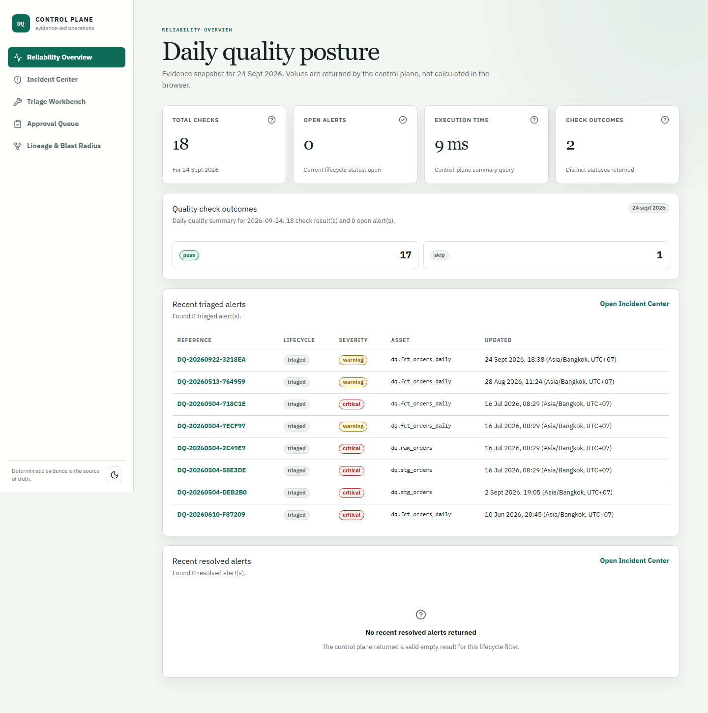

<details>
<summary>Stored triage report in dark mode</summary>

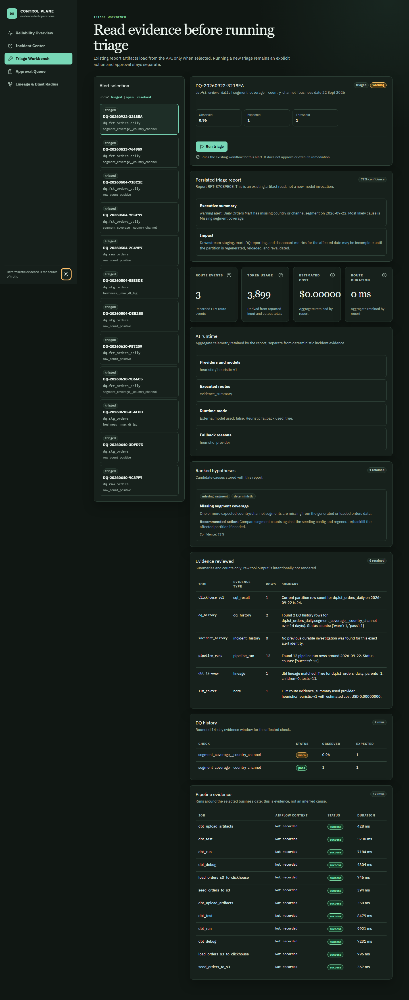

</details>

<details>
<summary>Next.js Reliability Overview and historical triaged alerts</summary>

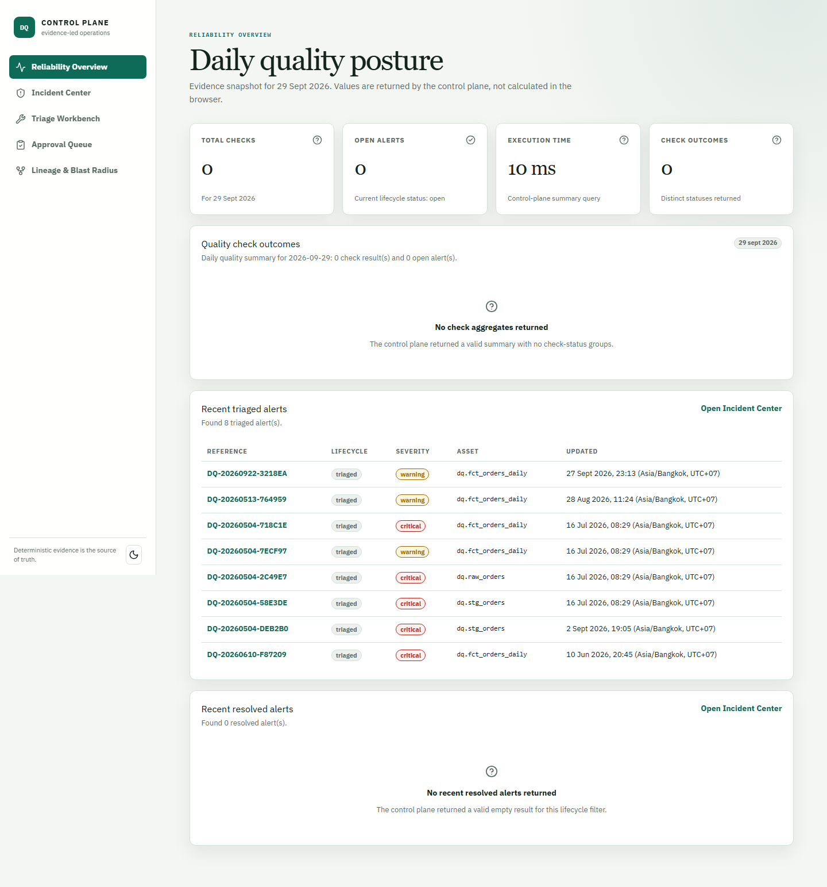

The selected September 28 summary legitimately contains zero checks and zero open alerts, while the lower table shows retained historical triaged alerts. This is an honest empty-state capture, not evidence of a successful daily pipeline for that date.

</details>

<details>
<summary>Next.js Triage Workbench with persisted evidence</summary>

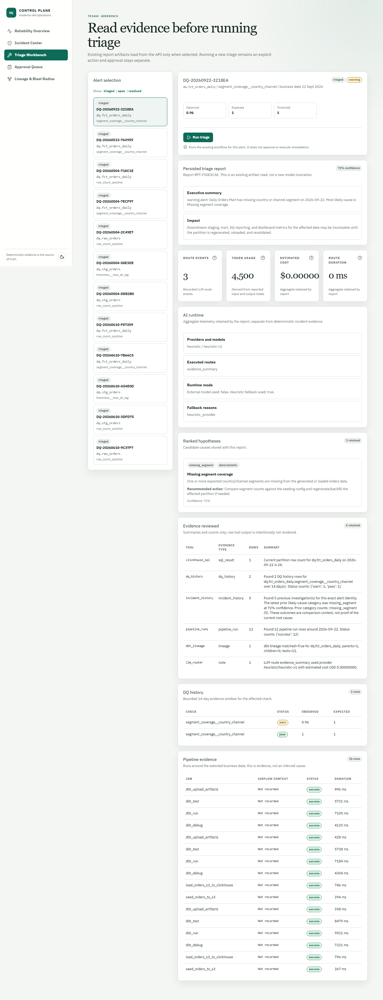

The report shown is a persisted heuristic artifact for Alert Ref `DQ-20260922-3218EA`. The page labels external model use as false and does not imply that opening the report invoked an LLM or executed remediation.

</details>

<details>
<summary>Streamlit alert selection</summary>

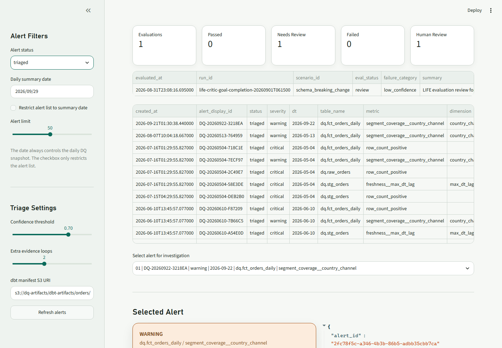

This view shows retained alert rows and the selected alert controls. It is not a live Discord response and does not prove that an approval or action was executed.

</details>

<details>
<summary>Airflow daily orchestrator graph</summary>

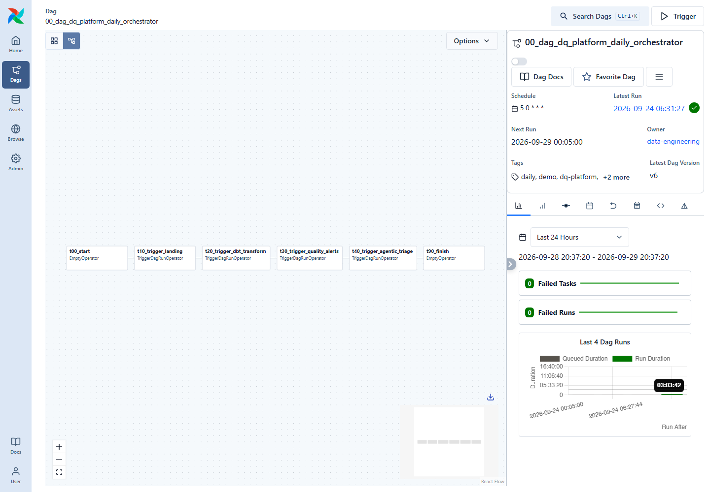

The graph shows the single scheduled control path from landing through dbt, quality alerts, optional agent triage, and finish. The visible successful historical run and zero-failure counters are operational UI evidence for this local stack, not a guarantee that every future run will succeed.

</details>

<details>
<summary>CH-UI read-only alert query</summary>

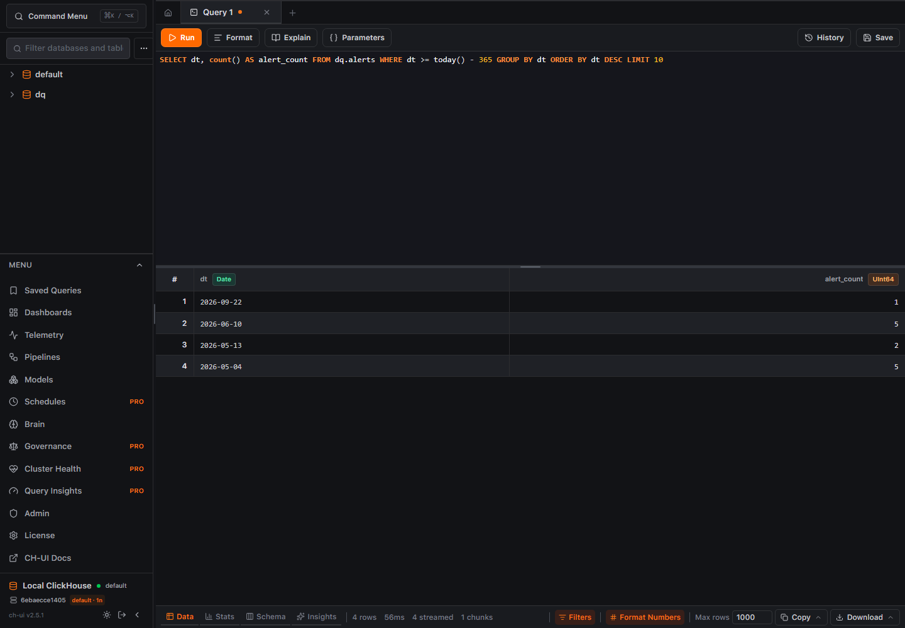

The query groups historical `dq.alerts` rows by business date. It demonstrates read-only warehouse inspection, not table mutation or remediation.

</details>

<details>
<summary>Discord operator output</summary>

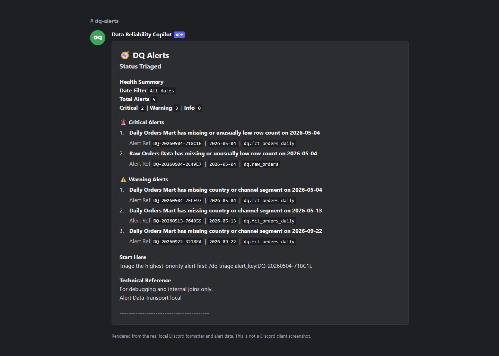

This image renders the actual local `/dq alerts` formatter output against retained synthetic alerts. It is intentionally labeled as a rendered message rather than a Discord client screenshot; no outbound message or external model call was needed to capture it.

</details>

<details>
<summary>SeaweedFS artifact inventory</summary>

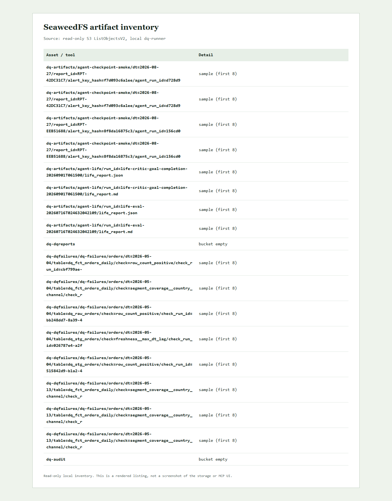

This image is a rendered inventory produced from a local read-only S3 `ListObjectsV2` result. It is not a screenshot of the SeaweedFS Filer UI. Empty provisioned buckets are shown rather than hidden.

</details>

<details>
<summary>MCP tool inventory</summary>

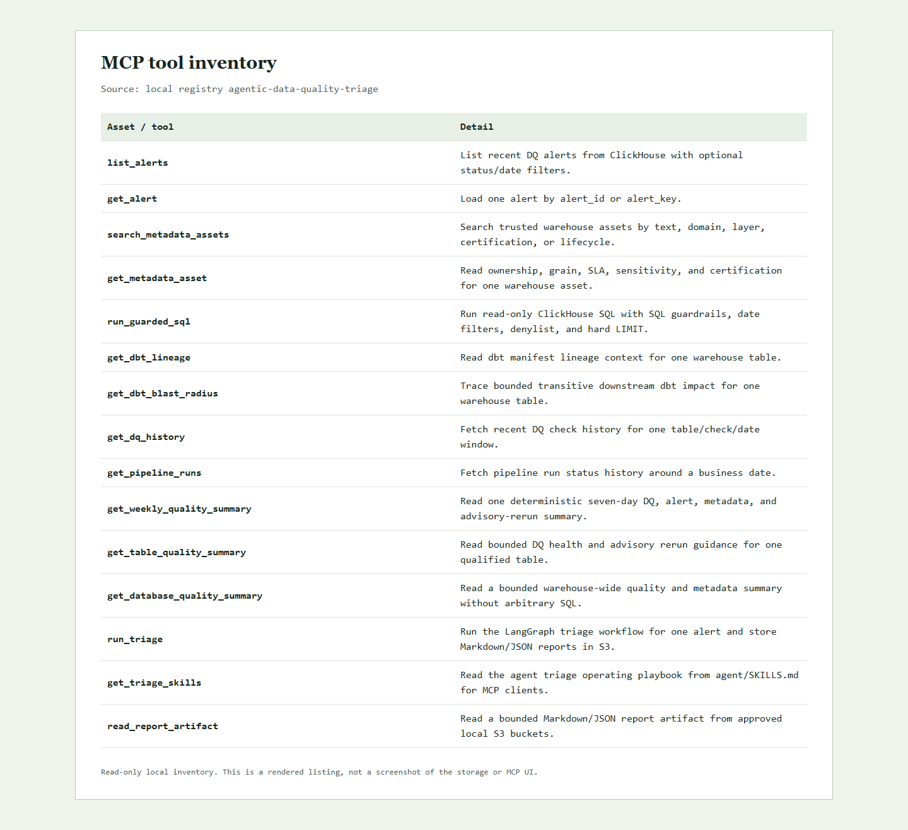

This is a rendered local registry listing, not an MCP client UI and not proof that every listed tool was invoked during one investigation.

</details>

<details>
<summary>Mobile operator view</summary>

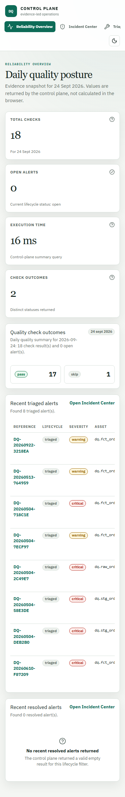

</details>

The browser pass covered all five pages at 1440px and 390px in both themes,
keyboard theme toggling, stored report visibility, and absence of hydration
errors or page-level horizontal overflow. A later operator pass exercised blank
identity rejection, approval followed by cancellation without dispatch, and
no-LLM triage with automatic stored-report refresh. Tab navigation reached all
primary links on desktop and mobile. This is not full accessibility
certification or proof of remediation execution. See the
[browser verification notes](web_operator_testing.md).

## Operational limits

This is a local synthetic-data reference implementation. Approval, execution, verification and closure are separate. The legacy ClickHouse backfill queue is not transactional; the PostgreSQL exact-scope action path has stronger coordination. Published pipeline and revalidation results must be inspected independently. Full-pipeline baseline regeneration used in an acceptance fixture is not autonomous AI repair. Mobile/two-human acceptance remains separate from desktop proof.

## Glossary

| Term | Meaning here |
| --- | --- |
| Business date / `dt` | Partition date under investigation, not necessarily today's date |
| Freshness | Whether expected data arrived within its defined time requirement |
| Data quality | Explicit checks of whether data meets the configured contract |
| Triage | Evidence collection and assessment of an incident's likely cause |
| Lineage | Recorded upstream/downstream data dependencies |
| Blast radius | Bounded downstream assets potentially affected by an issue |
| HITL | Human-in-the-loop review before a controlled action |
| Heuristic mode | Rule-based explanation without an external model |
| Checkpoint | Persisted workflow state used for controlled resume/replay |
| Fan-out | Dispatching independent bounded tasks before aggregating their results |
| LIFE-inspired evaluation | Scenario-based feedback and human-reviewed improvement proposals |
| Control plane | Interfaces, policy, metadata and decisions around the execution/data systems |

## Further reading

- [Agent runtime skills](../agent/SKILLS.md)
- [Supervisor and context architecture](agent_supervisor_lite_architecture.md)
- [Reliability evaluation](agent_reliability_evaluation.md)
- [Approval cancellation boundary](approval_cancellation_semantics.md)
- [Web operator testing](web_operator_testing.md)
- [Discord output templates](discord_output_templates.md)
- [LLM billing and cost-safety decisions](decisions/llm_api_billing_and_cost_safety.md)
- [Gemini triage acceptance](gemini_triage_acceptance.md)
- [Gemini fan-out acceptance](gemini_fanout_acceptance.md)
- [MCP stdio acceptance](mcp_stdio_acceptance.md)
- [Development and Airflow acceptance rules](../AGENTS.md)
